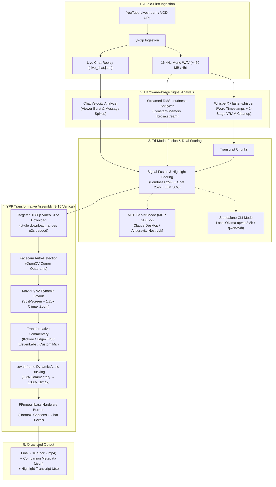
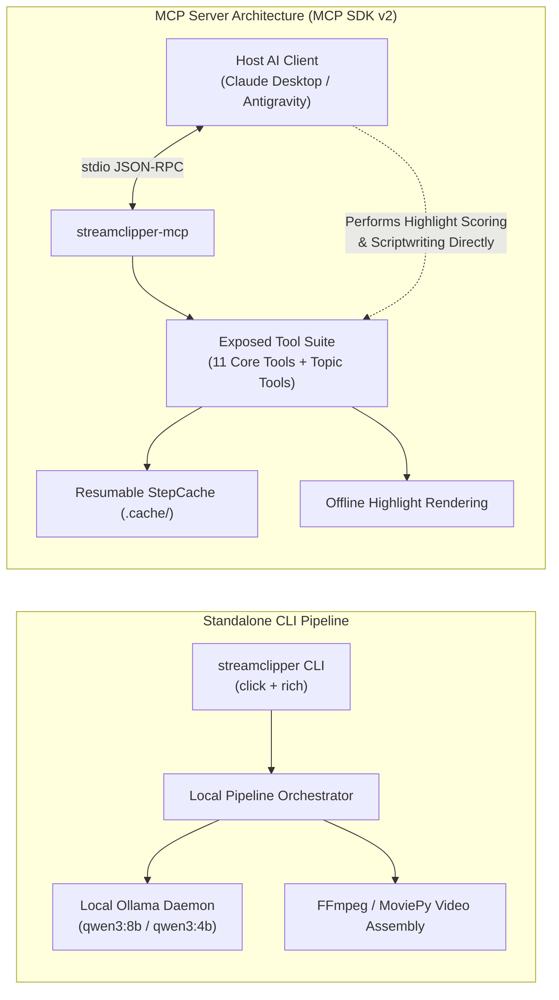
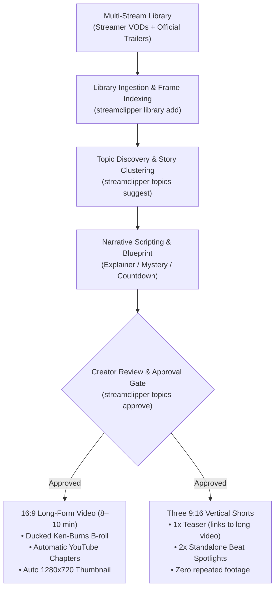

<div align="center">

# StreamClipper

[](https://www.python.org/)
[](pyproject.toml)
[](https://github.com/modelcontextprotocol)
[](https://ffmpeg.org/)
[](https://github.com/m-bain/whisperX)
[](https://github.com)

**Autonomous AI Livestream Clipping & YPP Transformative Video Pipeline**  
*Turn multi-hour livestreams and VODs into monetizable, commentary-rich YouTube Shorts and long-form topic deep dives.*

</div>

---

## Overview

StreamClipper is a free, open-source, game-agnostic AI video clipping pipeline with dual execution interfaces: a high-performance **CLI (`click` + `rich`)** and a **Model Context Protocol (`MCPServer` via MCP SDK v2)** stdio server for host AI clients like Claude Desktop and Antigravity.

Unedited stream rips frequently get flagged and rejected under the [YouTube Channel Monetization Policies](https://support.google.com/youtube/answer/1311392?hl=en) for **Reused Content**. StreamClipper solves this by turning raw stream slices into genuinely transformative, value-added video content:

- **Audio-First Ingestion**: Downloads lightweight 16 kHz mono WAV audio first (~460 MB for a 4-hour VOD) and only fetches targeted &plusmn;3s padded 1080p video cuts for selected highlights via `yt-dlp download_ranges`.
- **Tri-Modal Signal Fusion**: Fuses streamed audio RMS loudness spikes (`25%`), YouTube live chat velocity bursts (`25%`), and semantic LLM scores (`50%`), with dynamic weight renormalization and quiet-gem score floors.
- **5-Tier Dynamic Hardware Auto-Configuration**: Profiles your GPU VRAM, CUDA Compute Capability, and NVENC availability at startup to configure transcription model sizes, batch sizes, compute precisions, and local LLM tags without manual editing.
- **YPP Transformative Narrative & Story Engine**: Synthesizes tone-matched commentary intros/outros (`funny`, `fail`, `hype`, `clutch`, `graphics_detail`, `chat_chaos`, `lore_secret`, `analysis`), applies dynamic 18% audio ducking (`volume=...:eval=frame`), stitches multi-beat story structures, and burns Hormozi active-word captions alongside real viewer chat tickers.
- **Topic Video Deep Dives**: Clusters multiple streams and trailers into one 8–10 minute chaptered 16:9 documentary and three targeted 9:16 vertical Shorts with shared assets and zero footage repetition.

---

## System Architecture



---

## Dual Execution Modes

StreamClipper is engineered to work either as an autonomous local CLI tool or as an interactive tool suite inside your AI development assistant.



### Standalone CLI Mode
In CLI mode, StreamClipper runs end-to-end autonomously from your terminal. Highlight scoring and narrative scriptwriting run against a local Ollama instance (`qwen3:8b` or `qwen3:4b` auto-selected by your hardware profile).

### MCP Server Mode (`streamclipper-mcp`)
In MCP mode, your host AI assistant (Claude Desktop, Antigravity) connects to `streamclipper-mcp` over stdio. StreamClipper provides specialized tools (`download_stream_audio`, `transcribe_audio`, `analyze_signals`, `get_transcript_chunks`, `submit_highlights`, `render_clip`). Your host LLM inspects signal-filtered transcript chunks (saving 60–80% context tokens) and directly authors commentary scripts before triggering zero-Ollama rendering.

---

## Key Features

### Audio-First Ingestion & Constant-Memory Processing
- **Minimal Bandwidth Usage**: Downloads 16 kHz mono WAV audio first (~460 MB for a 4-hour VOD) using `yt-dlp`. Video data is only retrieved for final highlights via `download_ranges` with &plusmn;3s padding.
- **Streaming Audio Loudness**: Audio is analyzed block-by-block using `soundfile.info()` and `librosa.stream(..., fill_value=0.0)`. Multi-hour recordings process with flat memory consumption.
- **Native Live Chat Extraction**: Extracts `.live_chat.json` directly from YouTube, skips pre-stream negative offsets, identifies viewer message velocity spikes, and captures sample viewer chat reactions.
- **Tri-Modal Dynamic Renormalization**: Audio loudness spikes (`25%`), live chat velocity bursts (`25%`), and semantic LLM scores (`50%`) are fused. If chat replay is missing, weights dynamically renormalize, and quiet high-scoring gems (`score >= 8.5`) receive an automatic `0.85 × score` floor.
- **Resilient Step Caching**: Every stage (`PENDING` &rarr; `DOWNLOADING` &rarr; `TRANSCRIBING` &rarr; `ANALYZING` &rarr; `SCORING` &rarr; `ASSEMBLING` &rarr; `COMPLETE`) persists to `.cache/`. Interrupted pipelines or `FAILED` states automatically roll back to the last valid step without re-downloading audio or re-transcribing.

### Dynamic Hardware Auto-Configuration
StreamClipper detects system hardware via PyTorch CUDA introspection, Compute Capability checks, and FFmpeg codec probing. Six configuration keys (`transcription.device`, `transcription.model_size`, `transcription.compute_type`, `transcription.batch_size`, `llm.model`, `video.codec`) default to `"auto"` and resolve into optimal profiles:

| Hardware Tier | Detection Criteria | Device | Whisper Size | Precision | Batch Size | Local LLM | Video Codec |
| :--- | :--- | :---: | :---: | :---: | :---: | :---: | :---: |
| **`cuda_high_vram`** | CUDA VRAM &ge; 10.0 GB | `cuda` | `large-v2` | `float16` | `16` | `qwen3:8b` | `h264_nvenc` *(else `libx264`)* |
| **`cuda_mid_tensor`** *(RTX 4050 6GB)* | 5.5–9.9 GB VRAM + (CC &ge; 8.0 or RTX) | `cuda` | `large-v2` | `int8_float16` | `8` | `qwen3:8b` | `h264_nvenc` *(else `libx264`)* |
| **`cuda_mid_no_tensor`** *(GTX 1660S 6GB)* | 5.5–9.9 GB VRAM + (CC < 8.0, no RTX) | `cuda` | `medium` | `int8` | `4` | `qwen3:4b` | `h264_nvenc` *(else `libx264`)* |
| **`cpu_fallback`** | CUDA detected but < 5.5 GB VRAM | `cpu` | `base` | `int8` | `4` | `qwen3:4b` | `libx264` |
| **`cpu_only`** | No CUDA GPU available | `cpu` | `base` | `int8` | `4` | `qwen3:4b` | `libx264` |

> [!NOTE]
> All auto-detected values can be overridden individually in `config.yaml`. Run `streamclipper setup` to inspect your active tier and verify override provenance.

### YPP Transformative Narrative & Story Engine
StreamClipper supports four explicit transformation modes:

| Mode | Narrative Commentary | Context Badge | Punch-in Zoom | Chat Ticker | Multi-Beat Jump Cuts | Intended Content |
| :---: | :---: | :---: | :---: | :---: | :---: | :--- |
| **`auto`** *(default)* | Yes | Yes | Yes | Yes | Auto (if &ge;5s dead air) | Standard streams & highlights |
| **`narrative`** | Yes | Yes | Yes | Yes | No (single continuous cut) | High-stakes continuous moments |
| **`story`** | Yes | Yes | Yes | Yes | Yes (stitches 2–3 beats) | Multi-stage encounters / setups |
| **`raw`** | No | No | No | No | No (uncut slice + captions) | Purist clips & fast archival |

- **Adaptive Commentary Classification**: Analyzes each highlight's context into `funny`, `fail`, `graphics_detail`, `hype`, `clutch`, `chat_chaos`, `lore_secret`, or `analysis`, adapting script tone to match the moment naturally.
- **Conditional Multi-Beat Story Mode**: Detects long pauses (&ge;5s dead air) and stitches 2–3 beats (*Setup &rarr; Escalation &rarr; Payoff*), automatically remapping word-level subtitle timings, chat bursts, and zoom offsets to the unified timeline.
- **Locked Split-Line Punch-In Zoom**: In facecam layouts (35% top facecam / 65% bottom gameplay), the 1.20x climax zoom applies strictly to the gameplay layer around `peak_time`, leaving the split line locked at `y = 672` without cropping the facecam.
- **FFmpeg `libass` Subtitle Burn-In**: Burns active-word highlighted captions (`hormozi`, `single_word`, or `sentence`) alongside live chat reaction bursts. Subtitles are rendered via an isolated Windows-safe working-directory call to prevent path escaping bugs.
- **Single Lossy Video Re-Encode Architecture**: Intermediate compositing writes ultrafast high-bitrate temp video. Commentary audio mixing copies video streams (`-c:v copy`), performing only one lossy video compression pass during final caption burn-in.

---

## Audio Ducking & Visual Polish Timeline


During narration windows, StreamClipper applies time-varying volume ducking down to `18%` (`volume=...:eval=frame`). As soon as the commentary finishes, original stream volume returns to `100%` so punchlines, clutch reactions, and gameplay audio hit at full dynamic impact.

### Voiceover Synthesis Options
StreamClipper supports four voiceover strategies configured via `transformation.tts_engine`:
1. **Local Kokoro-82M** (`kokoro`): 100% offline, free neural TTS with natural intonation (default voice: `af_heart`).
2. **Microsoft Edge-TTS** (`edge-tts`): Free, high-quality cloud TTS requiring no API keys (default voice: `en-US-GuyNeural`).
3. **ElevenLabs API** (`elevenlabs`): Studio-grade voices or personal voice clones via `ELEVENLABS_API_KEY` and `transformation.elevenlabs_voice_id`.
4. **Human Microphone Override**: Pass pre-recorded audio files (`--voice-intro ./intro.wav --voice-outro ./outro.wav`) to use your own voice with automatic ducking and normalization.

> [!TIP]
> Setting `transformation.tts_engine: "auto"` uses local Kokoro-82M when available and falls back cleanly to Edge-TTS if local speech libraries are absent.

---

## Topic Video Production Pipeline

In addition to vertical Shorts, StreamClipper includes an end-to-end long-form topic video generator. It ingests multiple livestreams, gameplay clips, and official trailers into a searchable library, discovers common topics, and constructs structured multi-stream deep dives.



Each approved topic plan produces:
- **1 Long 16:9 Video** (8–10 minutes) with auto-spaced YouTube chapters, Ken-Burns ducked B-roll, on-screen streamer credits, an auto-generated 1280×720 thumbnail, and upload-ready metadata.
- **1 Teaser Short (`short_teaser.mp4`)**: Hooks viewers with the core mystery or premise and points directly to the long-form video via YouTube Studio's "Related Video" feature.
- **2 Standalone Shorts (`short_a.mp4`, `short_b.mp4`)**: Distinct, punchy highlight shorts built from separate story beats with zero footage overlap.

---

## Prerequisites & Installation

### System Requirements
- **Python**: `>= 3.10` (Python 3.12 strongly recommended for prebuilt CUDA wheels on Windows).
- **FFmpeg**: FFmpeg build with **`libass`** and **`h264_nvenc`** on system `PATH`.
- **GPU**: NVIDIA GPU with 6 GB+ VRAM recommended (CPU-only execution fully supported).
- **LLM Backend**: Local [Ollama](https://ollama.com/) (for standalone CLI) or an MCP host client (Claude Desktop / Antigravity).

### Windows Installation (PowerShell)

```powershell
# 1. Install FFmpeg with libass support via WinGet
winget install Gyan.FFmpeg

# Restart PowerShell and verify FFmpeg and the libass filter:
ffmpeg -version
ffmpeg -hide_banner -filters | Select-String " ass "

# 2. Clone repository & create Python 3.12 virtual environment
git clone https://github.com/PrakashD2003/Clipper.git
cd Clipper

py -3.12 -m venv .venv
.\.venv\Scripts\Activate.ps1

# 3. Optional: Install CUDA PyTorch wheels (for NVIDIA GPUs)
pip install torch torchaudio --index-url https://download.pytorch.org/whl/cu124

# 4. Install StreamClipper with MCP and TTS extras
pip install -e ".[mcp,tts]"

# Optional: Install WhisperX for wav2vec2 word-level alignment
pip install -e ".[whisperx]"
```

### Linux Installation (Ubuntu / Debian)

```bash
# 1. Install system prerequisites and FFmpeg
sudo apt update && sudo apt install -y ffmpeg libsndfile1 libgl1 libglib2.0-0 python3 python3-venv

# Verify FFmpeg and libass:
ffmpeg -version
ffmpeg -hide_banner -filters | grep " ass "

# 2. Clone repository & create virtual environment
git clone https://github.com/PrakashD2003/Clipper.git
cd Clipper

python3 -m venv .venv
source .venv/bin/activate

# 3. Optional: Install CUDA PyTorch wheels
pip install torch torchaudio --index-url https://download.pytorch.org/whl/cu124

# 4. Install StreamClipper
pip install -e ".[mcp,tts]"
pip install -e ".[whisperx]"
```

### Available Package Extras

| Package Extra | Command | Included Components |
| :--- | :--- | :--- |
| **Core** | `pip install -e .` | `yt-dlp`, `faster-whisper`, `librosa`, `soundfile`, `opencv-python`, `moviepy>=2.0.0`, `ollama`, `click`, `rich` |
| **`[mcp]`** | `pip install -e ".[mcp]"` | MCP SDK v2 (`mcp>=2.0.0`) for `streamclipper-mcp` |
| **`[tts]`** | `pip install -e ".[tts]"` | Free voiceover engines (`kokoro>=0.9.0` and `edge-tts>=6.1.0`) |
| **`[whisperx]`**| `pip install -e ".[whisperx]"` | `whisperx` with wav2vec2 forced phoneme alignment |
| **`[dev]`** | `pip install -e ".[dev]"` | Test suite dependencies (`pytest`, `pytest-asyncio`) |

### Hardware Verification

Verify your toolchain and inspect the resolved hardware tier:

```bash
streamclipper setup
```

`streamclipper setup` verifies `yt-dlp`, `FFmpeg`, `WhisperX`, `SoundFile`, `OpenCV`, `MoviePy`, `Ollama SDK`, and `MCP SDK v2`, probes your GPU VRAM and Compute Capability, and outputs your active configuration tier.

---

## CLI Command Reference

### Clip a Single Stream (`streamclipper clip`)

```bash
# Auto mode (resolves to story if multi-beat sub_clips exist, else narrative)
streamclipper clip "https://www.youtube.com/watch?v=VIDEO_ID" --game "GTA 6" --mode auto

# Narrative mode (single continuous cut with full YPP commentary and overlays)
streamclipper clip "https://www.youtube.com/watch?v=VIDEO_ID" --mode narrative

# Multi-beat story mode (Setup -> Escalation -> Payoff cuts + commentary)
streamclipper clip "https://www.youtube.com/watch?v=VIDEO_ID" --mode story

# Raw mode (uncut clip + captions only, skipping voiceover and commentary)
streamclipper clip "https://www.youtube.com/watch?v=VIDEO_ID" --mode raw

# Supply custom recorded human voiceover for intro/outro
streamclipper clip "https://www.youtube.com/watch?v=VIDEO_ID" --mode story --voice-intro ./my_intro.wav --voice-outro ./my_outro.wav

# Force re-execution (bypasses .cache/ and re-runs all stages)
streamclipper clip "https://www.youtube.com/watch?v=VIDEO_ID" --force
```

### Auto-Discovery & Batch Clipping (`streamclipper auto`)

Searches YouTube for top streams of a specified game, ranks them by popularity, and batch-processes highlights in parallel:

```bash
streamclipper auto --game "GTA 6" --max-streams 3 --max-clips 2 --mode auto
```

### Pipeline Diagnostics & Cache Status (`streamclipper status`)

Lists all cached pipelines in `.cache/`, their active status (`DOWNLOADING`, `TRANSCRIBING`, `ANALYZING`, `SCORING`, `ASSEMBLING`, `COMPLETE`), and detected highlight counts:

```bash
streamclipper status
```

### Topic Video Production (`library` & `topics`)

```bash
# Ingest sources into game library
streamclipper library add "https://youtube.com/watch?v=..." --channel "StreamerA" --game "GTA 6"

# Suggest topics based on ingested transcripts and frame sheets
streamclipper topics suggest "GTA 6"

# Draft a structured script and beat outline
streamclipper topics plan "GTA 6" "hidden-military-base"

# Review plan details and approve for render
streamclipper topics show PLAN_ID
streamclipper topics approve PLAN_ID

# Render long-form 16:9 documentary and vertical Shorts
streamclipper topics render PLAN_ID
streamclipper topics shorts PLAN_ID
```

### Output Layout

```text
output/
└── GTA 6/
    └── StreamerName/
        └── 2026-11-23/
            ├── clip_01.mp4              # 1080x1920 9:16 vertical Short
            ├── clip_01.json             # Companion metadata (titles, tags, script, mode)
            └── clip_01_transcript.txt   # Timestamped transcript of the highlight
```

---

## MCP Server Integration Guide

StreamClipper exposes its full pipeline as an MCP server (`streamclipper-mcp`), allowing host AI clients to orchestrate downloads, transcriptions, scoring, and rendering.

### Claude Desktop Configuration

Add StreamClipper to your configuration file:
- **Windows**: `%APPDATA%\Claude\claude_desktop_config.json`
- **macOS**: `~/Library/Application Support/Claude/claude_desktop_config.json`
- **Linux**: `~/.config/Claude/claude_desktop_config.json`

```json
{
  "mcpServers": {
    "streamclipper": {
      "command": "D:\\GTA6-Clipper\\.venv\\Scripts\\streamclipper-mcp.exe",
      "args": [],
      "env": {}
    }
  }
}
```

### Antigravity Configuration

Add to your workspace or user `mcp_config.json`:

```json
{
  "mcpServers": {
    "streamclipper": {
      "command": "streamclipper-mcp",
      "args": []
    }
  }
}
```

> [!TIP]
> If using ElevenLabs voice generation in MCP mode without setting a global environment variable, add `"ELEVENLABS_API_KEY": "sk_your_key"` to the `"env"` object in your MCP configuration.

### Exposed MCP Tools

| Tool Name | Scope | Purpose |
| :--- | :---: | :--- |
| `discover_streams` | Discovery | Searches YouTube for top recent livestreams or VODs by game keyword. |
| `download_stream_audio` | Ingestion | Downloads 16 kHz mono WAV audio and initializes resumable `StepCache` state. |
| `transcribe_audio` | Analysis | Executes hardware-aware transcription with WhisperX word alignment. |
| `analyze_signals` | Analysis | Computes streamed RMS loudness spikes and native live chat velocity spikes. |
| `get_transcript_chunks` | Scoring | Returns transcript chunks paired with signals (`only_with_signals=True` cuts tokens by 60–80%). |
| `submit_highlights` | Scoring | Submits host-LLM highlight picks with `moment_type`, `narration_intro`, and `narration_outro`. |
| `render_clip` | Assembly | Renders an individual highlight into a 9:16 Short (supports `auto`, `narrative`, `story`, `raw`). |
| `render_all_selected` | Assembly | Batch renders all highlights submitted to `StepCache` without requiring local Ollama. |
| `get_pipeline_status` | Management | Inspects active pipeline states, progress flags, and cached highlight counts. |
| `generate_post_metadata`| Distribution| Formats YouTube titles, description copy, and normalized hashtags offline. |
| `cleanup_temp` | Maintenance | Clears intermediate video and audio chunks for a URL from `general.temp_dir`. |
| `library_add_source` | Topics | Ingests a video source into the multi-stream game library. |
| `list_library` / `search_library` | Topics | Queries indexed library footage and transcripts. |
| `suggest_topics` / `start_topic_plan` | Topics | Discovers narrative topics and drafts chaptered production outlines. |
| `approve_topic_plan` | Topics | Approves a topic plan for rendering through the quality gate. |
| `render_topic_video` / `render_topic_shorts` | Topics | Assembles the final 16:9 long documentary and three vertical Shorts. |

For a step-by-step interactive workflow walkthrough, see the [MCP Workflow Guide](docs/streamclipper-mcp-workflow-guide.md) and [Topic Videos Guide](docs/topic-videos-guide.md).

---

## Configuration Reference (`config.yaml`)

StreamClipper reads `config.default.yaml` and applies your local `config.yaml` overrides on top. Only keys you wish to customize need to be defined.

### General Settings (`general`)

| Parameter | Default | Description |
| :--- | :---: | :--- |
| `output_dir` | `"./output"` | Destination directory for final videos and companion metadata files. |
| `temp_dir` | `"./temp"` | Temporary scratch directory for downloads and intermediate renders. |
| `cache_dir` | `"./.cache"` | Directory storing resumable `StepCache` pipeline state JSON files. |
| `max_concurrent_streams` | `2` | Maximum concurrent streams processed during auto-discovery runs. |
| `log_level` | `"INFO"` | Logging verbosity (`DEBUG`, `INFO`, `WARNING`, `ERROR`). |

### Transcription Settings (`transcription`)

| Parameter | Default | Description |
| :--- | :---: | :--- |
| `engine` | `"whisperx"` | ASR transcription engine: `whisperx` (wav2vec2 alignment) or `faster-whisper`. |
| `model_size` | `"auto"` | Model size (`auto`, `tiny`, `base`, `small`, `medium`, `large-v2`). |
| `device` | `"auto"` | Execution target (`auto`, `cuda`, `cpu`). |
| `compute_type` | `"auto"` | Precision (`auto`, `float16`, `int8_float16`, `int8`). Auto-coerced to `int8` on CPU. |
| `batch_size` | `"auto"` | Inference batch size (`auto`, `4`, `8`, `16`). |
| `language` | `"en"` | Language code (`en` or `auto` for multi-language detection). |

### Signal Analysis & Highlight Scoring (`analysis`)

| Parameter | Default | Description |
| :--- | :---: | :--- |
| `chunk_minutes` | `12` | Duration in minutes of transcript chunks evaluated during scoring. |
| `min_clip_seconds` | `30` | Minimum allowed duration for an extracted highlight clip. |
| `max_clip_seconds` | `90` | Maximum allowed duration for an extracted highlight clip. |
| `max_clips_per_stream` | `5` | Maximum number of top highlights retained per stream. |
| `min_highlight_score` | `7.0` | Minimum fused score (0–10 scale) required for a highlight to pass. |
| `weights.loudness` | `0.25` | Relative weight of audio RMS loudness spikes (weights sum to 1.0). |
| `weights.chat_velocity` | `0.25` | Relative weight of YouTube live chat message velocity bursts. |
| `weights.llm_score` | `0.50` | Relative weight of LLM semantic highlight scoring. |
| `loudness.threshold_std`| `2.5` | Number of standard deviations above mean RMS to trigger a loudness spike. |
| `chat.prominence_factor`| `3.0` | Number of standard deviations above baseline rate to trigger a chat burst. |

### Video Composition & Encoding (`video`)

| Parameter | Default | Description |
| :--- | :---: | :--- |
| `resolution` | `[1080, 1920]` | Output resolution in pixels (9:16 vertical aspect ratio). |
| `fps` | `30` | Output frame rate. |
| `codec` | `"auto"` | Video codec (`auto` selects `h264_nvenc` with fallback to `libx264`). |
| `audio_codec` | `"aac"` | Output audio encoding format. |
| `crf` | `23` | Quality target (`-crf` for `libx264`, `-cq` for `h264_nvenc`; lower = higher quality). |

### Captions & Visual Polish (`captions` & `transformation`)

| Parameter | Default | Description |
| :--- | :---: | :--- |
| `captions.style` | `"hormozi"` | Subtitle format: `hormozi` (active word highlight), `single_word`, or `sentence`. |
| `captions.words_per_group` | `4` | Number of words displayed simultaneously in `hormozi` mode. |
| `captions.color` | `"white"` | Primary subtitle text color. |
| `captions.highlight_color` | `"#FFD700"` | Active-word highlight color. |
| `transformation.mode` | `"auto"` | Default transformation mode (`auto`, `narrative`, `story`, `raw`). |
| `transformation.tts_engine` | `"auto"` | Commentary voiceover engine (`auto`, `kokoro`, `edge-tts`, `elevenlabs`, `none`). |
| `transformation.tts_voice` | `"af_heart"` | Voice identifier for local Kokoro-82M synthesis. |
| `transformation.edge_tts_voice` | `"en-US-GuyNeural"` | Voice identifier for Microsoft Edge-TTS synthesis. |
| `transformation.duck_stream_volume` | `0.18` | Stream volume ratio during active narration (18%). |
| `transformation.punch_in_zoom` | `1.20` | Punch-in zoom multiplier applied to gameplay at `peak_time`. |
| `transformation.zoom_duration_seconds`| `3.5` | Total duration of the punch-in zoom window. |
| `transformation.show_chat_ticker` | `true` | Burn real live chat reaction messages during highlight spikes. |

---

## Troubleshooting & Diagnostics

### Windows: Script Execution or FFmpeg Filter Errors
- **Execution Policy Error**: If PowerShell blocks activating your virtual environment (`Activate.ps1`), allow local scripts for your user:
  ```powershell
  Set-ExecutionPolicy -Scope CurrentUser RemoteSigned
  ```
- **Missing `ass` Filter**: Verify that your FFmpeg binary includes `libass`:
  ```powershell
  ffmpeg -hide_banner -filters | Select-String " ass "
  ```
  If missing, install the Gyan full build via `winget install Gyan.FFmpeg`.

### CUDA PyTorch Detected as CPU
If `streamclipper setup` reports that no CUDA GPU was detected despite having an NVIDIA card, PyPI may have installed the CPU-only PyTorch wheel. Reinstall CUDA PyTorch inside your `.venv`:
```powershell
pip uninstall -y torch torchaudio
pip install torch torchaudio --index-url https://download.pytorch.org/whl/cu124
streamclipper setup
```

### Out-of-Memory (OOM) on 6 GB VRAM GPUs
StreamClipper implements automatic **two-stage VRAM cleanup** (deleting the WhisperX ASR model and clearing GPU cache before loading the wav2vec2 alignment model). If background applications consume VRAM, you can lower resource usage in `config.yaml`:
```yaml
transcription:
  model_size: "small"
  batch_size: 4
```

### Hardware Video Encoder (`h264_nvenc`) Fallback
StreamClipper automatically catches NVENC initialization failures and falls back to software `libx264`. To permanently enforce CPU video encoding (e.g., on headless servers or older drivers):
```yaml
video:
  codec: "libx264"
```

### Missing Live Chat Replay
Standard YouTube uploads and select past VODs do not provide `.live_chat.json` replay tracks. StreamClipper logs this gracefully and **automatically renormalizes signal weights** across audio loudness and semantic LLM scores without failing the pipeline.

---

## Project Structure

```text
streamclipper/
├── config.default.yaml             # Complete default configuration & hardware presets
├── pyproject.toml                  # Packaging specifications, dependencies & entry points
├── docs/                           # Architecture guides, MCP runbooks & topic video guides
│   ├── streamclipper-implementation-guide-v2.md
│   ├── streamclipper-mcp-workflow-guide.md
│   └── topic-videos-guide.md
├── src/streamclipper/
│   ├── cli.py                      # Click + Rich command-line interface
│   ├── config.py                   # YAML configuration parser & 5-tier hardware auto-profiler
│   ├── models.py                   # IntEnum PipelineStatus & dataclass serialization schemas
│   ├── cache.py                    # StepCache resumable pipeline state manager
│   ├── pipeline.py                 # Async orchestrator with FAILED rollback & GPU concurrency locks
│   ├── discovery/                  # YouTube stream discovery & keyword search
│   ├── download/                   # Audio ingestion, targeted range downloader, chat scraper
│   ├── analysis/                   # WhisperX transcriber, streamed RMS loudness, chat velocity
│   ├── scoring/                    # Tri-modal signal fusion, OllamaScorer, narrative prompts
│   ├── assembly/                   # Facecam quadrant detector, 9:16 layout composer, narrator, ASS burner
│   ├── output/                     # Exporter (lossless temp -> ducked audio -> ASS burn) & FileOrganizer
│   └── mcp_server/                 # MCP SDK v2 stdio server implementation
└── tests/                          # Pytest suite with unit, mock & integration tests
```
