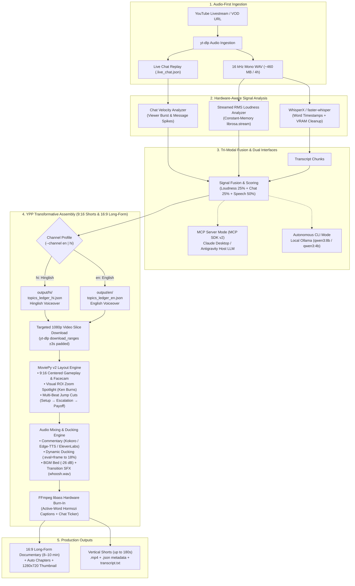
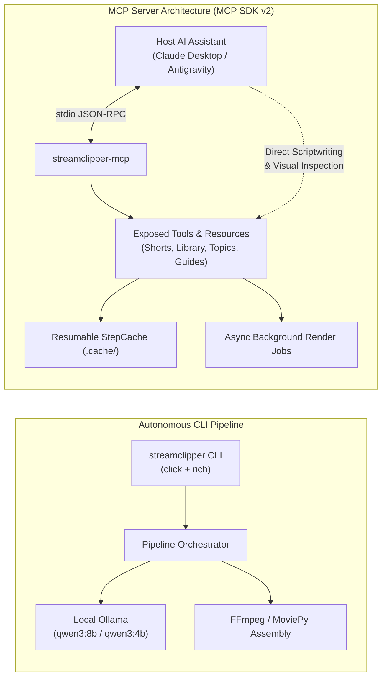
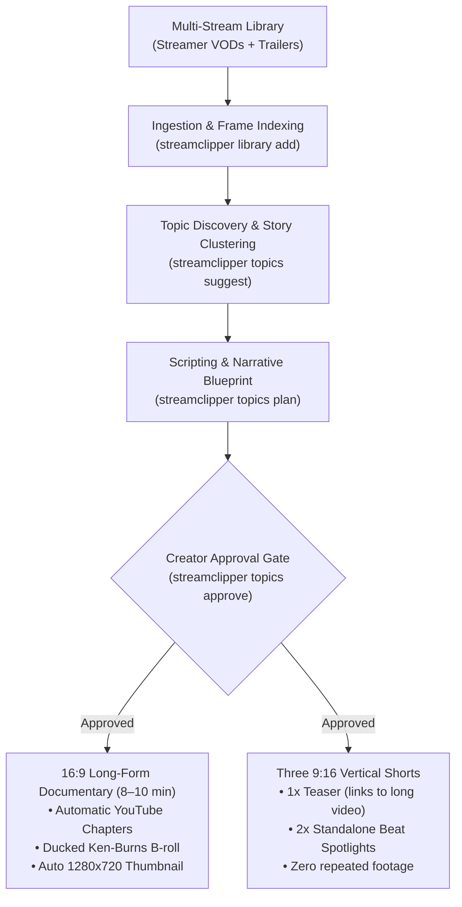

<div align="center">

# StreamClipper

[](https://www.python.org/)
[](pyproject.toml)
[](https://github.com/modelcontextprotocol)
[](https://ffmpeg.org/)
[](https://github.com/m-bain/whisperX)
[](https://github.com)

**Autonomous AI Livestream Clipping & YPP Transformative Video Pipeline**  
*Turn multi-hour gaming livestreams into monetizable, commentary-rich YouTube Shorts (up to 180s) and chaptered 16:9 topic documentaries with dual-channel isolation.*

</div>

---

## Overview

StreamClipper is an open-source, game-agnostic AI video curation and rendering engine built for YouTube automation. It offers two operational interfaces: a high-performance **CLI (`click` + `rich`)** and a **Model Context Protocol (`MCPServer` via MCP SDK v2)** stdio server for host AI clients like Claude Desktop and Antigravity.

Unedited stream rips get flagged and rejected under [YouTube Channel Monetization Policies](https://support.google.com/youtube/answer/1311392?hl=en) for **Reused Content**. StreamClipper eliminates this barrier by transforming raw stream highlights into genuinely transformative, value-added video content:

- **Audio-First Ingestion**: Downloads lightweight 16 kHz mono audio (~460 MB for a 4-hour VOD) and only pulls targeted &plusmn;3s padded 1080p video cuts for curated highlights via `yt-dlp download_ranges`.
- **Tri-Modal Signal Fusion**: Detects viral moments by fusing streamed RMS loudness spikes (`25%`), live chat velocity bursts (`25%`), and semantic speech scoring (`50%`), with dynamic renormalization and quiet-gem score floors.
- **Dual-Channel Isolation Profile (`en` | `hi`)**: Run English and Hinglish channels side-by-side with isolated output folders, topic ledgers, and voices while sharing the same underlying `.cache/` and `library.sqlite` source database.
- **5-Tier Dynamic Hardware Profiling**: Introspects GPU VRAM, CUDA Compute Capability, and NVENC availability at startup to automatically configure Whisper models, inference batch sizes, compute precisions, and local LLM tags.
- **YPP Transformative Narrative Engine**: Generates grounded commentary intros/outros, applies dynamic 18% audio ducking (`volume=...:eval=frame`), stitches multi-beat jump cuts, burns active-word Hormozi captions alongside live chat reaction tickers, and provides Ken Burns ROI zoom spotlights for screen/document clues.
- **Multi-Stream Topic Documentaries**: Ingests multiple streams into a searchable SQLite FTS5 library, discovers shared storylines, and renders 8–10 minute chaptered 16:9 documentaries alongside 3 companion vertical Shorts with zero repeated footage.
- **Monetization-Safe Audio Suite**: Pre-packaged with royalty-free, Content-ID-safe BGM tracks (synthwave, lo-fi, suspense, energetic) and CC0 48 kHz stereo transition sound effects (`whoosh.wav` and `pop.wav`).

---

## System Architecture



---

## Dual Execution Modes

StreamClipper runs seamlessly in two distinct environments:



### 1. Standalone CLI Mode
The CLI runs entirely on your local machine. Scoring and commentary generation execute against a local [Ollama](https://ollama.com/) instance (`qwen3:8b` or `qwen3:4b` automatically chosen by your hardware profile). Run single-command batch clipping or topic video generation directly from your terminal.

### 2. MCP Server Mode (`streamclipper-mcp`)
When connected to Claude Desktop or Antigravity, StreamClipper exposes its underlying toolchain over stdio. The host LLM inspects signal-filtered transcript chunks, verifies visual context sheets, snaps cut boundaries via `refine_highlight_bounds`, and writes grounded commentary directly before dispatching asynchronous render jobs.

---

## Key Features

### Dual-Channel Isolation (`en` vs `hi`)
Never mix English and Hinglish commentary on the same YouTube channel. StreamClipper provides first-class multi-channel isolation:

| Channel Flag | Output Directory | Topic Ledger | Narration Language | Discovery Locale |
| :---: | :---: | :---: | :---: | :---: |
| `--channel en` | `./output/en/` | `topics_ledger_en.json` | English (`en-US`) | `en-US` / Region `US` |
| `--channel hi` | `./output/hi/` | `topics_ledger_hi.json` | Roman Hinglish (`hi`) | `hi` / Region `IN` |

Both channel profiles share the same source ingestion `.cache/` and `library.sqlite` database—never download or transcribe the same stream twice.

### YPP Transformative Video Archetypes
StreamClipper supports five transformation archetypes to ensure compliance with YouTube's Reused Content policies:

| Archetype | Commentary | Context Badge | Punch-in Zoom | Chat Ticker | Multi-Beat Cuts | Typical Use Case |
| :---: | :---: | :---: | :---: | :---: | :---: | :--- |
| **`auto`** *(default)* | Yes | Yes | Yes | Yes | Auto (&ge;5s dead air) | Standard gameplay highlights |
| **`narrative`** | Yes | Yes | Yes | Yes | No (continuous cut) | High-stakes single encounters |
| **`story`** | Yes | Yes | Yes | Yes | Yes (2–3 beats) | Multi-stage missions and setups |
| **`breakdown`** | Yes | Yes (Evidence) | Sinusoidal Pan/Zoom | Yes | Optional | In-game screens, secret notes, Easter eggs |
| **`raw`** | No | No | No | No | No (uncut + captions) | Archival footage and purist clips |

- **Visual ROI Zoom Spotlight (`breakdown`)**: Features a Ken Burns pan & zoom with Lanczos scaling directly to target coordinates (`breakdown_roi=[ymin, xmin, ymax, xmax]`), dynamic spotlight duration sized to speech length, reverse-angle detection, and an on-screen evidence badge.
- **Modern 180s YouTube Shorts**: Fully supports YouTube's 3-minute Shorts format (`output.max_final_seconds: 180`) with highlights up to 90 seconds (`analysis.max_clip_seconds: 90`).
- **Centered Hero Gameplay Layout**: Optimized 9:16 layout with compact 480px facecam (25% height), centered hero gameplay ($y \approx 960$), and active-word captions in the lower third.

### 5-Tier Hardware Auto-Configuration
StreamClipper introspects system resources at startup and resolves six configuration keys (`transcription.device`, `transcription.model_size`, `transcription.compute_type`, `transcription.batch_size`, `llm.model`, `video.codec`) to optimal presets:

| Hardware Tier | Criteria | Device | Whisper Model | Precision | Batch | Local LLM | Video Codec |
| :--- | :--- | :---: | :---: | :---: | :---: | :---: | :---: |
| **`cuda_high_vram`** | CUDA VRAM &ge; 10.0 GB | `cuda` | `large-v2` | `float16` | `16` | `qwen3:8b` | `h264_nvenc` *(fallback `libx264`)* |
| **`cuda_mid_tensor`** *(RTX 4050 6GB)* | 5.5–9.9 GB VRAM + CC &ge; 8.0 | `cuda` | `large-v2` | `int8_float16` | `8` | `qwen3:8b` | `h264_nvenc` *(fallback `libx264`)* |
| **`cuda_mid_no_tensor`** *(GTX 1660S)* | 5.5–9.9 GB VRAM + CC < 8.0 | `cuda` | `medium` | `int8` | `4` | `qwen3:4b` | `h264_nvenc` *(fallback `libx264`)* |
| **`cpu_fallback`** | CUDA detected but < 5.5 GB VRAM | `cpu` | `base` | `int8` | `4` | `qwen3:4b` | `libx264` |
| **`cpu_only`** | No CUDA GPU available | `cpu` | `base` | `int8` | `4` | `qwen3:4b` | `libx264` |

> [!NOTE]
> Run `streamclipper setup` to inspect your active tier and verify hardware detection.

### Audio Ducking & Polish Timeline
Commentary windows duck the original stream volume to `18%` using FFmpeg frame-evaluated filtering (`volume=...:eval=frame`), avoiding digital clipping or volume pumping. As soon as narration ends, original stream audio ramps back to `100%`.

```mermaid
flowchart LR
    subgraph IntroWindow ["0.0s &ndash; Intro Window"]
        I1["Narration Voiceover"]
        I2["Stream Audio Ducked to 18%"]
        I3["BGM Bed at -26 dB"]
        I4["Context Hook Badge"]
    end

    subgraph ClimaxWindow ["Climax Window (Peak Moment)"]
        C1["Streamer Audio at 100%"]
        C2["1.20x Punch-In Spike Zoom"]
        C3["Live Chat Reaction Ticker"]
        C4["Active-Word Hormozi Captions"]
    end

    subgraph OutroWindow ["Outro Window &ndash; End"]
        O1["Narration Outro Voiceover"]
        O2["Stream Audio Ducked to 18%"]
        O3["Callout / CTA Card"]
    end

    IntroWindow --> ClimaxWindow --> OutroWindow
```



### Pre-Packaged Monetization-Safe Audio Suite
All included audio files are verified via `ffprobe` and free of YouTube Content ID claims:
- **`assets/bgm/`**: 4 complete instrumental tracks by Kevin MacLeod (CC-BY 4.0):
  - *Vice City / Retro Synthwave*: `neon_laser_horizon.mp3` (2m 58s)
  - *Chill Lo-Fi / Commentary*: `chill_wave.mp3` (4m 00s)
  - *Suspense / Investigative*: `crypto.mp3` (3m 24s)
  - *Upbeat Gaming (Shorts)*: `cipher.mp3` (3m 51s)
- **`assets/sfx/`**: 2 native 48 kHz stereo PCM WAV sound effects (CC0 1.0 Universal / Public Domain):
  - `whoosh.wav` (0.55s): Filtered pink-noise transition swoosh for chapter transitions and cuts.
  - `pop.wav` (0.35s): Subtle UI acoustic pop for zooms and callouts.
- Full attribution templates and technical specifications are documented in [assets/LICENSES.md](assets/LICENSES.md).

---

## Multi-Stream Topic Documentaries

StreamClipper includes a complete long-form topic video generator that produces structured 16:9 documentaries from multiple streams and trailers:



Every approved topic plan yields:
1. **16:9 Long Documentary (8–10 min)**: Automatic YouTube chapters, Ken Burns B-roll transitions, on-screen streamer credits, transition sound cues (`whoosh.wav`), and an auto-generated 1280×720 thumbnail.
2. **1 Companion Teaser Short (`short_teaser.mp4`)**: Hooks viewers and points directly to the long-form video via YouTube Studio's "Related Video" selector.
3. **2 Standalone Shorts (`short_a.mp4`, `short_b.mp4`)**: Highlight cuts built from distinct story beats with zero footage overlap.

---

## Installation & Setup

### Prerequisites
- **Python**: `>= 3.10` (Python 3.12 recommended).
- **FFmpeg**: Must include **`libass`** (subtitle rendering) and optional **`h264_nvenc`** (GPU acceleration) on system `PATH`.
- **NVIDIA GPU**: 6 GB+ VRAM recommended (CPU fallback supported).
- **Ollama**: Required only for standalone CLI mode (`ollama pull qwen3:8b` or `qwen3:4b`).

### Windows Installation (PowerShell)

```powershell
# 1. Install FFmpeg with libass support via WinGet
winget install Gyan.FFmpeg

# Restart PowerShell and verify FFmpeg libass filter:
ffmpeg -hide_banner -filters | Select-String " ass "

# 2. Clone repository & create Python 3.12 virtual environment
git clone https://github.com/PrakashD2003/Clipper.git
cd Clipper

py -3.12 -m venv .venv
.\.venv\Scripts\Activate.ps1

# 3. Optional: Install CUDA PyTorch wheels (for NVIDIA GPUs)
pip install torch torchaudio --index-url https://download.pytorch.org/whl/cu124

# 4. Install StreamClipper with MCP and TTS extras
pip install -e ".[mcp,tts]"

# Optional: Install WhisperX for wav2vec2 alignment
pip install -e ".[whisperx]"
```

### Linux Installation (Ubuntu / Debian)

```bash
# 1. Install system prerequisites and FFmpeg
sudo apt update && sudo apt install -y ffmpeg libsndfile1 libgl1 libglib2.0-0 python3 python3-venv

# Verify FFmpeg and libass:
ffmpeg -hide_banner -filters | grep " ass "

# 2. Clone repository & create virtual environment
git clone https://github.com/PrakashD2003/Clipper.git
cd Clipper

python3 -m venv .venv
source .venv/bin/activate

# 3. Optional: Install CUDA PyTorch wheels
pip install torch torchaudio --index-url https://download.pytorch.org/whl/cu124

# 4. Install StreamClipper
pip install -e ".[mcp,tts]"
pip install -e ".[whisperx]"
```

### Verify Toolchain & Hardware
```bash
streamclipper setup
```
`streamclipper setup` verifies `yt-dlp`, `FFmpeg`, `WhisperX`, `SoundFile`, `OpenCV`, `MoviePy`, `Ollama SDK`, and `MCP SDK v2`, probes GPU VRAM, and displays the resolved hardware tier.

---

## CLI Command Reference

### Clip a Single Stream (`streamclipper clip`)

```bash
# Auto mode with English channel profile (outputs to ./output/en/)
streamclipper clip "https://www.youtube.com/watch?v=VIDEO_ID" --channel en --mode auto

# Multi-beat story mode with Hinglish channel profile (outputs to ./output/hi/)
streamclipper clip "https://www.youtube.com/watch?v=VIDEO_ID" --channel hi --mode story

# Visual breakdown mode (ROI spotlight zoom)
streamclipper clip "https://www.youtube.com/watch?v=VIDEO_ID" --mode breakdown

# Custom human recorded voiceover
streamclipper clip "https://www.youtube.com/watch?v=VIDEO_ID" --voice-intro ./intro.wav --voice-outro ./outro.wav

# Force re-execution (bypasses .cache/)
streamclipper clip "https://www.youtube.com/watch?v=VIDEO_ID" --force
```

### Auto-Discovery & Batch Processing (`streamclipper auto`)

```bash
# Discover top English GTA 6 streams and clip 2 highlights each
streamclipper auto --game "GTA 6" --channel en --max-streams 3 --max-clips 2

# Discover top Hindi / Hinglish GTA 6 streams
streamclipper auto --game "GTA 6" --channel hi --max-streams 3 --max-clips 2
```

### Topic Video Production (`library` & `topics`)

```bash
# 1. Ingest streams and trailers into the multi-stream library
streamclipper library add "https://youtube.com/watch?v=STREAM_A" --channel "StreamerA" --game "GTA 6"
streamclipper library add "https://youtube.com/watch?v=TRAILER_1" --channel "Rockstar" --game "GTA 6"

# 2. Discover topics across library footage
streamclipper topics suggest "GTA 6" --channel en

# 3. Draft chaptered blueprint for a topic
streamclipper topics plan "GTA 6" "vice-city-police-ai" --channel en

# 4. Review blueprint and approve for rendering
streamclipper topics show PLAN_ID
streamclipper topics approve PLAN_ID

# 5. Render long documentary and vertical Shorts
streamclipper topics render PLAN_ID --channel en
streamclipper topics shorts PLAN_ID --channel en
```

### Diagnostics & Cache Status (`streamclipper status`)
```bash
streamclipper status
```

---

## MCP Server Integration Guide

StreamClipper exposes its full pipeline as an MCP server (`streamclipper-mcp`), allowing host AI clients (Claude Desktop, Antigravity) to orchestrate downloads, transcriptions, scoring, and rendering.

### Claude Desktop Configuration
Add to `%APPDATA%\Claude\claude_desktop_config.json` (Windows) or `~/.config/Claude/claude_desktop_config.json` (Linux):

```json
{
  "mcpServers": {
    "streamclipper": {
      "command": "D:\\GTA6-Clipper\\.venv\\Scripts\\streamclipper-mcp.exe",
      "args": [],
      "env": {}
    }
  }
}
```

### Antigravity Configuration
Add to your workspace or user `mcp_config.json`:

```json
{
  "mcpServers": {
    "streamclipper": {
      "command": "streamclipper-mcp",
      "args": []
    }
  }
}
```

> [!TIP]
> If using ElevenLabs voice generation in MCP mode, set `"ELEVENLABS_API_KEY": "sk_your_key"` in the `"env"` block of your MCP configuration.

### Exposed MCP Tools

| Tool Name | Scope | Description |
| :--- | :---: | :--- |
| `get_operator_guide` | Reference | Returns the complete StreamClipper v4 operator runbook and host LLM guide. |
| `discover_streams` | Discovery | Searches YouTube for streams with optional `channel` (`en` \| `hi`), `language`, and `region`. |
| `download_stream_audio` | Ingestion | Downloads 16 kHz mono WAV audio and initializes resumable `StepCache` state. |
| `transcribe_audio` | Analysis | Asynchronous WhisperX transcription job (returns `job_id`; poll `get_render_status`). |
| `analyze_signals` | Analysis | Computes streamed RMS loudness spikes and native YouTube chat velocity bursts. |
| `get_transcript_chunks` | Scoring | Returns transcript chunks paired with signals (`only_with_signals=True` saves 60–80% context tokens). |
| `inspect_moment_context`| Quality | Extracts visual contact sheets around a timestamp for visual confirmation. |
| `refine_highlight_bounds`| Quality | Snaps highlight boundaries to natural speech pauses and detects dead air. |
| `submit_highlights` | Scoring | Submits curated highlights with `moment_type`, `narration_intro`, `narration_outro`, and ROI zoom. |
| `render_clip` | Assembly | Asynchronous render job for a single highlight with optional `channel` routing (`en` \| `hi`). |
| `render_all_selected` | Assembly | Batch renders all submitted highlights with optional `channel` routing. |
| `get_render_status` | Management | Polls asynchronous transcription and render job status. |
| `cancel_render` | Management | Cancels an active background render job. |
| `get_pipeline_status` | Management | Inspects active pipeline progress and cached highlight counts. |
| `generate_post_metadata`| Distribution| Generates YouTube titles, description copy, and capped hashtags offline. |
| `cleanup_temp` | Maintenance | Cleans intermediate temp slices for a URL from `general.temp_dir`. |
| `library_add_source` | Topics | Ingests a video source into the multi-stream game library. |
| `list_library` / `search_library` | Topics | Queries indexed library footage and transcript chunks. |
| `suggest_topics` | Topics | Discovers narrative topics with optional `channel` ledger isolation. |
| `start_topic_plan` | Topics | Drafts a structured script and chapter outline with optional `channel` profile. |
| `approve_topic_plan` | Topics | Approves a topic plan for rendering (Human Approval Gate). |
| `render_topic_video` | Topics | Assembles the 16:9 long documentary with optional `channel` profile. |
| `render_topic_shorts` | Topics | Assembles the 3 companion vertical Shorts with optional `channel` profile. |

### Exposed MCP Resources
- `streamclipper://operator-guide`: Comprehensive host LLM operator runbook ([docs/streamclipper-mcp-operator-guide.md](docs/streamclipper-mcp-operator-guide.md)).
- `streamclipper://workflow-guide`: Step-by-step interactive workflow walkthrough.

---

## Configuration Reference (`config.yaml`)

StreamClipper loads `config.default.yaml` and applies local overrides from `config.yaml`. Only modified keys need to be defined.

```yaml
# config.yaml (User Overrides)
general:
  output_dir: "./output"
  cross_process_gpu_lock: true

channels:
  en:
    output_dir: "./output/en"
    narration_language: "english"
    ledger_name: "topics_ledger_en.json"
    discovery_language: "en-US"
    discovery_region: "US"
  hi:
    output_dir: "./output/hi"
    narration_language: "hinglish"
    ledger_name: "topics_ledger_hi.json"
    discovery_language: "hi"
    discovery_region: "IN"

transformation:
  bgm_path: "./assets/bgm"
  bgm_volume_db: -26.0
  elevenlabs_voice_id: "sH7iOGVcAwHfz5cRCpce"           # English narrator
  elevenlabs_hinglish_voice_id: "wEVNLy7G7EQcp5QVRso5"  # Hinglish narrator

longform:
  transition_sfx_path: "./assets/sfx/whoosh.wav"
```

### Key Configuration Parameters

| Section | Parameter | Default | Description |
| :--- | :--- | :---: | :--- |
| `general` | `output_dir` | `"./output"` | Root directory for rendered outputs (overridden by `channels.<channel>.output_dir`). |
| `general` | `cross_process_gpu_lock` | `true` | File-based lock serializing GPU access across processes. |
| `channels` | `en.output_dir` | `"./output/en"` | Output folder for English channel renders. |
| `channels` | `hi.output_dir` | `"./output/hi"` | Output folder for Hinglish channel renders. |
| `transcription` | `model_size` | `"auto"` | Whisper model size (`auto`, `base`, `medium`, `large-v2`). |
| `transcription` | `compute_type` | `"auto"` | Precision (`auto`, `float16`, `int8_float16`, `int8`). |
| `analysis` | `max_clip_seconds` | `90` | Maximum candidate highlight duration in seconds. |
| `output` | `max_final_seconds` | `180` | Maximum final Short duration (modern 3-minute YouTube Shorts cap). |
| `transformation`| `mode` | `"auto"` | Transformation archetype (`auto`, `narrative`, `story`, `breakdown`, `raw`). |
| `transformation`| `bgm_path` | `""` | Path to background music track or directory of tracks (`assets/bgm`). |
| `transformation`| `bgm_volume_db`| `-26.0` | Background music volume under speech. |
| `transformation`| `duck_stream_volume` | `0.18` | Original stream audio volume ratio during active voiceover (18%). |
| `longform` | `transition_sfx_path` | `""` | Path to transition sound effect (`assets/sfx/whoosh.wav`). |

---

## Troubleshooting & Diagnostics

### Windows Execution Policy & FFmpeg
- **PowerShell Script Policy**: Run `Set-ExecutionPolicy -Scope CurrentUser RemoteSigned` if PowerShell blocks `.venv\Scripts\Activate.ps1`.
- **Verify `libass`**: Ensure `ffmpeg -hide_banner -filters | Select-String " ass "` outputs the `ass` filter. If missing, install Gyan full build via `winget install Gyan.FFmpeg`.

### CUDA PyTorch Falling Back to CPU
If `streamclipper setup` detects CPU despite an NVIDIA card being present, reinstall the CUDA wheel:
```powershell
pip uninstall -y torch torchaudio
pip install torch torchaudio --index-url https://download.pytorch.org/whl/cu124
streamclipper setup
```

### 6 GB VRAM GPU Out-of-Memory (OOM) Protection
StreamClipper features automatic two-stage VRAM garbage collection (deleting the WhisperX model and freeing PyTorch cache before loading phoneme alignment). For 6 GB cards (e.g. GTX 1660 SUPER, RTX 4050 Laptop), `cuda_mid_tensor` and `cuda_mid_no_tensor` profiles auto-select conservative batch sizes.

---

## Project Structure

```text
streamclipper/
├── assets/
│   ├── bgm/                        # Monetization-safe BGM tracks (synthwave, lo-fi, suspense, upbeat)
│   ├── sfx/                        # 48 kHz stereo PCM sound effects (whoosh.wav, pop.wav)
│   └── LICENSES.md                 # Full copyright verification & attribution log
├── config.default.yaml             # Complete default configuration & hardware presets
├── config.yaml                     # Local user overrides (gitignored)
├── pyproject.toml                  # Packaging specifications & dependencies
├── docs/                           # Architecture runbooks & operator guides
│   ├── streamclipper-mcp-operator-guide.md
│   ├── streamclipper-mcp-workflow-guide.md
│   └── topic-videos-guide.md
├── src/streamclipper/
│   ├── cli.py                      # Click + Rich command-line interface
│   ├── config.py                   # YAML configuration parser & channel profile applicator
│   ├── models.py                   # Dataclass serialization schemas & PipelineStatus
│   ├── cache.py                    # StepCache resumable pipeline state manager
│   ├── pipeline.py                 # Async orchestrator with GPU concurrency locks
│   ├── discovery/                  # YouTube stream discovery & keyword search
│   ├── download/                   # Audio ingestion, targeted range downloader, chat scraper
│   ├── analysis/                   # WhisperX transcriber, streamed RMS loudness, chat velocity
│   ├── scoring/                    # Tri-modal signal fusion, OllamaScorer, narrative prompts
│   ├── assembly/                   # 9:16 layout composer, breakdown ROI zoom, ASS burner
│   ├── output/                     # Exporter (temp -> ducked audio -> ASS burn) & FileOrganizer
│   ├── topics/                     # Multi-stream topic discovery, planner, long-form renderer
│   └── mcp_server/                 # MCP SDK v2 stdio server implementation
└── tests/                          # Comprehensive pytest test suite (1,170+ tests)
```
