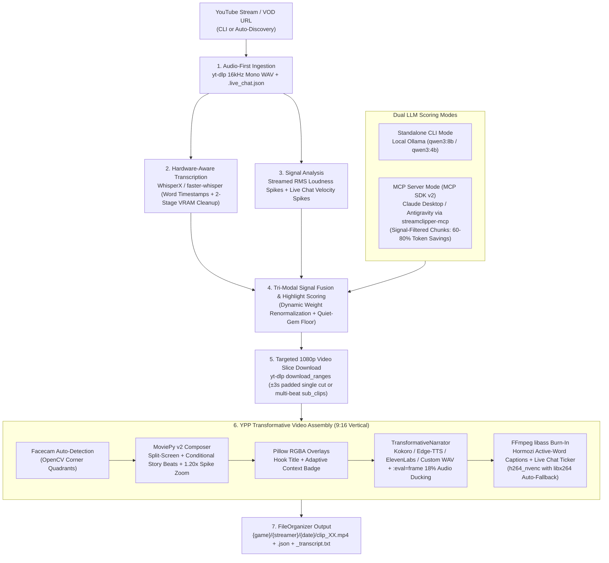

# StreamClipper

**Free, open-source, game-agnostic AI stream clipping pipeline** with dual **CLI (`click` + `rich`)** and **MCP (`MCPServer` via MCP SDK v2)** execution modes — engineered to turn long-form livestreams and VODs into engaging, YouTube Partner Program (**YPP**) transformative 9:16 vertical Shorts.

StreamClipper uses an **audio-first ingestion strategy** (downloading lightweight 16 kHz mono WAV audio first and only fetching ±3 s padded 1080p video slices for selected highlights), **tri-modal highlight detection** (audio loudness + live chat velocity + LLM semantic scoring), **5-tier dynamic hardware auto-configuration** (from GTX 1660 SUPER to RTX 4050 to high-VRAM CUDA GPUs and CPU-only machines), and a **YPP Transformative Narrative & Story Engine** that adds adaptive commentary, conditional multi-beat pacing, punch-in spike zoom, Hormozi captions, and live chat burst tickers.

---

## Architecture Overview



---

## Key Features

### Audio-First & Resumable Pipeline
- **Audio-First Ingestion**: Extracts 16 kHz mono PCM WAV audio (~460 MB for a 4-hour VOD) via `yt-dlp` before downloading a single frame of video, then fetches only ±3 s padded 1080p video cuts (`download_ranges`) for the highlights you actually keep.
- **Constant-Memory Signal Analysis**: Streams audio via `soundfile.info()` + `librosa.stream(..., fill_value=0.0)` so multi-hour VODs never exhaust RAM, while native `yt-dlp` live chat replay extraction (`.live_chat.json`) detects viewer velocity bursts and captures real viewer messages.
- **Tri-Modal Signal Fusion with Dynamic Renormalization**: Combines audio loudness spikes (`25%`), live chat velocity spikes (`25%`), and LLM semantic scoring (`50%`). If a VOD lacks live chat replay or loudness spikes, weights automatically renormalize across available modalities — and top-tier quiet moments (`llm_score >= 8.5`) receive a `0.85 × score` floor so witty or visually detailed clips without yelling still pass.
- **Step Caching & Automatic `FAILED` Recovery**: Every pipeline stage (`PENDING` → `DOWNLOADING` → `TRANSCRIBING` → `ANALYZING` → `SCORING` → `ASSEMBLING` → `COMPLETE`) is cached to `.cache/`. Interrupted or failed runs automatically recover to the last completed artifact stage (or pass `--force` to restart from scratch).

### YPP Transformative Narrative & Story Engine
Designed around the [YouTube Channel Monetization Policies](https://support.google.com/youtube/answer/1311392?hl=en) and Reused Content guidelines, StreamClipper supports **four explicit transformation modes**:

| Mode | Behavior |
| :--- | :--- |
| **`auto`** *(default)* | Resolves per highlight to **`story`** when validated multi-beat `sub_clips` exist, or **`narrative`** for clean single-cut moments. |
| **`narrative`** | Single continuous cut with full YPP commentary intro/outro, adaptive context badge, spike punch-in zoom, Hormozi captions, and live chat ticker (never jump-cuts `sub_clips`). |
| **`story`** | Multi-beat jump-cut stitching (*Setup → Escalation → Payoff*, 2–3 beats removing ≥5 s of dead air) when validated `sub_clips` exist (falling back cleanly to a single cut), plus full YPP commentary and overlays. |
| **`raw`** | Uncut single clip with captions only (skips narrative LLM commentary, voiceover, context badge, punch-in zoom, multi-beat cuts, and live chat ticker; `hook_title` still honors `hook_title.enabled`). |

- **Adaptive `moment_type` Commentary**: Classifies every highlight into `funny`, `fail`, `graphics_detail`, `hype`, `clutch`, `chat_chaos`, `lore_secret`, or `analysis` so the generated `narration_intro`, `narration_outro`, and `context_badge` match the clip's natural vibe instead of forcing dry analysis onto comedic or hype moments.
- **Conditional Multi-Beat Jump-Cut Story Mode (`sub_clips`)**: Automatically remaps word-level timestamps, live chat bursts, and spike zoom offsets onto the stitched beat timeline via `remap_timeline_for_beats()`.
- **Spike-Synced Punch-In Zoom**: Applies a smooth `1.20x` center punch-in zoom around `peak_time` (`3.5 s` default) to emphasize the climax.
- **Hormozi ASS Captions & Live Chat Burst Ticker**: Burns active-word highlighted captions (`hormozi`, `single_word`, or `sentence`) and real `.live_chat.json` viewer bursts via FFmpeg's `libass` filter using Windows-safe `cwd` invocation and single-pass hardware encoding (`h264_nvenc` with automatic `libx264` fallback).
- **Pluggable Voiceover & Dynamic `:eval=frame` Audio Ducking**: Supports free local **Kokoro-82M**, free **Edge-TTS**, optional **ElevenLabs API / personal voice clone**, or custom human microphone WAVs (`--voice-intro` / `--voice-outro`). Stream audio dynamically ducks to `18%` during intro/outro narration (`volume=...:eval=frame`) and returns to `100%` during the highlight climax.
- **Auto Facecam Detection & 9:16 Composition**: Detects corner facecams with OpenCV and builds aspect-preserving vertical split-screen compositions (`1080×1920`) with a Pillow RGBA hook title and adaptive context badge.

---

## System Requirements

| Requirement | Recommended | Minimum / Notes |
| :--- | :--- | :--- |
| **Python** | **Python 3.12** (dedicated `.venv`) | Python `>= 3.10`. On Windows, Python 3.12 is strongly recommended so prebuilt CUDA wheels for `torch`, `ctranslate2`, `faster-whisper`, and `whisperx` install cleanly. |
| **FFmpeg & FFprobe** | FFmpeg with **`libass`** + **`h264_nvenc`** | Required on `PATH`. Windows: `winget install Gyan.FFmpeg`. Linux (Debian/Ubuntu): `sudo apt install ffmpeg`. |
| **GPU** | NVIDIA CUDA GPU with **6 GB+ VRAM** (e.g., GTX 1660 SUPER, RTX 4050, RTX 3060/4070+) | Optional — CPU-only mode (`cpu_only`) is automatically selected if no CUDA GPU is present. |
| **LLM Backend** | **Ollama** (`qwen3:8b` or `qwen3:4b`) **or** an **MCP Host Client** (Claude Desktop / Antigravity) | Standalone CLI uses local Ollama; MCP mode delegates scoring directly to your host AI client. |
| **OS** | Windows 10/11 or Linux (Ubuntu 22.04+ / Debian) | Tested end-to-end on Windows (PowerShell + `.venv`) and POSIX/Linux paths. |

---

## Dynamic Hardware Auto-Configuration

StreamClipper runs cleanly across heterogeneous machines without manual config edits. Six keys in `config.default.yaml` (`transcription.device`, `transcription.model_size`, `transcription.compute_type`, `transcription.batch_size`, `llm.model`, `video.codec`) default to `"auto"` and are dynamically resolved at startup via `detect_hardware_profile()` using `torch.cuda.get_device_properties(0).total_memory`, CUDA Compute Capability, and FFmpeg `h264_nvenc` detection:

| Hardware Tier (`HardwareProfile.tier`) | Detection Rule | `device` | `model_size` | `compute_type` | `batch_size` | `llm.model` | `video.codec` |
| :--- | :--- | :---: | :---: | :---: | :---: | :---: | :---: |
| **`cuda_high_vram`** | CUDA `>= 10.0 GB` VRAM | `cuda` | `large-v2` | `float16` | `16` | `qwen3:8b` | `h264_nvenc` *(else `libx264`)* |
| **`cuda_mid_tensor`** *(e.g. RTX 4050 6 GB)* | CUDA `5.5–9.9 GB` + (`major >= 8` or `"RTX"` in GPU name) | `cuda` | `large-v2` | `int8_float16` | `8` | `qwen3:8b` | `h264_nvenc` *(else `libx264`)* |
| **`cuda_mid_no_tensor`** *(e.g. GTX 1660 SUPER 6 GB)* | CUDA `5.5–9.9 GB` + (`major < 8` and no `"RTX"`) | `cuda` | `medium` | `int8` | `4` | `qwen3:4b` | `h264_nvenc` *(else `libx264`)* |
| **`cpu_fallback`** | CUDA detected, `< 5.5 GB` VRAM | `cpu` | `base` | `int8` | `4` | `qwen3:4b` | `libx264` |
| **`cpu_only`** | No CUDA GPU available | `cpu` | `base` | `int8` | `4` | `qwen3:4b` | `libx264` |

### Overriding Auto-Detected Settings
Copy `config.default.yaml` to `config.yaml` and replace any `"auto"` value with an explicit override. StreamClipper preserves all user overrides and shows provenance (`auto` vs `user override`) when you run `streamclipper setup`:

```yaml
# Example config.yaml overriding only model_size and video codec
transcription:
  model_size: "small"      # user override (other keys remain "auto")

video:
  codec: "libx264"         # force software H.264 instead of h264_nvenc
```

> **CPU Safety Guard:** If `transcription.device` resolves (or is set) to `"cpu"`, StreamClipper automatically coerces `float16` / `int8_float16` to `int8` so `faster-whisper` / WhisperX will not crash on CPU.

---

## Installation & Quick Start

### 1. Install Prerequisites (FFmpeg)

**Windows (PowerShell):**
```powershell
winget install Gyan.FFmpeg
# Restart your terminal, then verify FFmpeg + libass:
ffmpeg -version
ffmpeg -hide_banner -filters | Select-String " ass "
```

**Linux (Ubuntu / Debian):**
```bash
sudo apt update && sudo apt install -y ffmpeg libsndfile1 libgl1 libglib2.0-0 python3 python3-venv
ffmpeg -version
ffmpeg -hide_banner -filters | grep " ass "
```

### 2. Clone & Set Up Python Virtual Environment

**Windows (PowerShell — Python 3.12 `.venv`):**
```powershell
git clone https://github.com/PrakashD2003/Clipper.git
cd Clipper

py -3.12 -m venv .venv
.\.venv\Scripts\Activate.ps1

# Optional (NVIDIA GPU): install CUDA-enabled PyTorch before StreamClipper
pip install torch torchaudio --index-url https://download.pytorch.org/whl/cu124

# Install StreamClipper (core + MCP server + free TTS engines)
pip install -e ".[mcp,tts]"

# Optional: install WhisperX for word-level wav2vec2 alignment
pip install -e ".[whisperx]"
```

**Linux (bash):**
```bash
git clone https://github.com/PrakashD2003/Clipper.git
cd Clipper

python3 -m venv .venv
source .venv/bin/activate

# Optional (NVIDIA GPU): install CUDA-enabled PyTorch before StreamClipper
pip install torch torchaudio --index-url https://download.pytorch.org/whl/cu124

# Install StreamClipper (core + MCP server + free TTS engines)
pip install -e ".[mcp,tts]"

# Optional: install WhisperX for word-level wav2vec2 alignment
pip install -e ".[whisperx]"
```

> **Available Optional Extras (`pyproject.toml`):**
> - `pip install -e .` — Core CLI pipeline (`yt-dlp`, `faster-whisper`, `librosa`, `soundfile`, `opencv-python`, `moviepy>=2.0.0`, `ollama`, `click`, `rich`)
> - `pip install -e ".[tts]"` — Both free TTS engines (`kokoro` + `edge-tts`); or install individually via `.[kokoro]` / `.[edge-tts]`
> - `pip install -e ".[mcp]"` — MCP SDK v2 (`mcp>=2.0.0`) for `streamclipper-mcp`
> - `pip install -e ".[whisperx]"` — WhisperX with wav2vec2 word-level alignment
> - `pip install -e ".[dev]"` — Test suite (`pytest`, `pytest-asyncio`)

### 3. Verify Environment & Hardware Profile

```bash
streamclipper setup
```

`streamclipper setup` checks every dependency (`yt-dlp`, `FFmpeg`, `WhisperX`, `SoundFile`, `OpenCV`, `MoviePy v2`, `Ollama SDK`, `MCP SDK v2 (MCPServer)`), probes your CUDA GPU VRAM & Compute Capability, and prints the resolved `HardwareProfile` table.

### 4. Clip Your First Stream

```bash
# Default YPP auto mode (multi-beat story when sub_clips exist, else narrative)
streamclipper clip "https://www.youtube.com/watch?v=VIDEO_ID" --game "GTA 6" --mode auto

# Single-cut narrative mode (full commentary + overlays, never jump-cuts)
streamclipper clip "https://www.youtube.com/watch?v=VIDEO_ID" --mode narrative

# Multi-beat story mode (stitches Setup -> Escalation -> Payoff beats + commentary)
streamclipper clip "https://www.youtube.com/watch?v=VIDEO_ID" --mode story

# Raw mode (uncut clip + captions, skipping YPP voiceover, badge, zoom, and chat ticker)
streamclipper clip "https://www.youtube.com/watch?v=VIDEO_ID" --mode raw

# Supply your own recorded human voiceover WAVs for intro and/or outro
streamclipper clip "https://www.youtube.com/watch?v=VIDEO_ID" --mode story --voice-intro ./my_intro.wav --voice-outro ./my_outro.wav

# Ignore cached pipeline stages and re-run from scratch
streamclipper clip "https://www.youtube.com/watch?v=VIDEO_ID" --mode auto --force

# Auto-discover top recent streams for any game and batch-clip in parallel (non-interactive)
streamclipper auto --game "GTA 6" --max-streams 5 --max-clips 3 --mode auto

# Inspect cached / in-progress pipelines
streamclipper status
```

#### CLI Options Summary
- **Global flags** (`streamclipper [OPTIONS] COMMAND`):
  - `-c, --config FILE`: Path to a custom `config.yaml`
  - `-v, --verbose`: Enable `DEBUG` logging
  - `--version`: Print version and exit
- **`streamclipper clip URL`**: `-n/--max-clips`, `-g/--game`, `-s/--streamer`, `--interactive/--no-interactive`, `--mode [auto|narrative|story|raw]`, `--voice-intro FILE`, `--voice-outro FILE`, `--force`
- **`streamclipper auto`**: `-g/--game`, `-n/--max-streams`, `--max-clips`, `--mode [auto|narrative|story|raw]`, `--voice-intro FILE`, `--voice-outro FILE`, `--force`
- **`streamclipper setup`**: Dependency checks + `HardwareProfile` resolution report
- **`streamclipper status`**: Table of cached/in-progress pipelines in `.cache/`

#### Generated Output Layout
```text
output/
└── GTA 6/
    └── StreamerName/
        └── 2026-11-18/
            ├── clip_01.mp4              # 1080x1920 9:16 H.264/AAC vertical Short
            ├── clip_01.json             # Hook title, description, hashtags, moment_type, narration & mode
            └── clip_01_transcript.txt   # Clean highlight transcript
```

---

## Voiceover & YPP Narration Setup

`TransformativeNarrator` (`src/streamclipper/assembly/narrator.py`) overlays intro/outro commentary while dynamically ducking stream audio to `18%` (`volume=...:eval=frame`), leaving original stream audio at `100%` during the highlight's climax.

### Option 1: Free Default (`auto`: Kokoro-82M → Edge-TTS)
Install the optional TTS extras:
```bash
pip install -e ".[tts]"
```
With `transformation.tts_engine: "auto"` (the default):
1. **Primary — Local Kokoro-82M (100% offline & free)**: Uses `transformation.tts_voice` (default: `"af_heart"`).
2. **Fallback — Microsoft Edge-TTS (free, no API key)**: Automatically used if Kokoro is unavailable, using `transformation.edge_tts_voice` (default: `"en-US-GuyNeural"`).

You can also lock a specific free engine in `config.yaml`:
```yaml
transformation:
  tts_engine: "kokoro"            # or "edge-tts"
  tts_voice: "af_heart"           # Kokoro voice ID
  edge_tts_voice: "en-US-GuyNeural"
```

### Option 2: Optional ElevenLabs API / Personal Voice Clone
To narrate clips in a studio voice or your own **ElevenLabs personal voice clone**:

1. Export your API key in the environment:
   **Windows (PowerShell):**
   ```powershell
   $env:ELEVENLABS_API_KEY = "sk_your_elevenlabs_api_key"
   ```
   **Linux / macOS (bash):**
   ```bash
   export ELEVENLABS_API_KEY="sk_your_elevenlabs_api_key"
   ```
2. Configure `config.yaml`:
   ```yaml
   transformation:
     tts_engine: "elevenlabs"
     elevenlabs_voice_id: "YOUR_CLONED_VOICE_ID"
     elevenlabs_model_id: "eleven_multilingual_v2"
   ```
If `ELEVENLABS_API_KEY` or `elevenlabs_voice_id` is unset (or an API error occurs), StreamClipper gracefully falls back to the free `auto` chain (`kokoro` → `edge-tts`) so renders never fail.

### Option 3: Custom Human Microphone WAVs (Highest YPP Authenticity)
Record your own short intro/outro WAV (or `.m4a`/`.mp3`/`.aac`, probed via `ffprobe` fallback) and pass it directly on the CLI (or via MCP `render_clip`):
```bash
streamclipper clip "https://www.youtube.com/watch?v=VIDEO_ID" --mode narrative --voice-intro ./recordings/intro.wav --voice-outro ./recordings/outro.wav
```
Custom audio paths bypass TTS synthesis for that slot, normalize automatically to `48000 Hz` stereo, work even on silent video clips (via a synthesized `anullsrc` base track), and apply the exact same `18%` dynamic stream ducking.

To keep visual overlays (hook title, context badge, spike zoom, live chat ticker) without any voiceover audio, set `transformation.tts_engine: "none"`.

---

## Standalone Mode with Ollama

When running StreamClipper from the CLI without an MCP host, highlight scoring and YPP commentary generation run locally through [Ollama](https://ollama.com/).

### 1. Install & Start Ollama
- **Windows**: Download and install from [ollama.com/download](https://ollama.com/download) (or `winget install Ollama.Ollama`). Ollama runs automatically in the system tray at `http://localhost:11434`.
- **Linux**:
  ```bash
  curl -fsSL https://ollama.com/install.sh | sh
  ollama serve
  ```

### 2. Pull the Model for Your Hardware Tier
Pull the model matching the `llm.model` shown by `streamclipper setup`:

```bash
# For cuda_high_vram (10 GB+ VRAM) and cuda_mid_tensor (e.g. RTX 4050 6 GB):
ollama pull qwen3:8b

# For cuda_mid_no_tensor (e.g. GTX 1660 SUPER 6 GB), cpu_fallback, or cpu_only:
ollama pull qwen3:4b
```

Verify Ollama is reachable:
```bash
ollama list
```
To use a different local model or remote Ollama server, override `llm.model` and `llm.base_url` in `config.yaml`.

---

## MCP Server Setup (Claude Desktop & Antigravity)

StreamClipper exposes its entire pipeline over stdio using **MCP SDK v2 (`MCPServer` from `mcp>=2.0.0`)** via the `streamclipper-mcp` entry point. In MCP mode, **your host AI client (Claude Desktop, Antigravity, etc.) acts as the highlight scorer and YPP scriptwriter** — no local Ollama installation required.

### 1. Install the MCP Extra
```bash
pip install -e ".[mcp]"
```

### 2. Configure Claude Desktop or Antigravity

Add StreamClipper to your MCP client configuration file:
- **Claude Desktop (Windows)**: `%APPDATA%\Claude\claude_desktop_config.json`
- **Claude Desktop (macOS)**: `~/Library/Application Support/Claude/claude_desktop_config.json`
- **Claude Desktop (Linux)**: `~/.config/Claude/claude_desktop_config.json`
- **Antigravity**: Workspace / user `mcp_config.json`

**Standard (`streamclipper-mcp` on `PATH`):**
```json
{
  "mcpServers": {
    "streamclipper": {
      "command": "streamclipper-mcp",
      "args": [],
      "env": {}
    }
  }
}
```

**Windows `.venv` Explicit Path (recommended if `.venv\Scripts` is not on global `PATH` — adjust the path to your local clone):**
```json
{
  "mcpServers": {
    "streamclipper": {
      "command": "D:\\GTA6-Clipper\\.venv\\Scripts\\streamclipper-mcp.exe",
      "args": [],
      "env": {}
    }
  }
}
```
> *Optional:* If you want ElevenLabs voiceovers in MCP mode without setting a system-wide environment variable, add `"ELEVENLABS_API_KEY": "sk_your_key"` inside `"env"`. Leave `"env": {}` to inherit your existing shell/system environment variables untouched.

### 3. Exposed MCP Tools (`streamclipper-mcp`)

| Tool Name | Purpose |
| :--- | :--- |
| `discover_streams` | Find top recent YouTube streams/VODs for a given game (`game`, `max_results`). |
| `download_stream_audio` | Download 16 kHz mono WAV audio and initialize `StepCache` state. |
| `transcribe_audio` | Run hardware-aware WhisperX transcription (resolves `StepCache` by `url` or `audio_path`). |
| `analyze_signals` | Run streamed loudness + `yt-dlp` live chat velocity analysis and persist spikes to cache (resolves `StepCache` by `url` or `audio_path`). |
| `get_transcript_chunks` | Return timestamped transcript chunks paired with overlapping spikes (resolves `StepCache` by `url` or `audio_path`; `only_with_signals=True` by default, cutting context tokens by 60–80%). |
| `submit_highlights` | Submit host-LLM highlight selections including `moment_type`, `narration_intro`, `narration_outro`, `context_badge`, and `sub_clips`, fusing signals and persisting to `StepCache`. |
| `render_clip` | Render a single highlight into a final 9:16 Short offline without requiring Ollama (`mode`: `auto` \| `narrative` \| `story` \| `raw`, `sub_clips_json`, and optional `voice_intro_path` / `voice_outro_path`). |
| `render_all_selected` | Batch-render all submitted highlights stored in `StepCache` for a stream (zero-Ollama offline metadata path). |
| `get_pipeline_status` | Inspect status and progress of all cached pipelines. |
| `generate_post_metadata` | Generate structured post captions and normalized hashtags offline (`use_ollama=False` by default; set `use_ollama=True` to invoke local Ollama). |
| `cleanup_temp` | Remove temporary audio/video files bounded within `general.temp_dir` for a specific `url` (or for all `COMPLETE` pipelines when `url` is omitted). |

---

## Topic Videos (16:9 Long-Form & 9:16 Shorts)

StreamClipper includes a complete **Topic Video Pipeline** that clusters many streams and official gameplay trailers of the same game into original, narrator-led deep dives and vertical Shorts. One approved script produces:

- **1 Long 16:9 Video** (8–10 minutes) with auto-spaced YouTube chapters, Ken-Burns ducked B-roll, on-screen credit pills, auto-generated 1280×720 thumbnail, and ready-to-paste `long_post.txt`.
- **3 Vertical 9:16 Shorts** (35–60 seconds) with persistent hook title, on-screen channel credits, ducked commentary, and Hormozi captions:
  - **1 Teaser Short (`short_teaser.mp4`)**: Hooks viewers and points directly to the long video via YouTube Studio's "Related Video" feature.
  - **2 Standalone Shorts (`short_a.mp4`, `short_b.mp4`)**: Independent spotlight videos built around distinct strong beats, with zero footage repetition between them.

### Quick Workflow
```bash
# 1. Ingest sources (streamer VODs + official footage)
streamclipper library add "https://youtube.com/watch?v=..." --channel "StreamerName" --game "GTA 6"

# 2. Discover candidate topics
streamclipper topics suggest "GTA 6"

# 3. Plan outline and script (rotates numbered explainer, countdown ranking, or mystery story shape)
streamclipper topics plan "GTA 6" "hidden-casino-secrets"

# 4. Mandatory review & approval gate
streamclipper topics show PLAN_ID
streamclipper topics approve PLAN_ID

# 5. Render 16:9 long video and 9:16 Shorts
streamclipper topics render PLAN_ID
streamclipper topics shorts PLAN_ID
```

For full details on the MCP tools, Ollama CLI workflows, upload checklists, and YouTube Partner Program fair-use policies, see the comprehensive [Topic Videos Guide](docs/topic-videos-guide.md).

---

## Configuration Reference (`config.yaml`)

StreamClipper loads `config.default.yaml` first and deep-merges your optional `config.yaml` (or `-c /path/to/config.yaml`) on top. You only need to specify keys you want to customize.

### `general`
| Key | Default | Description |
| :--- | :--- | :--- |
| `general.output_dir` | `"./output"` | Root directory for rendered clips, metadata JSON, and transcripts. |
| `general.temp_dir` | `"./temp"` | Working directory for downloaded audio/segments and intermediate renders. |
| `general.cache_dir` | `"./.cache"` | Directory for resumable `StepCache` pipeline JSON states. |
| `general.max_concurrent_streams` | `2` | Maximum concurrent streams processed by `streamclipper auto` (GPU work stays lock-serialized). |
| `general.log_level` | `"INFO"` | Logging level (`DEBUG`, `INFO`, `WARNING`, `ERROR`); overridden to `DEBUG` by `-v/--verbose`. |

### `discovery`
| Key | Default | Description |
| :--- | :--- | :--- |
| `discovery.platform` | `"youtube"` | Streaming platform (`youtube`). |
| `discovery.default_game` | `"GTA 6"` | Default game used when `--game` is omitted. |
| `discovery.game_keywords` | `["GTA 6", "Grand Theft Auto 6", "GTA VI"]` | YouTube search query variants used when discovering streams for `discovery.default_game`. |
| `discovery.min_viewers` | `1000` | Minimum view/viewer threshold for discovered VODs. |
| `discovery.max_streams` | `10` | Maximum number of streams returned by discovery. |
| `discovery.min_duration_hours` | `1` | Minimum VOD length in hours (filters out short uploads). |

### `transcription`
| Key | Default | Description |
| :--- | :--- | :--- |
| `transcription.engine` | `"whisperx"` | ASR engine: `whisperx` (word-level wav2vec2 alignment) or `faster-whisper`. |
| `transcription.model_size` | `"auto"` | `auto` \| `tiny` \| `base` \| `small` \| `medium` \| `large-v2`. |
| `transcription.device` | `"auto"` | `auto` \| `cuda` \| `cpu`. |
| `transcription.compute_type` | `"auto"` | `auto` \| `float16` \| `int8_float16` \| `int8`. |
| `transcription.language` | `"en"` | ISO language code (e.g., `"en"`) or `"auto"` for automatic language detection. |
| `transcription.batch_size` | `"auto"` | `auto` \| positive integer (e.g., `4`, `8`, `16`). |

### `analysis`
| Key | Default | Description |
| :--- | :--- | :--- |
| `analysis.chunk_minutes` | `12` | Duration (minutes) of each transcript chunk sent to scoring. |
| `analysis.min_clip_seconds` | `30` | Minimum allowed clip duration in seconds. |
| `analysis.max_clip_seconds` | `90` | Maximum allowed clip duration in seconds. |
| `analysis.max_clips_per_stream` | `5` | Maximum number of top highlights selected per stream. |
| `analysis.min_highlight_score` | `7.0` | Minimum fused score (0–10) required for a highlight to pass. |
| `analysis.weights.loudness` | `0.25` | Weight of audio RMS loudness spikes (all 3 weights must sum to `1.0`). |
| `analysis.weights.chat_velocity` | `0.25` | Weight of live chat velocity spikes. |
| `analysis.weights.llm_score` | `0.50` | Weight of LLM semantic highlight score. |
| `analysis.loudness.threshold_std` | `2.5` | Standard deviations above mean RMS to trigger a loudness spike. |
| `analysis.loudness.window_seconds` | `2` | RMS frame window size in seconds. |
| `analysis.loudness.merge_gap_seconds` | `5` | Merge adjacent loudness spikes closer than N seconds (preserving peak timestamp). |
| `analysis.chat.window_seconds` | `10` | Time bin size (seconds) for live chat velocity calculation. |
| `analysis.chat.prominence_factor` | `3.0` | Standard deviations above baseline message rate for a chat spike. |
| `analysis.chat.min_messages` | `50` | Minimum total chat messages required before enabling chat velocity analysis. |

### `llm`
| Key | Default | Description |
| :--- | :--- | :--- |
| `llm.provider` | `"ollama"` | Standalone CLI LLM backend (`ollama`). |
| `llm.model` | `"auto"` | `auto` (`qwen3:8b` / `qwen3:4b` per `HardwareProfile`) or any Ollama model tag. |
| `llm.base_url` | `"http://localhost:11434"` | Ollama HTTP API endpoint. |
| `llm.temperature` | `0.3` | Sampling temperature for structured highlight JSON scoring. |
| `llm.timeout_seconds` | `120` | Per-chunk request timeout in seconds. |

### `video`
| Key | Default | Description |
| :--- | :--- | :--- |
| `video.format` | `"mp4"` | Output container format. |
| `video.resolution` | `[1080, 1920]` | Output `[width, height]` in pixels (9:16 vertical Shorts). |
| `video.fps` | `30` | Output frame rate. |
| `video.codec` | `"auto"` | `auto` (`h264_nvenc` if CUDA+NVENC else `libx264`) \| `h264_nvenc` \| `libx264`. |
| `video.audio_codec` | `"aac"` | Output audio codec. |
| `video.crf` | `23` | Quality target (`-crf` for `libx264`, `-cq` for `h264_nvenc`; lower = higher quality, 18–28). |

### `captions`
| Key | Default | Description |
| :--- | :--- | :--- |
| `captions.style` | `"hormozi"` | Caption style: `hormozi` (grouped active-word highlight), `single_word`, or `sentence`. |
| `captions.words_per_group` | `4` | Words shown simultaneously in `hormozi` style. |
| `captions.font` | `"Arial"` | ASS font family name. |
| `captions.font_size` | `72` | ASS font size. |
| `captions.color` | `"white"` | Base caption text color (`white`, `black`, `yellow`, `gold`, `red`, `cyan`, or `#RRGGBB` hex). |
| `captions.highlight_color` | `"#FFD700"` | Active-word highlight color (`#RRGGBB` hex or supported named color, converted dynamically to ASS BGR). |
| `captions.stroke_color` | `"black"` | Text outline/stroke color (`white`, `black`, `yellow`, `gold`, `red`, `cyan`, or `#RRGGBB` hex). |
| `captions.stroke_width` | `4` | Outline thickness in pixels. |
| `captions.position_y_ratio` | `0.75` | Vertical placement ratio (`0.75` = 75% down from top). |

### `hook_title`
| Key | Default | Description |
| :--- | :--- | :--- |
| `hook_title.enabled` | `true` | Enable/disable the opening hook title overlay. |
| `hook_title.duration_seconds` | `4` | Duration the hook title remains visible at the start of the clip. |
| `hook_title.font` | `"Arial-Bold"` | Pillow TrueType font name or path. |
| `hook_title.font_size` | `50` | Hook title font size. |
| `hook_title.color` | `"white"` | Hook title text color. |
| `hook_title.stroke_color` | `"black"` | Hook title outline color. |
| `hook_title.stroke_width` | `3` | Hook title outline thickness. |
| `hook_title.position` | `"top"` | Placement: `top` or `center`. |
| `hook_title.fade_in` | `true` | Apply `CrossFadeIn` transition (up to `0.5 s`) on the hook title banner and adaptive context badge. |

### `metadata`
| Key | Default | Description |
| :--- | :--- | :--- |
| `metadata.hashtag_count` | `15` | Target number of normalized hashtags saved in companion metadata JSON. |
| `metadata.include_streamer_tag` | `true` | Include normalized `#StreamerName` tag. |
| `metadata.include_game_tag` | `true` | Include normalized `#GameName` tag. |

### `output`
| Key | Default | Description |
| :--- | :--- | :--- |
| `output.structure` | `"{game}/{streamer}/{date}"` | Output folder template (sanitized for Windows/POSIX path safety). |
| `output.filename_template` | `"clip_{index:02d}"` | Filename stem template (`{index}`, `{game}`, `{streamer}`, `{date}`). |
| `output.save_metadata_json` | `true` | Write companion `.json` metadata beside each rendered clip. |
| `output.save_transcript_txt` | `true` | Write companion `_transcript.txt` beside each rendered clip. |

### `transformation` (YPP Anti-Reused-Content Engine)
| Key | Default | Description |
| :--- | :--- | :--- |
| `transformation.enabled` | `true` | Master toggle for YPP transformative commentary, badge, zoom, and chat ticker. |
| `transformation.mode` | `"auto"` | `auto` \| `narrative` \| `story` \| `raw` (overridable per run via `--mode`). |
| `transformation.tts_engine` | `"auto"` | `auto` (`kokoro` → `edge-tts`) \| `kokoro` \| `edge-tts` \| `elevenlabs` \| `none`. |
| `transformation.tts_voice` | `"af_heart"` | Kokoro-82M voice ID (e.g., `af_heart`, `am_michael`, `bf_emma`). |
| `transformation.edge_tts_voice` | `"en-US-GuyNeural"` | Edge-TTS voice ID used for `edge-tts` or `auto` fallback. |
| `transformation.elevenlabs_voice_id` | `""` | Optional ElevenLabs voice or personal voice clone ID (requires `ELEVENLABS_API_KEY`). |
| `transformation.elevenlabs_model_id` | `"eleven_multilingual_v2"` | ElevenLabs TTS model ID. |
| `transformation.duck_stream_volume` | `0.18` | Stream audio volume ratio during narrator voiceover (`0.18` = 18%). |
| `transformation.punch_in_zoom` | `1.20` | Center punch-in zoom multiplier at `peak_time` (`1.0` = disabled). |
| `transformation.zoom_duration_seconds` | `3.5` | Duration of the punch-in zoom window in seconds. |
| `transformation.show_chat_ticker` | `true` | Burn real `.live_chat.json` viewer bursts during highlight spikes. |

---

## Troubleshooting (Windows & Linux)

### Windows: `ffmpeg`, `git`, or `.venv` Activation Blocked
- Install FFmpeg via `winget install Gyan.FFmpeg` and restart PowerShell.
- If PowerShell blocks `.\.venv\Scripts\Activate.ps1`, either allow local scripts once (`Set-ExecutionPolicy -Scope CurrentUser RemoteSigned`) or invoke `.venv` executables directly (`.\.venv\Scripts\streamclipper.exe setup`).
- If `git` or `ffmpeg` is installed but missing from your session `PATH`, add them temporarily or via *System Properties → Environment Variables*:
  ```powershell
  $env:PATH += ";C:\Program Files\Git\cmd"
  where.exe ffmpeg
  where.exe ffprobe
  ```
- Verify your FFmpeg build includes `libass`:
  ```powershell
  ffmpeg -hide_banner -filters | Select-String " ass "
  ```
  *(StreamClipper invokes FFmpeg with `cwd` set to the `.ass` parent directory and a relative `-vf ass=filename.ass` argument, completely avoiding Windows drive-letter colon-escaping bugs.)*

### PyTorch Installed CPU-Only Instead of CUDA
If `streamclipper setup` prints `No CUDA GPU detected` on a machine with an NVIDIA GPU, `pip` likely installed the CPU-only PyTorch wheel from PyPI. Reinstall the CUDA wheel inside your `.venv`:
```bash
pip uninstall -y torch torchaudio
pip install torch torchaudio --index-url https://download.pytorch.org/whl/cu124
streamclipper setup
```

### `h264_nvenc` Encoding Error or Outdated GPU Driver
- StreamClipper automatically falls back from `h264_nvenc` to `libx264` if NVENC fails at encode time.
- To force software encoding permanently (e.g., older NVIDIA drivers or headless Linux servers), set:
  ```yaml
  video:
    codec: "libx264"
  ```

### Out-of-Memory (OOM) on 6 GB VRAM GPUs
- StreamClipper performs **two-stage GPU VRAM cleanup** (explicitly freeing the WhisperX ASR model and calling `torch.cuda.empty_cache()` before loading the wav2vec2 alignment model) and auto-tunes 6 GB cards (`int8` / `medium` / `batch_size: 4` on GTX 1660 SUPER; `int8_float16` / `large-v2` / `batch_size: 8` on RTX 4050).
- If another GPU app (game, OBS, browser hardware acceleration) is consuming VRAM, lower `transcription.batch_size: 2` or `transcription.model_size: "small"` in `config.yaml`, or temporarily switch `transcription.device: "cpu"`.

### Ollama Connection Refused (`http://localhost:11434`)
- Confirm the Ollama daemon is running (`ollama list`). On Linux, start it with `ollama serve`.
- Confirm the active `llm.model` shown by `streamclipper setup` has been pulled (`ollama pull qwen3:8b` or `ollama pull qwen3:4b`).

### Missing Live Chat Replay on Older / Non-Stream YouTube Videos
- Regular uploads and some VODs do not include YouTube live chat replay (`.live_chat.json`). StreamClipper logs this cleanly and **dynamically renormalizes signal fusion weights** across loudness + LLM score without failing.

### Linux: Missing `libGL.so.1` or `libsndfile.so.1`
If OpenCV or SoundFile fails to import on a minimal Linux distro / Docker container:
```bash
sudo apt install -y libgl1 libglib2.0-0 libsndfile1
```

### Stale Cache or Re-Running With New Mode/Settings
- StreamClipper caches completed stages in `.cache/` so re-runs are fast.
- To discard cached pipeline state and re-run from scratch (for example after switching `--mode` or `config.yaml`), pass `--force`:
  ```bash
  streamclipper clip "https://www.youtube.com/watch?v=VIDEO_ID" --mode story --force
  ```

---

## Project Structure & Development

```text
streamclipper/
├── config.default.yaml             # Default configuration ("auto" hardware keys + YPP defaults)
├── pyproject.toml                  # PEP 517 packaging, extras (mcp, tts, whisperx, dev), entry points
├── docs/                           # Implementation blueprint & agent runbooks
├── reports/                        # Phase & package verification audit reports
├── src/streamclipper/
│   ├── cli.py                      # Click + Rich CLI (clip, auto, setup, status)
│   ├── config.py                   # Hierarchical YAML config & 5-tier HardwareProfile auto-tuning
│   ├── models.py                   # IntEnum PipelineStatus & recursive JSON dataclasses
│   ├── cache.py                    # StepCache resumable stage persistence
│   ├── pipeline.py                 # Async end-to-end orchestrator + FAILED recovery + GPU lock
│   ├── discovery/                  # YouTube stream discovery
│   ├── download/                   # 16kHz audio, ±3s video slices, native yt-dlp live chat
│   ├── analysis/                   # WhisperX transcription, streamed RMS loudness, chat velocity
│   ├── prompts/                    # Adaptive YPP highlight scoring & metadata prompt templates
│   ├── scoring/                    # Tri-modal fusion, OllamaScorer, YPP adaptive prompts, metadata
│   ├── assembly/                   # Facecam detector, 9:16 composer, hooks, ASS captions, narrator
│   ├── output/                     # Exporter (ultrafast CRF18 -> duck -> ASS) & FileOrganizer
│   └── mcp_server/                 # MCP SDK v2 (MCPServer) stdio server (streamclipper-mcp)
└── tests/                          # Comprehensive pytest unit & real FFmpeg integration suite
```

### Running the Test Suite
```powershell
# Windows (.venv)
.\.venv\Scripts\pytest.exe -v

# Linux (.venv)
.venv/bin/pytest -v
```

---

## License

MIT License. See [`pyproject.toml`](pyproject.toml) for package metadata.
