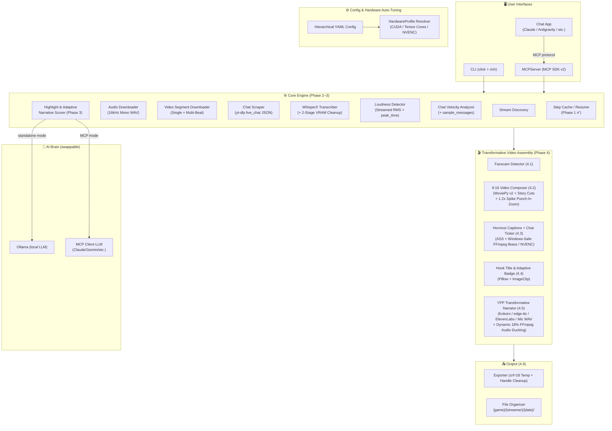
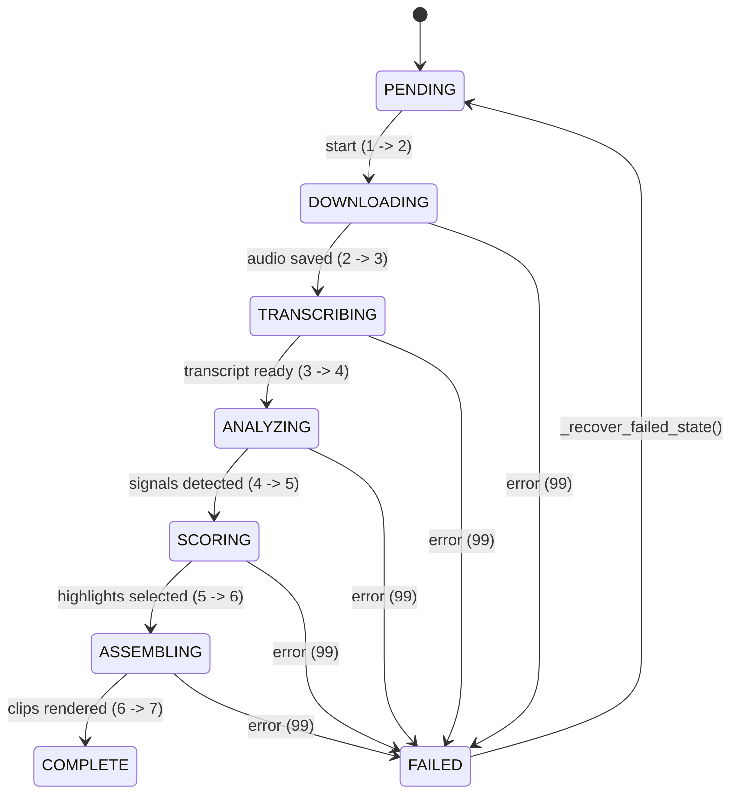
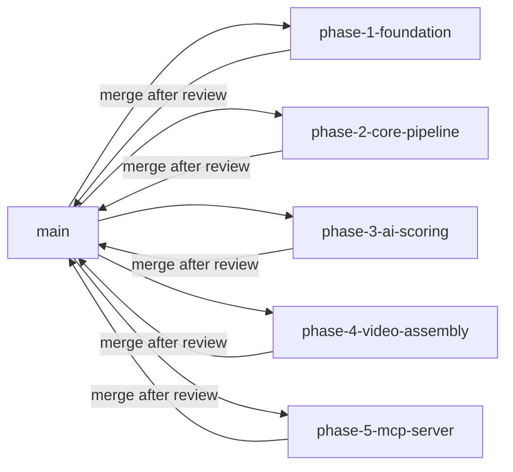

# 🎮 StreamClipper — Implementation Guide (v2.2 — Patched + Auto-Hardware + YPP Transformative Engine)

> **A free, open-source, game-agnostic AI stream clipping system with MCP + CLI modes and built-in YouTube Partner Program (YPP) Transformative Narrative & Story synthesis**  
> **Milestone Status:** **All 5 Phases (`phase-1-foundation` through `phase-5-mcp-server`, Packages `1.1–5.2` + Reviews `1.R–5.R`) are ✅ COMPLETE and MERGED into `main` (StreamClipper v2.2 release).**  
> *v2.2 preserves all 12 v2 runtime/architectural fixes, all 6 Windows & edge-case patches (`FAILED` retry recovery, `librosa.stream` `fill_value=0.0`, Windows-safe FFmpeg `cwd` ASS burn-in + file-lock cleanup + `crf=18` single-loss temp encode, aspect-preserving facecam crop, non-negative chat offsets, dynamic ASS highlight color), 5-tier `HardwareProfile` auto-configuration (`h264_nvenc` → `libx264`), all 5 architectural caveat resolutions (story timeline remapping `remap_timestamps` / `remap_timeline_for_beats` with `clip_start_offset=0.0`, dynamic FFmpeg audio ducking filtergraph with 48kHz stereo normalization and overlap budget clamping, optional TTS dependencies with Windows `espeak-ng` check before Kokoro, single-pass video encoding pipeline with `-c:v copy` audio mixing, and Layout A 1.2x spike zoom inside the gameplay clip locking the 35%/65% split line), and both YPP narrative clarifications (suppressing ducked streamer speech captions during active narration to display tone-matched commentary cards, and two-pass AI scoring separating candidate discovery from top-tier narrative synthesis on 4B–8B models).*

## Architecture Overview



### 🛡️ Mandatory Architectural Guardrails & Caveat Resolutions (v2.2)

To prevent runtime crashes, audio/video desync, model hallucinations, and double-compression degradation, the pipeline enforces these 5 technical caveat resolutions and 2 design clarifications:

| Item | Location | Architectural Bug / Caveat | Runtime Impact | Clean Resolution in v2.2 |
| :--- | :--- | :--- | :--- | :--- |
| **Caveat 1** | Pkg 4.2 & 4.3 (`composer.py`, `captions.py`) | Word & chat timestamps desync in `--mode story` | If `sub_clips` cuts dead air between beats (e.g., Beat 1: 3810–3825s, Beat 2: 3845–3875s), subtracting a scalar `clip_start_offset` makes Beat 2's captions appear 20s late (past the end of the clip). | Implement `remap_timestamps(words, sub_clips, chat_burst, peak_time)` / `remap_timeline_for_beats(...)` mapping each word and chat message onto the contiguous stitched timeline (`0.0 .. total_stitched_dur`), dropping dead-air words/chat, and passing `clip_start_offset=0.0` to `AssCaptionBurner.generate_ass()`. |
| **Caveat 2** | Pkg 4.5 (`narrator.py`) | Hardcoded `amix=inputs=3` crashes when intro or outro is omitted; audio rate mismatch | Hardcoding 3 inputs crashes FFmpeg when `intro_wav` or `outro_wav` is missing. Overlap on short clips bleeds into climax, and 24kHz mono Kokoro tracks clash with 48kHz stereo YouTube audio. | Dynamically construct filtergraph for active inputs (`inputs = 1 + len(active_tracks)`), resample all streams via `aresample=48000,aformat=channel_layouts=stereo` with stereo `adelay=ms\|ms`, clamp narration windows on short clips (capped to 30% per window / 75% total budget), and duck volume using `:eval=frame`. |
| **Caveat 3** | Pkg 4.5 & `pyproject.toml` | `kokoro` & `edge-tts` missing from pyproject; Kokoro requires `espeak-ng` on Windows | `hexgrad/kokoro` requires `espeak-ng.dll` (`PHONEMIZER_ESPEAK_LIBRARY`), which is absent from standard Windows virtual environments, causing unhandled runtime errors. | Add `[project.optional-dependencies]` `tts = ["edge-tts>=6.1.0"]`, `edge-tts = ["edge-tts>=6.1.0"]`, `kokoro = ["kokoro>=0.9.0"]`. Implement `_is_espeak_available()` check on Windows so `tts_engine: "auto"` skips Kokoro and falls back cleanly to cloud `edge-tts` (zero-setup Microsoft neural voices), then `none`. |
| **Caveat 4** | Pkg 4.3, 4.5, 4.6 (`captions.py`, `narrator.py`, `exporter.py`) | Multiple lossy FFmpeg video re-encodes | MoviePy MP4 encode (#1) + narrator mixing video encode (#2) + ASS caption burning video encode (#3) degrades visual quality and triples render times. | Pass `-c:v copy` in `mix_narration_with_ducking()` (zero video re-encoding during audio mixing) and write intermediate MoviePy video at high quality (`preset="ultrafast"`, `-crf 18`), leaving the single final lossy video compression to `burn_captions()` with configured `video.codec` and `video.crf`. |
| **Caveat 5** | Pkg 4.2 (`composer.py`) | 1.2x punch-in zoom on Layout A vs. Layout B | Zooming the entire composed 1080x1920 frame crops off the top 10% of the streamer's facecam and shifts the 35%/65% split line downwards. | Apply the 1.2x punch-in zoom inside the gameplay clip (`1080x1248`, bottom 65%) before stacking in `CompositeVideoClip`, keeping the facecam intact and the 35%/65% split line locked at `y = 672`. |
| **Clarification 1** | Pkg 4.3 & 4.6 (`captions.py`, `exporter.py`) | Captions during ducked narration vs streamer speech | Showing streamer captions while original stream audio is ducked to 18% and the narrator is speaking different commentary looks broken and confusing. | Suppress streamer speech captions during active ducked narration windows (`[0.0, intro_dur]` and `[outro_start, clip_duration]`), and burn tone-matched narration caption cards (`narration_intro` and `narration_outro`) in `Style: Hormozi` during those windows so on-screen text matches what viewers hear. |
| **Clarification 2** | Pkg 3.1 & 3.2 (`scorer.py`, `ollama_scorer.py`) | 4B local models (`qwen3:4b` on GTX 1660 SUPER) handling complex nested JSON | Forcing a 4B model in a single pass (`highlight_scorer.txt`) to output timestamps, scores, hooks, intro/outro narration, badge, and nested `sub_clips` arrays causes frequent JSON parse failures and token truncation. | Enforce a **Two-Pass Scoring Architecture**: Pass 1 (`highlight_scorer.txt`) candidate discovery across 12-minute chunks identifying candidate ranges and moments; Pass 2 (`narrative_writer.txt`) generating `narration_intro`, `narration_outro`, and `context_badge` ONLY on the top 3–5 selected highlights, saving tokens and ensuring ~99% valid JSON parse rate on 4B–8B models. |

## Technology Stack

| Component | Technology | Version | Purpose |
| :--- | :--- | :--- | :--- |
| Language | Python | `3.12` (`.venv`) / `>=3.10` | Core language ([Python Packaging Guide](https://packaging.python.org/en/latest/guides/writing-pyproject-toml/)) |
| Build Backend | `setuptools.build_meta` | `>=68.0` | PEP 517 build system ([Setuptools `build_meta` Docs](https://setuptools.pypa.io/en/latest/build_meta.html)) |
| CLI Framework | `click` + `rich` | `>=8.1.0` / `>=13.0.0` | CLI interface and terminal progress tables |
| Stream & Chat Download | [`yt-dlp`](https://github.com/yt-dlp/yt-dlp) | `>=2024.8.0` | 16kHz mono WAV extraction, single/multi-beat segment downloads, and `live_chat` JSON replay |
| Transcription | [`whisperx`](https://github.com/m-bain/whisperx) + `faster-whisper` | `>=1.0.0` | GPU-accelerated speech-to-text with wav2vec2 word-level alignment |
| Audio Analysis | `librosa` + `soundfile` + `scipy` | `>=0.10.0` / `>=0.12.1` | Block-streamed RMS loudness spike detection with `peak_time` tracking |
| Face Detection | `opencv-python` | `>=4.8.0` | Corner-filtered facecam auto-detection |
| Video Composition | [`moviepy`](https://pypi.org/project/moviepy/) | `>=2.0.0` | 9:16 aspect-preserving crop/resize, conditional multi-beat story cuts, and 1.2x spike zoom ([MoviePy v2 Migration Guide](https://zulko.github.io/moviepy/getting_started/updating_to_v2.html)) |
| Caption & Chat Burn-In | [FFmpeg `ass` Filter](https://trac.ffmpeg.org/wiki/HowToBurnSubtitlesIntoVideo) + optional `h264_nvenc` | System CLI | Windows-safe `cwd` `.ass` active-word captions + live chat burst ticker with GPU/CPU H.264 encode |
| YPP Narrator & Ducking | [`Kokoro-82M`](https://github.com/hexgrad/kokoro) / [`edge-tts`](https://github.com/rany2/edge-tts) / optional **ElevenLabs API (incl. Voice Clone)** / custom mic WAV + FFmpeg | Optional / CLI | Adaptive intro/outro voiceover mixed over 18% ducked stream audio to satisfy [YouTube Monetization Policies](https://support.google.com/youtube/answer/1311392?hl=en) |
| Local LLM | `ollama` (Python SDK) | `>=0.3.0` | Standalone mode AI highlight scoring, adaptive narrative scripting, and metadata generation |
| MCP Server | [`mcp` (`MCPServer`)](https://github.com/modelcontextprotocol/python-sdk) | `>=2.0.0` | Decorator-driven Model Context Protocol SDK v2 server (`from mcp.server.mcpserver import MCPServer`) |
| Data & Config | `pandas` + `numpy` + `pyyaml` | `>=2.0.0` / `>=1.24.0` / `>=6.0` | Chat time-series binning and hierarchical YAML configuration |
| GPU Diagnostics & Auto-Tuning | [`torch.cuda`](https://docs.pytorch.org/docs/stable/cuda.html) | `>=2.0.0` | Device detection (`total_memory`, `major`, `minor`, `name`), `HardwareProfile` auto-tuning, and VRAM cache clearing |

## Dynamic Hardware Auto-Configuration Policy

When `"auto"` is configured in `config.default.yaml` for `transcription.device`, `transcription.model_size`, `transcription.compute_type`, `transcription.batch_size`, `llm.model`, or `video.codec`, `resolve_hardware_config()` inspects `torch.cuda.get_device_properties(0)` (`total_memory`, `major`, `minor`, `name`) and FFmpeg encoder support (`ffmpeg -hide_banner -encoders`) to pick safe, fast defaults across heterogeneous machines (e.g., Desktop GTX 1660 SUPER 6 GB vs. Laptop RTX 4050 6 GB vs. high-VRAM GPU vs. CPU-only):

| Hardware Tier (`HardwareProfile.tier`) | Detection Rule | `device` | `model_size` | `compute_type` | `batch_size` | `llm.model` | `video.codec` |
| :--- | :--- | :--- | :--- | :--- | :--- | :--- | :--- |
| **`cuda_high_vram`** | `cuda` & `vram_gb >= 10.0` | `cuda` | `large-v2` | `float16` | `16` | `qwen3:8b` | `h264_nvenc` (else `libx264`) |
| **`cuda_mid_tensor`** (e.g. RTX 4050 6GB) | `cuda` & `5.5 <= vram_gb < 10.0` & (`major >= 8` or `"RTX"` in `name.upper()`) | `cuda` | `large-v2` | `int8_float16` | `8` | `qwen3:8b` | `h264_nvenc` (else `libx264`) |
| **`cuda_mid_no_tensor`** (e.g. GTX 1660 SUPER 6GB) | `cuda` & `5.5 <= vram_gb < 10.0` & not Tensor Core (`major < 8` and `"RTX"` not in `name.upper()`) | `cuda` | `medium` | `int8` | `4` | `qwen3:4b` | `h264_nvenc` (else `libx264`) |
| **`cpu_fallback`** | `cuda` present but `vram_gb < 5.5` | `cpu` | `base` | `int8` | `4` | `qwen3:4b` | `libx264` |
| **`cpu_only`** | No CUDA available | `cpu` | `base` | `int8` | `4` | `qwen3:4b` | `libx264` |

> [!IMPORTANT]
> Explicit values in a user's `config.yaml` **always win** over `"auto"` resolution. Only keys currently equal to `"auto"` are replaced with the resolved `HardwareProfile` values.

> [!NOTE]
> **Two-Pass AI Scoring on 4B–8B Local LLMs (`qwen3:4b` / `qwen3:8b`):**  
> On resource-constrained hardware such as the GTX 1660 SUPER (Turing TU116, 6GB VRAM, no Tensor Cores), prompting `qwen3:4b` to output full narrative scripts, badges, and nested multi-beat `sub_clips` in a single prompt across all 12-minute chunks causes severe token bloat, slow generation, and malformed JSON. The pipeline enforces a two-pass scoring architecture:
> 1. **Pass 1 (`highlight_scorer.txt`)**: Fast candidate scouting per 12-minute chunk outputting strictly candidate timestamps, score, `moment_type`, title, reason, quote, and optional `sub_clips`.
> 2. **Pass 2 (`narrative_writer.txt`)**: Tone-matched YPP transformation (`narration_intro`, `narration_outro`, `context_badge`) executed ONLY on the final top 3–5 highlights after signal fusion and deduplication, saving tokens and ensuring ~99% valid JSON parsing.

## Data Models

> [!NOTE]
> These dataclasses are shared across ALL phases. They must be implemented first (Package 1.2) as every other component depends on them. `PipelineStatus` uses `IntEnum` so stage comparisons (`state.status < PipelineStatus.TRANSCRIBING`) evaluate numerically rather than alphabetically, and `SerializableModel` provides recursive JSON serialization for nested dataclasses, `Path` objects, and `Enum` values.

```python
# src/streamclipper/models.py
from dataclasses import dataclass, field, fields, is_dataclass
from enum import Enum, IntEnum
from pathlib import Path
from typing import Any, Optional
import json


class Platform(str, Enum):
    YOUTUBE = "youtube"
    TWITCH = "twitch"  # future
    KICK = "kick"      # future


class SignalType(str, Enum):
    LOUDNESS = "loudness"
    CHAT_VELOCITY = "chat_velocity"
    LLM_PICK = "llm_pick"


class PipelineStatus(IntEnum):
    PENDING = 1
    DOWNLOADING = 2
    TRANSCRIBING = 3
    ANALYZING = 4
    SCORING = 5
    ASSEMBLING = 6
    COMPLETE = 7
    FAILED = 99


def _serialize_value(val: Any) -> Any:
    """Recursively convert dataclasses, Paths, and Enums into JSON-safe primitives."""
    if isinstance(val, Path):
        return str(val)
    if isinstance(val, Enum):
        return val.value
    if is_dataclass(val) and not isinstance(val, type):
        return {f.name: _serialize_value(getattr(val, f.name)) for f in fields(val)}
    if isinstance(val, list):
        return [_serialize_value(item) for item in val]
    if isinstance(val, dict):
        return {str(k): _serialize_value(v) for k, v in val.items()}
    return val


@dataclass
class SerializableModel:
    def to_dict(self) -> dict[str, Any]:
        """Convert to a recursively JSON-serializable dict."""
        return _serialize_value(self)

    def to_json(self) -> str:
        return json.dumps(self.to_dict(), indent=2)


@dataclass
class StreamInfo(SerializableModel):
    url: str
    title: str
    platform: Platform
    streamer: str
    game: str
    duration_seconds: int
    view_count: int = 0
    video_id: str = ""

    @classmethod
    def from_dict(cls, data: dict[str, Any]) -> "StreamInfo":
        return cls(
            url=data["url"],
            title=data["title"],
            platform=Platform(data["platform"]),
            streamer=data["streamer"],
            game=data["game"],
            duration_seconds=int(data["duration_seconds"]),
            view_count=int(data.get("view_count", 0)),
            video_id=data.get("video_id", ""),
        )


@dataclass
class TimeRange(SerializableModel):
    start: float          # seconds from stream start
    end: float            # seconds from stream start
    score: float = 0.0
    signal_type: SignalType = SignalType.LOUDNESS
    metadata: dict[str, Any] = field(default_factory=dict)

    @classmethod
    def from_dict(cls, data: dict[str, Any]) -> "TimeRange":
        return cls(
            start=float(data["start"]),
            end=float(data["end"]),
            score=float(data.get("score", 0.0)),
            signal_type=SignalType(data.get("signal_type", SignalType.LOUDNESS.value)),
            metadata=dict(data.get("metadata", {})),
        )


@dataclass
class WordTimestamp(SerializableModel):
    text: str
    start: float          # seconds
    end: float            # seconds
    confidence: float = 0.0

    @classmethod
    def from_dict(cls, data: dict[str, Any]) -> "WordTimestamp":
        return cls(
            text=data["text"],
            start=float(data["start"]),
            end=float(data["end"]),
            confidence=float(data.get("confidence", 0.0)),
        )


@dataclass
class TranscriptSegment(SerializableModel):
    text: str
    start: float
    end: float
    words: list[WordTimestamp] = field(default_factory=list)

    @classmethod
    def from_dict(cls, data: dict[str, Any]) -> "TranscriptSegment":
        return cls(
            text=data["text"],
            start=float(data["start"]),
            end=float(data["end"]),
            words=[WordTimestamp.from_dict(w) for w in data.get("words", [])],
        )


@dataclass
class TranscriptionResult(SerializableModel):
    segments: list[TranscriptSegment]
    full_text: str
    language: str = "en"

    @classmethod
    def from_dict(cls, data: dict[str, Any]) -> "TranscriptionResult":
        return cls(
            segments=[TranscriptSegment.from_dict(s) for s in data.get("segments", [])],
            full_text=data.get("full_text", ""),
            language=data.get("language", "en"),
        )


@dataclass
class Highlight(SerializableModel):
    start: float
    end: float
    score: float                  # 1-10 from LLM
    title: str                    # suggested hook title
    reason: str                   # why this is a good clip
    best_quote: str = ""          # most memorable line
    loudness_score: float = 0.0   # from loudness detector
    chat_score: float = 0.0       # from chat analyzer
    final_score: float = 0.0      # weighted composite score
    transcript_chunk: str = ""    # the spoken words in this range
    word_timestamps: list[WordTimestamp] = field(default_factory=list)

    @classmethod
    def from_dict(cls, data: dict[str, Any]) -> "Highlight":
        return cls(
            start=float(data["start"]),
            end=float(data["end"]),
            score=float(data["score"]),
            title=data["title"],
            reason=data["reason"],
            best_quote=data.get("best_quote", ""),
            loudness_score=float(data.get("loudness_score", 0.0)),
            chat_score=float(data.get("chat_score", 0.0)),
            final_score=float(data.get("final_score", 0.0)),
            transcript_chunk=data.get("transcript_chunk", ""),
            word_timestamps=[
                WordTimestamp.from_dict(w) for w in data.get("word_timestamps", [])
            ],
        )


@dataclass
class FacecamRegion(SerializableModel):
    x: int
    y: int
    w: int
    h: int
    confidence: float = 0.0

    @classmethod
    def from_dict(cls, data: dict[str, Any]) -> "FacecamRegion":
        return cls(
            x=int(data["x"]),
            y=int(data["y"]),
            w=int(data["w"]),
            h=int(data["h"]),
            confidence=float(data.get("confidence", 0.0)),
        )


@dataclass
class ClipMetadata(SerializableModel):
    hook_title: str
    caption: str
    hashtags: list[str]
    streamer: str
    game: str
    source_url: str
    clip_start: float
    clip_end: float
    highlight_score: float

    @classmethod
    def from_dict(cls, data: dict[str, Any]) -> "ClipMetadata":
        return cls(
            hook_title=data["hook_title"],
            caption=data["caption"],
            hashtags=list(data.get("hashtags", [])),
            streamer=data["streamer"],
            game=data["game"],
            source_url=data["source_url"],
            clip_start=float(data["clip_start"]),
            clip_end=float(data["clip_end"]),
            highlight_score=float(data["highlight_score"]),
        )


@dataclass
class ClipResult(SerializableModel):
    video_path: Path
    metadata_path: Path
    metadata: ClipMetadata
    duration_seconds: float

    @classmethod
    def from_dict(cls, data: dict[str, Any]) -> "ClipResult":
        return cls(
            video_path=Path(data["video_path"]),
            metadata_path=Path(data["metadata_path"]),
            metadata=ClipMetadata.from_dict(data["metadata"]),
            duration_seconds=float(data["duration_seconds"]),
        )


@dataclass
class PipelineState(SerializableModel):
    """Tracks progress for resume capability."""
    stream_info: StreamInfo
    status: PipelineStatus = PipelineStatus.PENDING
    audio_path: Optional[Path] = None
    transcript: Optional[TranscriptionResult] = None
    loudness_spikes: list[TimeRange] = field(default_factory=list)
    chat_spikes: list[TimeRange] = field(default_factory=list)
    highlights: list[Highlight] = field(default_factory=list)
    selected_highlights: list[Highlight] = field(default_factory=list)
    clips: list[ClipResult] = field(default_factory=list)
    cache_dir: Optional[Path] = None
```

## Difficulty Levels & Model Assignment

| Level | Icon | Description | Assigned Model | Rationale |
| :--- | :--- | :--- | :--- | :--- |
| 🟢 Easy | `EASY` | Boilerplate, config, simple I/O, file organization | **Gemini 3.8 (high)** | Routine code, low complexity |
| 🟡 Medium | `MED` | Standard logic, API integration, data processing | **Gemini 3.8 (high)** | Straightforward but needs care |
| 🟠 Hard | `HARD` | Complex algorithms, multi-step processing, CV/ML | **Gemini 3.8 (high)** | Needs deeper reasoning |
| 🔴 Critical | `CRIT` | Architecture decisions, MCP protocol, prompt engineering, integration | **Claude Opus 4.6** | Requires nuanced judgment |

## Phase 1: Foundation & Scaffolding

> **Branch:** `phase-1-foundation`  
> **Goal:** Project structure, dynamic hardware-aware config system, data models, CLI skeleton, and step cache.  
> **All subsequent phases depend on this.**

### 📦 Package 1.1 — Project Scaffolding

| Property | Value |
| :--- | :--- |
| **Difficulty** | 🟢 Easy |
| **Assigned Model** | Gemini 3.8 (high) |
| **Estimated Effort** | ~30 min |
| **Dependencies** | None |
| **Commit Message** | `feat: project scaffolding, pyproject.toml, directory structure` |

#### What to Build

Create the entire project directory structure and Python packaging config using PEP 517 [`setuptools.build_meta`](https://setuptools.pypa.io/en/latest/build_meta.html).

#### Files to Create

##### [NEW] `pyproject.toml`
```toml
[build-system]
requires = ["setuptools>=68.0", "wheel"]
build-backend = "setuptools.build_meta"

[project]
name = "streamclipper"
version = "0.1.0"
description = "Free, open-source AI-powered stream clipping tool"
readme = "README.md"
license = {text = "MIT"}
requires-python = ">=3.10"
authors = [{name = "StreamClipper Contributors"}]

dependencies = [
    "yt-dlp>=2024.8.0",
    "faster-whisper>=1.0.0",
    "librosa>=0.10.0",
    "soundfile>=0.12.1",
    "opencv-python>=4.8.0",
    "moviepy>=2.0.0",
    "ollama>=0.3.0",
    "numpy>=1.24.0",
    "scipy>=1.11.0",
    "pandas>=2.0.0",
    "Pillow>=10.0.0",
    "pyyaml>=6.0",
    "click>=8.1.0",
    "rich>=13.0.0",
    "tqdm>=4.65.0",
]

[project.optional-dependencies]
whisperx = ["whisperx @ git+https://github.com/m-bain/whisperX.git"]
mcp = ["mcp>=2.0.0"]
tts = ["edge-tts>=6.1.0"]
edge-tts = ["edge-tts>=6.1.0"]
kokoro = ["kokoro>=0.9.0"]
dev = ["pytest>=7.0", "pytest-asyncio>=0.21"]

[project.scripts]
streamclipper = "streamclipper.cli:cli"
streamclipper-mcp = "streamclipper.mcp_server:main"

[tool.setuptools.packages.find]
where = ["src"]

[tool.setuptools.package-data]
streamclipper = ["config.default.yaml", "prompts/*.txt"]

[tool.pytest.ini_options]
asyncio_default_fixture_loop_scope = "function"
```

##### [NEW] Directory structure
```text
GTA6-Clipper/
├── pyproject.toml
├── README.md
├── config.default.yaml
├── src/
│   └── streamclipper/
│       ├── __init__.py              # version, package metadata
│       ├── cli.py                   # click CLI entry point
│       ├── models.py                # all dataclasses (from Data Models section)
│       ├── config.py                # config loading, validation & HardwareProfile resolver
│       ├── cache.py                 # step cache for resume
│       ├── discovery/
│       │   ├── __init__.py
│       │   └── youtube.py
│       ├── download/
│       │   ├── __init__.py
│       │   ├── audio.py
│       │   ├── video.py
│       │   └── chat.py
│       ├── analysis/
│       │   ├── __init__.py
│       │   ├── transcriber.py
│       │   ├── loudness.py
│       │   └── chat_velocity.py
│       ├── scoring/
│       │   ├── __init__.py
│       │   ├── scorer.py            # abstract scorer interface
│       │   └── ollama_scorer.py     # local LLM scorer
│       ├── assembly/
│       │   ├── __init__.py
│       │   ├── facecam.py
│       │   ├── composer.py          # 9:16 video assembly (MoviePy v2)
│       │   ├── captions.py          # Hormozi-style ASS + FFmpeg captions
│       │   └── hooks.py             # hook title overlay (Pillow + ImageClip)
│       ├── output/
│       │   ├── __init__.py
│       │   ├── exporter.py
│       │   └── organizer.py         # {game}/{streamer}/{date}/ structure
│       ├── mcp_server/
│       │   ├── __init__.py
│       │   └── server.py            # MCPServer (MCP SDK v2) tool definitions
│       ├── pipeline.py              # orchestrates the full pipeline
│       └── prompts/
│           ├── highlight_scorer.txt
│           ├── hook_generator.txt
│           └── caption_writer.txt
├── tests/
│   ├── __init__.py
│   ├── test_config.py
│   ├── test_download.py
│   ├── test_transcriber.py
│   ├── test_loudness.py
│   ├── test_chat.py
│   ├── test_scorer.py
│   ├── test_assembly.py
│   └── test_pipeline.py
├── reports/
│   └── phase-1/
└── output/                          # generated clips (gitignored)
```

##### [NEW] `src/streamclipper/__init__.py`
```python
"""StreamClipper — Free AI-powered stream clipping tool."""
__version__ = "0.1.0"
```

##### [NEW] `.gitignore`
```text
# Python
__pycache__/
*.pyc
*.egg-info/
dist/
build/
.eggs/

# Project
output/
temp/
*.wav
*.mp3
*.mp4
*.ass
*.live_chat.json

# Config
config.yaml          # user config (not default)

# IDE
.vscode/
.idea/

# Cache
.cache/
*.cache
```

#### Acceptance Criteria
- [ ] `pip install -e .` succeeds with `setuptools.build_meta`
- [ ] `streamclipper --help` prints the CLI help text
- [ ] All `__init__.py` files exist
- [ ] `.gitignore` covers outputs, `.ass` subtitles, `.live_chat.json`, cache, and Python artifacts

### 📦 Package 1.2 — Data Models & Dynamic Hardware-Aware Config System

| Property | Value |
| :--- | :--- |
| **Difficulty** | 🟡 Medium |
| **Assigned Model** | Gemini 3.8 (high) |
| **Estimated Effort** | ~1 hour |
| **Dependencies** | Package 1.1 |
| **Commit Message** | `feat: data models, config system with dynamic HardwareProfile auto-tuning` |

#### What to Build

Implement all shared data models (from the Data Models section above, including `IntEnum` `PipelineStatus` and recursive `SerializableModel`), `config.default.yaml` with `"auto"` hardware fields, and `src/streamclipper/config.py` with `HardwareProfile` and `resolve_hardware_config()`.

#### Files to Create

##### [NEW] `src/streamclipper/models.py`
Copy the complete `src/streamclipper/models.py` block from the Data Models section above verbatim.

##### [NEW] `config.default.yaml`
```yaml
# StreamClipper Default Configuration
# Copy this to config.yaml and customize.
# Fields set to "auto" are resolved dynamically at runtime via HardwareProfile
# based on detected GPU VRAM, CUDA Compute Capability (Tensor Cores), and FFmpeg NVENC support.

general:
  output_dir: "./output"
  temp_dir: "./temp"
  cache_dir: "./.cache"
  max_concurrent_streams: 2
  log_level: "INFO"

discovery:
  platform: "youtube"
  default_game: "GTA 6"
  game_keywords: ["GTA 6", "Grand Theft Auto 6", "GTA VI"]
  min_viewers: 1000
  max_streams: 10
  min_duration_hours: 1  # skip short videos

transcription:
  engine: "whisperx"      # whisperx | faster-whisper
  model_size: "auto"      # auto | tiny | base | small | medium | large-v2
  device: "auto"          # auto | cpu | cuda
  compute_type: "auto"    # auto | float16 | int8_float16 | int8
  language: "en"
  batch_size: "auto"      # auto | integer (e.g. 4, 8, 16)

analysis:
  chunk_minutes: 12
  min_clip_seconds: 30
  max_clip_seconds: 90
  max_clips_per_stream: 5
  min_highlight_score: 7.0

  # Signal weights (must sum to 1.0)
  weights:
    loudness: 0.25
    chat_velocity: 0.25
    llm_score: 0.50

  loudness:
    threshold_std: 2.5     # std deviations above mean
    window_seconds: 2      # RMS frame window
    merge_gap_seconds: 5   # merge spikes within N seconds

  chat:
    window_seconds: 10     # bin size for counting messages
    prominence_factor: 3.0 # std deviations for spike
    min_messages: 50       # skip chat analysis if fewer total messages

llm:
  provider: "ollama"       # ollama (standalone mode)
  model: "auto"            # auto | qwen3:8b | qwen3:4b | any Ollama model
  base_url: "http://localhost:11434"
  temperature: 0.3
  timeout_seconds: 120

video:
  format: "mp4"
  resolution: [1080, 1920]  # width x height (9:16)
  fps: 30
  codec: "auto"             # auto (h264_nvenc if CUDA+NVENC else libx264) | h264_nvenc | libx264
  audio_codec: "aac"
  crf: 23                   # quality (libx264 -crf / h264_nvenc -cq, lower = better, 18-28 range)

captions:
  style: "hormozi"           # hormozi | single_word | sentence
  words_per_group: 4         # words visible at once (hormozi style)
  font: "Arial"
  font_size: 72
  color: "white"
  highlight_color: "#FFD700"  # gold for active word (converted dynamically to ASS BGR &H00D7FF&)
  stroke_color: "black"
  stroke_width: 4
  position_y_ratio: 0.75     # 75% down the screen

hook_title:
  enabled: true
  duration_seconds: 4
  font: "Arial-Bold"
  font_size: 50
  color: "white"
  stroke_color: "black"
  stroke_width: 3
  position: "top"            # top | center
  fade_in: true

metadata:
  hashtag_count: 15
  include_streamer_tag: true
  include_game_tag: true

output:
  structure: "{game}/{streamer}/{date}"  # folder template
  filename_template: "clip_{index:02d}"
  save_metadata_json: true
  save_transcript_txt: true
```

##### [NEW] `src/streamclipper/config.py`
```python
"""Configuration loading with defaults, validation, merging, and dynamic hardware auto-tuning."""
from dataclasses import dataclass
from pathlib import Path
from typing import Any
import subprocess
import yaml

DEFAULT_CONFIG_PATH = Path(__file__).parent.parent.parent / "config.default.yaml"
USER_CONFIG_PATH = Path("config.yaml")


@dataclass(frozen=True)
class HardwareProfile:
    """Resolved hardware capabilities and recommended runtime parameters."""
    tier: str
    gpu_name: str
    vram_gb: float
    compute_capability: str
    has_tensor_cores: bool
    has_nvenc: bool
    device: str
    model_size: str
    compute_type: str
    batch_size: int
    llm_model: str
    video_codec: str


def _detect_nvenc_support() -> bool:
    """Return True if FFmpeg is installed and exposes the h264_nvenc encoder."""
    try:
        proc = subprocess.run(
            ["ffmpeg", "-hide_banner", "-encoders"],
            capture_output=True,
            text=True,
            timeout=5,
            check=False,
        )
        return proc.returncode == 0 and "h264_nvenc" in proc.stdout
    except (FileNotFoundError, subprocess.SubprocessError, OSError):
        return False


def detect_hardware_profile(check_nvenc: bool = True) -> HardwareProfile:
    """Inspect CUDA GPU properties and FFmpeg encoders to build a HardwareProfile."""
    try:
        import torch

        cuda_available = torch.cuda.is_available()
        if cuda_available:
            props = torch.cuda.get_device_properties(0)
            gpu_name = str(props.name)
            vram_gb = float(props.total_memory) / 1e9
            major = int(props.major)
            minor = int(props.minor)
            cc = f"{major}.{minor}"
            has_tensor_cores = (major >= 8) or ("RTX" in gpu_name.upper())
            has_nvenc = _detect_nvenc_support() if check_nvenc else False
            video_codec = "h264_nvenc" if has_nvenc else "libx264"

            if vram_gb >= 10.0:
                return HardwareProfile(
                    tier="cuda_high_vram",
                    gpu_name=gpu_name,
                    vram_gb=round(vram_gb, 2),
                    compute_capability=cc,
                    has_tensor_cores=has_tensor_cores,
                    has_nvenc=has_nvenc,
                    device="cuda",
                    model_size="large-v2",
                    compute_type="float16",
                    batch_size=16,
                    llm_model="qwen3:8b",
                    video_codec=video_codec,
                )

            if vram_gb >= 5.5 and has_tensor_cores:
                return HardwareProfile(
                    tier="cuda_mid_tensor",
                    gpu_name=gpu_name,
                    vram_gb=round(vram_gb, 2),
                    compute_capability=cc,
                    has_tensor_cores=True,
                    has_nvenc=has_nvenc,
                    device="cuda",
                    model_size="large-v2",
                    compute_type="int8_float16",
                    batch_size=8,
                    llm_model="qwen3:8b",
                    video_codec=video_codec,
                )

            if vram_gb >= 5.5:
                return HardwareProfile(
                    tier="cuda_mid_no_tensor",
                    gpu_name=gpu_name,
                    vram_gb=round(vram_gb, 2),
                    compute_capability=cc,
                    has_tensor_cores=False,
                    has_nvenc=has_nvenc,
                    device="cuda",
                    model_size="medium",
                    compute_type="int8",
                    batch_size=4,
                    llm_model="qwen3:4b",
                    video_codec=video_codec,
                )

            # CUDA GPU present but < 5.5 GB VRAM — fall back safely to CPU for ASR/LLM
            return HardwareProfile(
                tier="cpu_fallback",
                gpu_name=gpu_name,
                vram_gb=round(vram_gb, 2),
                compute_capability=cc,
                has_tensor_cores=has_tensor_cores,
                has_nvenc=has_nvenc,
                device="cpu",
                model_size="base",
                compute_type="int8",
                batch_size=4,
                llm_model="qwen3:4b",
                video_codec="libx264",
            )
    except Exception:
        pass

    return HardwareProfile(
        tier="cpu_only",
        gpu_name="CPU",
        vram_gb=0.0,
        compute_capability="N/A",
        has_tensor_cores=False,
        has_nvenc=False,
        device="cpu",
        model_size="base",
        compute_type="int8",
        batch_size=4,
        llm_model="qwen3:4b",
        video_codec="libx264",
    )


def resolve_hardware_config(
    data: dict[str, Any], profile: HardwareProfile | None = None
) -> tuple[dict[str, Any], HardwareProfile]:
    """Replace 'auto' hardware keys in data with values from HardwareProfile.

    Explicit user overrides (any value != 'auto') are preserved untouched.
    """
    hw = profile or detect_hardware_profile()

    transcription = data.setdefault("transcription", {})
    if transcription.get("device") == "auto":
        transcription["device"] = hw.device
    if transcription.get("model_size") == "auto":
        transcription["model_size"] = hw.model_size
    if transcription.get("compute_type") == "auto":
        transcription["compute_type"] = hw.compute_type
    if transcription.get("batch_size") == "auto":
        transcription["batch_size"] = hw.batch_size

    # Safety guard: float16 / int8_float16 are invalid on CPU
    if transcription.get("device") == "cpu" and transcription.get("compute_type") in (
        "float16",
        "int8_float16",
    ):
        transcription["compute_type"] = "int8"

    llm = data.setdefault("llm", {})
    if llm.get("model") == "auto":
        llm["model"] = hw.llm_model

    video = data.setdefault("video", {})
    if video.get("codec") == "auto":
        video["codec"] = hw.video_codec

    return data, hw


class Config:
    """Hierarchical config: user config overrides defaults, then resolves 'auto' hardware settings."""

    def __init__(
        self,
        user_config_path: Path | None = None,
        hardware_profile: HardwareProfile | None = None,
    ):
        with open(DEFAULT_CONFIG_PATH, encoding="utf-8") as f:
            self._data = yaml.safe_load(f)

        config_path = user_config_path or USER_CONFIG_PATH
        if config_path.exists():
            with open(config_path, encoding="utf-8") as f:
                user_data = yaml.safe_load(f) or {}
            self._data = self._deep_merge(self._data, user_data)

        self._raw_auto_keys = {
            key: self.get(key) == "auto"
            for key in (
                "transcription.device",
                "transcription.model_size",
                "transcription.compute_type",
                "transcription.batch_size",
                "llm.model",
                "video.codec",
            )
        }
        self._data, self.hardware_profile = resolve_hardware_config(
            self._data, profile=hardware_profile
        )
        self._validate()

    def get(self, dotted_key: str, default: Any = None) -> Any:
        """Access nested config: config.get('analysis.weights.loudness')."""
        keys = dotted_key.split(".")
        val = self._data
        for k in keys:
            if isinstance(val, dict) and k in val:
                val = val[k]
            else:
                return default
        return val

    def is_auto_resolved(self, dotted_key: str) -> bool:
        """Return True if this setting came from dynamic 'auto' hardware resolution."""
        return bool(self._raw_auto_keys.get(dotted_key, False))

    def _deep_merge(self, base: dict, override: dict) -> dict:
        """Recursively merge override into base."""
        result = base.copy()
        for key, val in override.items():
            if key in result and isinstance(result[key], dict) and isinstance(val, dict):
                result[key] = self._deep_merge(result[key], val)
            else:
                result[key] = val
        return result

    def _validate(self) -> None:
        """Validate critical config values."""
        weights = self.get("analysis.weights", {})
        total = sum(weights.values())
        if abs(total - 1.0) > 0.01:
            raise ValueError(f"Signal weights must sum to 1.0, got {total}")

        resolution = self.get("video.resolution", [1080, 1920])
        if len(resolution) != 2:
            raise ValueError("video.resolution must be [width, height]")

        batch_size = self.get("transcription.batch_size", 4)
        if not isinstance(batch_size, int) or batch_size < 1:
            raise ValueError(f"transcription.batch_size must be a positive int, got {batch_size!r}")

    @property
    def data(self) -> dict:
        return self._data
```

#### Acceptance Criteria
- [ ] `from streamclipper.models import *` imports all dataclasses without error
- [ ] `PipelineStatus.PENDING < PipelineStatus.ANALYZING` evaluates to `True`
- [ ] `Config()` loads defaults, merges user overrides, and resolves all `"auto"` hardware fields dynamically
- [ ] `detect_hardware_profile()` correctly classifies all 4 tiers:
  - `>= 10 GB` VRAM → `large-v2` / `float16` / `batch_size=16` / `qwen3:8b`
  - `5.5–9.9 GB` + Tensor Cores (e.g., RTX 4050 6GB CC 8.9) → `large-v2` / `int8_float16` / `batch_size=8` / `qwen3:8b`
  - `5.5–9.9 GB` without Tensor Cores (e.g., GTX 1660 SUPER 6GB CC 7.5) → `medium` / `int8` / `batch_size=4` / `qwen3:4b`
  - CPU / `< 5.5 GB` VRAM → `base` / `int8` / `batch_size=4` / `qwen3:4b` / `libx264`
- [ ] Explicit user overrides in `config.yaml` (e.g., forcing `transcription.model_size: "large-v2"` on GTX 1660 SUPER) are preserved untouched
- [ ] `config.get('analysis.weights.loudness')` returns `0.25` and validation rejects weights not summing to `1.0`
- [ ] Nested dataclasses (`TranscriptionResult` → `TranscriptSegment` → `WordTimestamp`) round-trip through JSON without `TypeError`

### 📦 Package 1.3 — CLI Skeleton & Step Cache

| Property | Value |
| :--- | :--- |
| **Difficulty** | 🟡 Medium |
| **Assigned Model** | Gemini 3.8 (high) |
| **Estimated Effort** | ~1 hour |
| **Dependencies** | Package 1.2 |
| **Commit Message** | `feat: CLI skeleton with hardware profile display and step cache for resume` |

#### What to Build

The CLI entry point with all command stubs (displaying the resolved `HardwareProfile` in `streamclipper setup` and checking GPU VRAM via `total_memory`), plus the step-caching system for full crash recovery.

#### Files to Create

##### [NEW] `src/streamclipper/cli.py`
```python
"""CLI entry point for StreamClipper."""
import click
from rich.console import Console
from rich.table import Table
from pathlib import Path
from .config import Config

console = Console()


@click.group()
@click.option("--config", "-c", type=click.Path(), default=None, help="Path to config.yaml")
@click.option("--verbose", "-v", is_flag=True, help="Verbose output")
@click.pass_context
def cli(ctx, config, verbose):
    """🎮 StreamClipper — AI-powered stream clipping tool"""
    ctx.ensure_object(dict)
    ctx.obj["config"] = Config(Path(config) if config else None)
    ctx.obj["verbose"] = verbose


@cli.command()
@click.argument("url")
@click.option("--max-clips", "-n", default=None, type=int, help="Max clips to generate")
@click.option("--game", "-g", default=None, help="Game name (overrides config)")
@click.option("--streamer", "-s", default=None, help="Streamer name (auto-detected if omitted)")
@click.option("--interactive/--no-interactive", default=True, help="Prompt to select highlights")
@click.pass_context
def clip(ctx, url, max_clips, game, streamer, interactive):
    """Clip highlights from a stream URL.

    Example: streamclipper clip "https://youtube.com/watch?v=XXXXX"
    """
    console.print(f"[bold green]🎬 Processing stream:[/] {url}")
    console.print("[yellow]⚠️ Pipeline not yet implemented. Coming in Phase 3.[/]")


@cli.command()
@click.option("--game", "-g", default=None, help="Game to search for")
@click.option("--max-streams", "-n", default=None, type=int, help="Number of streams")
@click.option("--max-clips", default=None, type=int, help="Clips per stream")
@click.pass_context
def auto(ctx, game, max_streams, max_clips):
    """Auto-discover top streams and clip them all.

    Example: streamclipper auto --game "GTA 6" --max-streams 5
    """
    config = ctx.obj["config"]
    game = game or config.get("discovery.default_game", "GTA 6")
    console.print(f"[bold green]🔍 Discovering top {game} streams...[/]")
    console.print("[yellow]⚠️ Discovery not yet implemented. Coming in Phase 3.[/]")


@cli.command()
@click.pass_context
def setup(ctx):
    """Check dependencies, detect hardware profile, and report system readiness.

    Example: streamclipper setup
    """
    config: Config = ctx.obj["config"]
    console.print("[bold]🔧 Checking system dependencies...[/]")
    _check_dependency("yt-dlp", "yt_dlp")
    _check_dependency("FFmpeg", None, cmd="ffmpeg -version")
    _check_dependency("WhisperX", "whisperx")
    _check_dependency("SoundFile", "soundfile")
    _check_dependency("OpenCV", "cv2")
    _check_dependency("MoviePy v2", "moviepy")
    _check_dependency("Ollama SDK", "ollama")
    _check_gpu()
    _render_hardware_profile(config)


@cli.command()
@click.pass_context
def status(ctx):
    """Show status of cached/in-progress pipelines.

    Example: streamclipper status
    """
    from .cache import StepCache

    cache = StepCache(ctx.obj["config"])
    pipelines = cache.list_all()

    if not pipelines:
        console.print("[dim]No cached pipelines found.[/]")
        return

    table = Table(title="Pipeline Status")
    table.add_column("Stream", style="cyan")
    table.add_column("Status", style="green")
    table.add_column("Highlights", style="yellow")
    table.add_column("Clips", style="magenta")

    for p in pipelines:
        table.add_row(
            p.stream_info.title[:40] or p.stream_info.url[:40],
            p.status.name.lower(),
            str(len(p.highlights)),
            str(len(p.clips)),
        )
    console.print(table)


def _check_dependency(name: str, module: str | None, cmd: str | None = None):
    """Check if a dependency is installed."""
    try:
        if module:
            __import__(module)
        if cmd:
            import subprocess

            subprocess.run(cmd.split(), capture_output=True, check=True)
        console.print(f"  [green]✓[/] {name}")
    except (ImportError, FileNotFoundError, subprocess.CalledProcessError):
        console.print(f"  [red]✗[/] {name} — not installed")


def _check_gpu():
    """Check CUDA GPU availability."""
    try:
        import torch

        if torch.cuda.is_available():
            props = torch.cuda.get_device_properties(0)
            vram = props.total_memory / 1e9
            cc = f"{props.major}.{props.minor}"
            console.print(
                f"  [green]✓[/] GPU: {props.name} ({vram:.1f}GB VRAM, CC {cc})"
            )
        else:
            console.print("  [yellow]⚠[/] No CUDA GPU detected — will use CPU (slower)")
    except ImportError:
        console.print("  [yellow]⚠[/] PyTorch not installed — GPU check skipped")


def _render_hardware_profile(config: Config) -> None:
    """Display the resolved HardwareProfile and active config values."""
    hw = config.hardware_profile
    table = Table(title=f"🖥️ Resolved Hardware Profile ({hw.tier})")
    table.add_column("Setting", style="cyan")
    table.add_column("Active Value", style="green")
    table.add_column("Source", style="dim")

    rows = [
        ("GPU / VRAM / CC", f"{hw.gpu_name} ({hw.vram_gb:.1f} GB, CC {hw.compute_capability})", "detected"),
        ("Tensor Cores / NVENC", f"Tensor={hw.has_tensor_cores}, NVENC={hw.has_nvenc}", "detected"),
        ("transcription.device", str(config.get("transcription.device")), "auto" if config.is_auto_resolved("transcription.device") else "user override"),
        ("transcription.model_size", str(config.get("transcription.model_size")), "auto" if config.is_auto_resolved("transcription.model_size") else "user override"),
        ("transcription.compute_type", str(config.get("transcription.compute_type")), "auto" if config.is_auto_resolved("transcription.compute_type") else "user override"),
        ("transcription.batch_size", str(config.get("transcription.batch_size")), "auto" if config.is_auto_resolved("transcription.batch_size") else "user override"),
        ("llm.model", str(config.get("llm.model")), "auto" if config.is_auto_resolved("llm.model") else "user override"),
        ("video.codec", str(config.get("video.codec")), "auto" if config.is_auto_resolved("video.codec") else "user override"),
    ]
    for setting, value, source in rows:
        table.add_row(setting, value, source)
    console.print(table)
```

##### [NEW] `src/streamclipper/cache.py`
```python
"""Step-level caching for pipeline resume capability."""
import json
import hashlib
from pathlib import Path
from datetime import datetime
from .models import (
    PipelineState,
    PipelineStatus,
    StreamInfo,
    TimeRange,
    Highlight,
    ClipResult,
    TranscriptionResult,
)
from .config import Config


class StepCache:
    """Persists pipeline state after each major step for crash recovery."""

    def __init__(self, config: Config):
        self.cache_dir = Path(config.get("general.cache_dir", "./.cache"))
        self.cache_dir.mkdir(parents=True, exist_ok=True)

    def get_cache_key(self, url: str) -> str:
        """Generate a stable cache key from a URL."""
        return hashlib.sha256(url.encode()).hexdigest()[:16]

    def get_cache_path(self, url: str) -> Path:
        """Get the cache file path for a given stream URL."""
        return self.cache_dir / f"{self.get_cache_key(url)}.json"

    def save_state(self, state: PipelineState) -> None:
        """Save current pipeline state and transcript to disk."""
        key = self.get_cache_key(state.stream_info.url)
        cache_path = self.get_cache_path(state.stream_info.url)
        data = {
            "stream_info": state.stream_info.to_dict(),
            "status": int(state.status),
            "audio_path": str(state.audio_path) if state.audio_path else None,
            "has_transcript": state.transcript is not None,
            "loudness_spikes": [s.to_dict() for s in state.loudness_spikes],
            "chat_spikes": [s.to_dict() for s in state.chat_spikes],
            "highlights": [h.to_dict() for h in state.highlights],
            "selected_highlights": [h.to_dict() for h in state.selected_highlights],
            "clips": [c.to_dict() for c in state.clips],
            "updated_at": datetime.now().isoformat(),
        }
        if state.transcript:
            transcript_path = self.cache_dir / f"{key}_transcript.json"
            with open(transcript_path, "w", encoding="utf-8") as f:
                f.write(state.transcript.to_json())

        with open(cache_path, "w", encoding="utf-8") as f:
            json.dump(data, f, indent=2)

    def load_state(self, url: str) -> PipelineState | None:
        """Load cached pipeline state (including transcript and spikes) if it exists."""
        key = self.get_cache_key(url)
        cache_path = self.get_cache_path(url)
        if not cache_path.exists():
            return None

        with open(cache_path, encoding="utf-8") as f:
            data = json.load(f)

        state = PipelineState(
            stream_info=StreamInfo.from_dict(data["stream_info"]),
            status=PipelineStatus(int(data["status"])),
            loudness_spikes=[
                TimeRange.from_dict(s) for s in data.get("loudness_spikes", [])
            ],
            chat_spikes=[
                TimeRange.from_dict(s) for s in data.get("chat_spikes", [])
            ],
            highlights=[
                Highlight.from_dict(h) for h in data.get("highlights", [])
            ],
            selected_highlights=[
                Highlight.from_dict(h) for h in data.get("selected_highlights", [])
            ],
            clips=[ClipResult.from_dict(c) for c in data.get("clips", [])],
        )
        if data.get("audio_path"):
            state.audio_path = Path(data["audio_path"])

        transcript_path = self.cache_dir / f"{key}_transcript.json"
        if data.get("has_transcript") and transcript_path.exists():
            with open(transcript_path, encoding="utf-8") as tf:
                state.transcript = TranscriptionResult.from_dict(json.load(tf))

        return state

    def clear(self, url: str) -> None:
        """Remove cached state and transcript for a URL."""
        key = self.get_cache_key(url)
        for path in [
            self.get_cache_path(url),
            self.cache_dir / f"{key}_transcript.json",
        ]:
            if path.exists():
                path.unlink()

    def list_all(self) -> list[PipelineState]:
        """List all cached pipeline states."""
        states = []
        for cache_file in self.cache_dir.glob("*.json"):
            if cache_file.stem.endswith("_transcript"):
                continue
            try:
                with open(cache_file, encoding="utf-8") as f:
                    data = json.load(f)
                states.append(
                    PipelineState(
                        stream_info=StreamInfo.from_dict(data["stream_info"]),
                        status=PipelineStatus(int(data["status"])),
                        highlights=[
                            Highlight.from_dict(h) for h in data.get("highlights", [])
                        ],
                        clips=[ClipResult.from_dict(c) for c in data.get("clips", [])],
                    )
                )
            except (json.JSONDecodeError, KeyError, ValueError):
                continue
        return states
```

#### Acceptance Criteria
- [ ] `streamclipper --help` shows all commands: `clip`, `auto`, `setup`, `status`
- [ ] `streamclipper setup` checks each dependency, reports GPU VRAM/CC via `total_memory`, and displays the resolved `HardwareProfile` table (including auto vs. user override provenance)
- [ ] `StepCache` saves and restores full `PipelineState` including nested `TranscriptionResult`, `loudness_spikes`, `chat_spikes`, and `highlights`
- [ ] `StepCache` lists and clears cached states cleanly

## Phase 2: Core Pipeline — Download & Analysis

> **Branch:** `phase-2-core-pipeline`  
> **Goal:** Implement downloading, hardware-aware transcription, streamed loudness detection, and `yt-dlp` chat analysis.  
> **Depends on:** Phase 1 merged into `main`.

### 📦 Package 2.1 — Audio Downloader

| Property | Value |
| :--- | :--- |
| **Difficulty** | 🟢 Easy |
| **Assigned Model** | Gemini 3.8 (high) |
| **Estimated Effort** | ~30 min |
| **Dependencies** | Phase 1 |
| **Commit Message** | `feat: 16kHz mono audio downloader using yt-dlp` |

#### Files to Create

##### [NEW] `src/streamclipper/download/audio.py`

**Specification:**
- Use [`yt-dlp`](https://github.com/yt-dlp/yt-dlp) Python API (not subprocess) to download audio-only from a YouTube URL
- Extract audio as **16kHz mono PCM WAV** using `postprocessor_args: {"extractaudio": ["-ar", "16000", "-ac", "1"]}` so a 4-hour VOD is ~460 MB instead of ~2.7 GB and matches [WhisperX](https://github.com/m-bain/whisperx)'s native 16kHz sample rate
- Extract stream metadata: title, channel name (streamer), duration, view count, video ID
- Save to `{temp_dir}/{video_id}.wav`
- Support progress callback for CLI display
- Handle errors: private videos, region-locked, deleted, age-restricted
- If the WAV file already exists (from cache), skip download and return the path

**Key function signatures:**
```python
def download_audio(
    url: str,
    output_dir: Path,
    progress_callback: Callable | None = None,
) -> tuple[Path, StreamInfo]:
    """Download 16kHz mono WAV audio and extract metadata. Returns (audio_path, stream_info)."""


def extract_stream_info(url: str) -> StreamInfo:
    """Extract metadata without downloading."""
```

#### Acceptance Criteria
- [ ] Downloads 16kHz mono WAV audio from a public YouTube VOD URL
- [ ] Returns accurate `StreamInfo` with title, streamer, duration, view count, and `video_id`
- [ ] Skips download if the WAV file already exists on disk
- [ ] Raises descriptive errors for invalid or private URLs

### 📦 Package 2.2 — Video Segment Downloader

| Property | Value |
| :--- | :--- |
| **Difficulty** | 🟢 Easy |
| **Assigned Model** | Gemini 3.8 (high) |
| **Estimated Effort** | ~30 min |
| **Dependencies** | Package 2.1 |
| **Commit Message** | `feat: video segment downloader for specific time ranges` |

#### Files to Create

##### [NEW] `src/streamclipper/download/video.py`

**Specification:**
- Download only a specific time range from a YouTube video (not the full stream)
- Use [`yt-dlp`](https://github.com/yt-dlp/yt-dlp)'s `download_ranges` callback (`yt_dlp.utils.download_range_func`) with `force_keyframes_at_cuts: True`
- Download best quality up to 1080p (`bestvideo[height<=1080]+bestaudio/best[height<=1080]`, merged to MP4)
- Save to `{temp_dir}/{video_id}_{int(start)}_{int(end)}.mp4` and skip if already present
- Add configurable buffer before and after the requested range (default ±3.0 seconds, clamped to `>= 0.0`)
- Support downloading multiple beat ranges via `download_multiple_segments()` so Phase 4 can stitch conditional Multi-Beat Story Mode (`sub_clips`) without downloading dead air between beats

**Key function signatures:**
```python
def download_segment(
    url: str,
    start_seconds: float,
    end_seconds: float,
    output_dir: Path,
    buffer_seconds: float = 3.0,
) -> Path:
    """Download a specific time segment from a video."""


def download_multiple_segments(
    url: str,
    segments: list[tuple[float, float]],
    output_dir: Path,
    buffer_seconds: float = 3.0,
) -> list[Path]:
    """Download multiple segments efficiently."""
```

#### Acceptance Criteria
- [ ] Downloads only the specified time range (not the full video)
- [ ] Output file contains merged video + audio in MP4 format
- [ ] Buffer padding works (±3 seconds, clamped at 0.0s start)
- [ ] Multiple segments download reliably with configurable `buffer_seconds`

### 📦 Package 2.3 — WhisperX Transcriber

| Property | Value |
| :--- | :--- |
| **Difficulty** | 🟠 Hard |
| **Assigned Model** | Gemini 3.8 (high) |
| **Estimated Effort** | ~1.5 hours |
| **Dependencies** | Package 2.1 |
| **Commit Message** | `feat: WhisperX transcription with hardware auto-tuning and VRAM cleanup` |

#### Files to Create

##### [NEW] `src/streamclipper/analysis/transcriber.py`

**Specification:**
- Read the already-resolved hardware settings from `Config` (`transcription.device`, `transcription.model_size`, `transcription.compute_type`, `transcription.batch_size`) and log the active `config.hardware_profile` (e.g., `RTX 4050 → large-v2/int8_float16/bs=8`, `GTX 1660 SUPER → medium/int8/bs=4`, `CPU → base/int8/bs=4`)
- Use [WhisperX](https://github.com/m-bain/whisperx) to transcribe 16kHz WAV audio with word-level timestamps
- Use `faster-whisper` (with `word_timestamps=True`) as fallback if WhisperX is not installed
- Explicitly unload ASR and alignment models (`del model`, `del model_a`, `gc.collect()`, `torch.cuda.empty_cache()`) via [`torch.cuda`](https://docs.pytorch.org/docs/stable/cuda.html) so GPU VRAM is freed between alignment and Phase 3 Ollama scoring (essential on 6 GB GPUs)
- Return `TranscriptionResult` with segments and word timestamps
- Cache the transcript to disk (JSON) via `save_transcript` / `load_transcript`

**Key function signatures and VRAM management:**
```python
import gc
import logging
import torch
from pathlib import Path
from ..models import TranscriptionResult, TranscriptSegment, WordTimestamp
from ..config import Config

logger = logging.getLogger(__name__)


class Transcriber:
    def __init__(self, config: Config):
        """Initialize with resolved hardware-aware settings from Config."""
        self.config = config
        self.engine = config.get("transcription.engine", "whisperx")
        self.device = config.get("transcription.device", "cpu")
        self.model_size = config.get("transcription.model_size", "base")
        self.compute_type = config.get("transcription.compute_type", "int8")
        self.batch_size = int(config.get("transcription.batch_size", 4))
        self.language = config.get("transcription.language", "en")

        if self.device == "cpu" and self.compute_type in ("float16", "int8_float16"):
            self.compute_type = "int8"

        hw = getattr(config, "hardware_profile", None)
        logger.info(
            "Transcriber configured: tier=%s device=%s model=%s compute_type=%s batch_size=%d",
            hw.tier if hw else "custom",
            self.device,
            self.model_size,
            self.compute_type,
            self.batch_size,
        )

    def transcribe(self, audio_path: Path) -> TranscriptionResult:
        """Transcribe audio file and return word-level results."""

    def _transcribe_whisperx(self, audio_path: Path) -> TranscriptionResult:
        """WhisperX path with alignment and explicit two-stage VRAM cleanup."""
        import whisperx

        model = whisperx.load_model(
            self.model_size, self.device, compute_type=self.compute_type
        )
        audio = whisperx.load_audio(str(audio_path))
        result = model.transcribe(audio, batch_size=self.batch_size)
        detected_lang = result.get("language", self.language)

        # 1. Free ASR model before loading alignment model on 6GB GPUs
        del model
        gc.collect()
        if torch.cuda.is_available():
            torch.cuda.empty_cache()

        # 2. Align for word-level timestamps
        model_a, metadata = whisperx.load_align_model(
            language_code=detected_lang, device=self.device
        )
        aligned = whisperx.align(
            result["segments"],
            model_a,
            metadata,
            audio,
            self.device,
            return_char_alignments=False,
        )

        # 3. Free alignment model so Ollama has full GPU VRAM in Phase 3
        del model_a, audio
        gc.collect()
        if torch.cuda.is_available():
            torch.cuda.empty_cache()

        return self._convert_aligned_segments(aligned["segments"], detected_lang)

    def _transcribe_faster_whisper(self, audio_path: Path) -> TranscriptionResult:
        """Fallback using faster-whisper with word_timestamps=True and VRAM cleanup."""

    def save_transcript(self, result: TranscriptionResult, output_path: Path) -> None:
        """Persist TranscriptionResult to JSON."""

    def load_transcript(self, path: Path) -> TranscriptionResult | None:
        """Load cached TranscriptionResult from JSON."""
```

#### Acceptance Criteria
- [ ] Reads resolved `HardwareProfile` settings (`device`, `model_size`, `compute_type`, `batch_size`) from `Config` and logs the active profile
- [ ] Transcribes a WAV file and returns `TranscriptionResult` with word-level timestamps (`WordTimestamp`)
- [ ] Frees GPU VRAM after ASR and alignment (`gc.collect()` + `torch.cuda.empty_cache()`)
- [ ] Automatically forces `compute_type="int8"` on CPU
- [ ] Falls back to `faster-whisper` (`word_timestamps=True`) if WhisperX is not installed
- [ ] Saves and loads transcript cache as JSON

### 📦 Package 2.4 — Loudness Spike Detector

| Property | Value |
| :--- | :--- |
| **Difficulty** | 🟡 Medium |
| **Assigned Model** | Gemini 3.8 (high) |
| **Estimated Effort** | ~45 min |
| **Dependencies** | Package 2.1 (needs audio file) |
| **Commit Message** | `feat: streamed loudness spike detection using librosa and soundfile` |

#### Files to Create

##### [NEW] `src/streamclipper/analysis/loudness.py`

**Specification:**
- Stream WAV audio in blocks using `librosa.stream(..., fill_value=0.0)` and `soundfile.info()` instead of loading the entire 4-hour array into memory with `librosa.load()`
- **Tail-block safety:** Always pass `fill_value=0.0` to `librosa.stream()` so the final block is zero-padded to at least `frame_length` and `librosa.feature.rms(..., center=False)` never throws `ParameterError`
- Compute RMS energy in configurable windows (default 2-second frames), convert to dB (`librosa.amplitude_to_db`), detect peaks above `mean + threshold_std * std_dev` via `scipy.signal.find_peaks`, normalize scores to `0.0–10.0`, and merge nearby spikes within `merge_gap_seconds`
- **YPP Spike-Zoom Hook (`peak_time`)**: Record the exact peak timestamp (e.g., `float(peak_idx * hop_duration)`) inside `TimeRange.metadata["peak_time"]`. When `_merge_nearby()` merges nearby spikes within `merge_gap_seconds`, preserve the `peak_time` of the highest-scoring spike so Phase 4 (`composer.py`) knows the exact climax second to trigger a `1.20x` punch-in zoom
- Return list of `TimeRange` objects with `signal_type=SignalType.LOUDNESS`

**Key function signatures and streamed algorithm:**
```python
from pathlib import Path
import librosa
import numpy as np
import soundfile as sf
from scipy.signal import find_peaks
from ..models import TimeRange, SignalType
from ..config import Config


class LoudnessDetector:
    def __init__(self, config: Config):
        self.threshold_std = config.get("analysis.loudness.threshold_std", 2.5)
        self.window_seconds = config.get("analysis.loudness.window_seconds", 2)
        self.merge_gap = config.get("analysis.loudness.merge_gap_seconds", 5)

    def detect(self, audio_path: Path) -> list[TimeRange]:
        """Detect loudness spikes in audio using constant-memory streaming."""
        rms_db, hop_duration = self._compute_rms_db(audio_path)
        spikes = self._find_spikes(rms_db, hop_duration)
        return self._merge_nearby(spikes)

    def _compute_rms_db(self, audio_path: Path) -> tuple[np.ndarray, float]:
        """Stream audio in 4-minute blocks to compute RMS energy in dB."""
        info = sf.info(str(audio_path))
        sr = info.samplerate
        hop_length = int(sr * self.window_seconds)
        frame_length = hop_length * 2

        rms_chunks: list[np.ndarray] = []
        stream = librosa.stream(
            str(audio_path),
            block_length=120,
            frame_length=frame_length,
            hop_length=hop_length,
            mono=True,
            fill_value=0.0,
        )
        for y_block in stream:
            if len(y_block) < frame_length:
                continue
            rms_block = librosa.feature.rms(
                y=y_block,
                frame_length=frame_length,
                hop_length=hop_length,
                center=False,
            )[0]
            rms_chunks.append(rms_block)

        rms = np.concatenate(rms_chunks) if rms_chunks else np.array([1e-10])
        rms_db = librosa.amplitude_to_db(rms, ref=np.max)
        return rms_db, float(self.window_seconds)

    def _find_spikes(self, rms_db: np.ndarray, hop_duration: float) -> list[TimeRange]:
        """Find peaks above mean + threshold_std * std_dev with 0-10 normalized scores and metadata['peak_time']."""

    def _merge_nearby(self, spikes: list[TimeRange]) -> list[TimeRange]:
        """Merge spikes within merge_gap seconds of each other, retaining max score and its peak_time."""
```

#### Acceptance Criteria
- [ ] Detects spikes in audio with screaming/yelling
- [ ] Uses `librosa.stream(..., fill_value=0.0)` so memory stays constant and short tail blocks never crash
- [ ] Returns `TimeRange` objects with accurate timestamps, normalized 0–10 scores, and `metadata["peak_time"]`
- [ ] Merges nearby spikes into single ranges with `SignalType.LOUDNESS` while preserving the highest peak's `peak_time`

### 📦 Package 2.5 — Chat Scraper & Velocity Analyzer

| Property | Value |
| :--- | :--- |
| **Difficulty** | 🟡 Medium |
| **Assigned Model** | Gemini 3.8 (high) |
| **Estimated Effort** | ~1 hour |
| **Dependencies** | Phase 1 |
| **Commit Message** | `feat: YouTube live_chat extraction via yt-dlp and velocity spike detection` |

#### Files to Create

##### [NEW] `src/streamclipper/download/chat.py`

**Specification:**
- Use [`yt-dlp`](https://github.com/yt-dlp/yt-dlp) (`writesubtitles=True`, `subtitleslangs=["live_chat"]`, `skip_download=True`) instead of unmaintained `pytchat` to download YouTube live chat replay as `.live_chat.json`
- Parse JSONLines `replayChatItemAction` entries (supporting both `liveChatTextMessageRenderer` and `liveChatPaidMessageRenderer`)
- **Non-negative offset guard:** Skip pre-stream messages with `offset_ms < 0` so downstream time binning never creates negative time bins
- Return as `pandas.DataFrame` with columns `["offset_seconds", "author", "message"]`
- Handle streams with no chat replay gracefully (return empty DataFrame)
- Cache scraped chat data to CSV

```python
import json
from pathlib import Path
import pandas as pd
import yt_dlp


class ChatScraper:
    def scrape(self, url: str, temp_dir: Path) -> pd.DataFrame:
        """Download YouTube live_chat replay via yt-dlp and return DataFrame."""
        temp_dir.mkdir(parents=True, exist_ok=True)
        ydl_opts = {
            "skip_download": True,
            "writesubtitles": True,
            "subtitleslangs": ["live_chat"],
            "outtmpl": str(temp_dir / "%(id)s.%(ext)s"),
            "quiet": True,
            "no_warnings": True,
        }
        with yt_dlp.YoutubeDL(ydl_opts) as ydl:
            info = ydl.extract_info(url, download=True)
            video_id = info.get("id", "stream")

        chat_file = temp_dir / f"{video_id}.live_chat.json"
        if not chat_file.exists():
            return pd.DataFrame(columns=["offset_seconds", "author", "message"])

        rows = []
        with open(chat_file, "r", encoding="utf-8") as f:
            for line in f:
                if not line.strip():
                    continue
                try:
                    entry = json.loads(line)
                    replay = entry.get("replayChatItemAction", {})
                    offset_ms = int(replay.get("videoOffsetTimeMsec", -1))
                    if offset_ms < 0:
                        continue
                    for action in replay.get("actions", []):
                        item_wrapper = action.get("addChatItemAction", {}).get("item", {})
                        item = (
                            item_wrapper.get("liveChatTextMessageRenderer")
                            or item_wrapper.get("liveChatPaidMessageRenderer")
                            or {}
                        )
                        if not item:
                            continue
                        author = item.get("authorName", {}).get("simpleText", "")
                        runs = item.get("message", {}).get("runs", [])
                        text = "".join(r.get("text", "") for r in runs)
                        if text:
                            rows.append(
                                {
                                    "offset_seconds": offset_ms / 1000.0,
                                    "author": author,
                                    "message": text,
                                }
                            )
                except (json.JSONDecodeError, ValueError, TypeError):
                    continue

        return pd.DataFrame(rows, columns=["offset_seconds", "author", "message"])

    def save_cache(self, df: pd.DataFrame, path: Path) -> None:
        """Save chat data to CSV."""
        df.to_csv(path, index=False)

    def load_cache(self, path: Path) -> pd.DataFrame | None:
        """Load cached chat data."""
        return pd.read_csv(path) if path.exists() else None
```

##### [NEW] `src/streamclipper/analysis/chat_velocity.py`

**Specification:**
- Take chat DataFrame from scraper
- Bin messages into time windows (default 10 seconds), ignoring any negative timestamps
- Compute message count per bin and detect velocity spikes via `scipy.signal.find_peaks` above `mean + prominence_factor * std`
- Skip analysis if total messages is less than configured minimum (default 50)
- **YPP Live Chat Overlay Hook (`sample_messages`)**: For each detected velocity spike `TimeRange`, attach up to 5 representative viewer messages from `chat_df` within `[start, end]` into `TimeRange.metadata["sample_messages"]` (`[{"author": str, "message": str, "offset_seconds": float}]`) so Phase 4 (`captions.py`) can render a real live-chat burst ticker on the video
- Return list of merged `TimeRange` objects with normalized 0–10 scores and `signal_type=SignalType.CHAT_VELOCITY`

```python
class ChatVelocityAnalyzer:
    def __init__(self, config: Config):
        self.window_seconds = config.get("analysis.chat.window_seconds", 10)
        self.prominence_factor = config.get("analysis.chat.prominence_factor", 3.0)
        self.min_messages = config.get("analysis.chat.min_messages", 50)

    def analyze(self, chat_df: pd.DataFrame) -> list[TimeRange]:
        """Detect chat velocity spikes. Returns time ranges with metadata['sample_messages']."""
```

#### Acceptance Criteria
- [ ] Downloads and parses YouTube `.live_chat.json` using `yt-dlp` without `pytchat`
- [ ] Skips pre-stream messages with negative `videoOffsetTimeMsec`
- [ ] Returns empty DataFrame gracefully for streams without chat replay
- [ ] Detects velocity spikes accurately, attaches up to 5 `metadata["sample_messages"]` per spike, and caches chat data to CSV
- [ ] Skips analysis when total messages are below `min_messages`

### 📦 Package 2.6 — Stream Discovery

| Property | Value |
| :--- | :--- |
| **Difficulty** | 🟡 Medium |
| **Assigned Model** | Gemini 3.8 (high) |
| **Estimated Effort** | ~45 min |
| **Dependencies** | Package 2.1 (uses `yt-dlp`) |
| **Commit Message** | `feat: YouTube stream discovery for any game` |

#### Files to Create

##### [NEW] `src/streamclipper/discovery/youtube.py`

**Specification:**
- Use [`yt-dlp`](https://github.com/yt-dlp/yt-dlp)'s `ytsearch` functionality to find recent streams for a given game
- Filter by: duration greater than `min_duration_hours` (default 1 hour), view count greater than `min_viewers`
- Deduplicate by `video_id`, sort by `view_count` descending, and limit results to `max_streams` from config

```python
class YouTubeDiscovery:
    def __init__(self, config: Config):
        self.min_viewers = config.get("discovery.min_viewers", 1000)
        self.max_streams = config.get("discovery.max_streams", 10)
        self.min_duration = config.get("discovery.min_duration_hours", 1) * 3600
        self.keywords = config.get("discovery.game_keywords", [])

    def discover(self, game: str | None = None) -> list[StreamInfo]:
        """Find top recent streams for a game."""

    def _search_youtube(self, query: str, max_results: int = 20) -> list[dict]:
        """Raw yt-dlp search using extract_flat=False."""

    def _filter_streams(self, results: list[dict], game: str) -> list[StreamInfo]:
        """Filter for actual streams (long duration, high views)."""
```

#### Acceptance Criteria
- [ ] Discovers streams for "GTA 6" (or any game) on YouTube
- [ ] Filters out short videos (under 1 hour) and low-view entries
- [ ] Returns deduplicated `StreamInfo` objects sorted by view count descending
- [ ] Respects `max_streams` limit

## Phase 3: AI Brain — Highlight Scoring

> **Branch:** `phase-3-ai-scoring`  
> **Goal:** Implement the LLM-based highlight scoring, signal fusion, and crash-safe pipeline orchestration.  
> **Depends on:** Phase 2 merged into `main`.

### 📦 Package 3.1 — Scorer Interface, YPP Adaptive Narrative Models & Prompt Templates

| Property | Value |
| :--- | :--- |
| **Difficulty** | 🔴 Critical |
| **Assigned Model** | Claude Opus 4.6 |
| **Estimated Effort** | ~1.5 hours |
| **Dependencies** | Phase 2 |
| **Commit Message** | `feat: scorer interface, YPP adaptive narrative prompts, and multi-beat signal fusion` |

#### Why This is Critical
The prompt engineering and scoring logic determine both viral quality and [YouTube Partner Program (YPP) Reused Content](https://support.google.com/youtube/community-guide/271248162/%F0%9F%94%8E-faq-reused-content-youtube%E2%80%99s-partner-program?hl=en) compliance. Raw single-slice stream clips with only auto-captions are routinely rejected as *"clips edited together with little or no narrative."* By classifying each highlight's `moment_type` (`funny`, `fail`, `graphics_detail`, `hype`, `clutch`, `chat_chaos`, `lore_secret`, `analysis`) and generating tone-matched `narration_intro` / `narration_outro`, an adaptive `context_badge`, and conditional `sub_clips` beats (only when ≥5s dead air exists), every clip gains natural, non-repetitive creative value.

#### Backward-Compatible Model & Config Extensions (Preserves All 36 Phase 1 Tests)

1. **Extend `Highlight` and `ClipMetadata` in `src/streamclipper/models.py` with default-valued fields** (updating `from_dict()` with `.get(...)` defaults so all 36 Phase 1 unit tests pass without modification):
```python
# Add default-valued fields at the end of Highlight in src/streamclipper/models.py:
    moment_type: str = "hype"          # funny | fail | graphics_detail | hype | clutch | chat_chaos | lore_secret | analysis
    narration_intro: str = ""          # 3-4s tone-matched spoken setup (10-15 words)
    narration_outro: str = ""          # 3-4s tone-matched spoken punchline / callout / takeaway (10-15 words)
    context_badge: str = ""            # Short adaptive pill (e.g., "🎨 Insane Detail", "💀 Instant Karma", "🔥 Clutch Escape")
    peak_time: float = 0.0             # Exact second of loudness peak for 1.2x punch-in zoom
    chat_burst: list[dict[str, Any]] = field(default_factory=list)  # Up to 5 viewer chat messages in range
    sub_clips: list[dict[str, Any]] = field(default_factory=list)   # Optional [{"start": s, "end": e, "label": "Setup"}]

# Add default-valued fields at the end of ClipMetadata in src/streamclipper/models.py:
    moment_type: str = "hype"
    narration_intro: str = ""
    narration_outro: str = ""
    context_badge: str = ""
    transformation_mode: str = "narrative"
```

2. **Add `transformation:` section to `config.default.yaml`**:
```yaml
transformation:
  enabled: true                        # Enable YPP anti-reused-content transformation
  mode: "auto"                         # auto (story if valid sub_clips else narrative) | narrative (single-cut + voiceover/overlays) | story (multi-beat cuts + voiceover/overlays) | raw (uncut + captions only)
  tts_engine: "auto"                   # auto (kokoro -> edge-tts) | kokoro | edge-tts | elevenlabs | none
  tts_voice: "af_heart"                # Kokoro voice ID (used when engine is kokoro)
  edge_tts_voice: "en-US-GuyNeural"    # Edge-TTS voice ID (used when engine is edge-tts or auto fallback)
  elevenlabs_voice_id: ""              # Optional ElevenLabs voice/clone ID (uses ELEVENLABS_API_KEY env var)
  elevenlabs_model_id: "eleven_multilingual_v2"
  duck_stream_volume: 0.18             # Duck original stream audio to 18% during narrator voiceover
  punch_in_zoom: 1.20                  # 1.20x center zoom around peak_time (1.0 = disabled)
  zoom_duration_seconds: 3.5           # Duration of punch-in zoom at peak moment
  show_chat_ticker: true               # Render real live_chat burst overlay during spike
```

#### Files to Create

##### [NEW] `src/streamclipper/scoring/scorer.py`

**Specification:**
- Abstract `Scorer` base class with `score_and_select()` and shared `get_candidate_chunks()` (reused by both standalone `OllamaScorer` and the Phase 5 `MCPServer`)
- Implements **signal fusion** — combines loudness, chat, and LLM scores with configurable weights
- Transcript chunking logic (12-minute windows with 1-minute overlap)
- IoU-based deduplication of overlapping highlights (keeping the higher `final_score`)
- Word timestamp extraction for each selected highlight
- **YPP Metadata & Story Validation**: Automatically populates `highlight.peak_time` from overlapping `loudness_spikes` (`metadata.get("peak_time")`, defaulting to `(h.start + h.end) / 2`), `highlight.chat_burst` from overlapping `chat_spikes` (`metadata.get("sample_messages", [])`), and validates `highlight.sub_clips` via `_validate_sub_clips(sub_clips, start, end)`:
  - Requires at least 2 beats (`len(sub_clips) >= 2`); otherwise returns `[]`.
  - Every beat must satisfy `start <= beat["start"] < beat["end"] <= end`, beat duration `>= 3.0s`, strictly non-overlapping and ordered (`prev_end <= next_start`), and total stitched duration within `[min_clip_seconds, max_clip_seconds]` (or `>= 10.0s` when highlight itself is short). Any invalid `sub_clips` list is cleared to `[]` so assembly safely falls back to a clean single cut.
  - Note: `Highlight.sub_clips` and `Highlight.chat_burst` are `list[dict[str, Any]]`, which `SerializableModel._serialize_value()` already serializes recursively without modifying `SerializableModel`.

```python
from abc import ABC, abstractmethod
from dataclasses import dataclass
from ..models import TranscriptionResult, TimeRange, Highlight, WordTimestamp
from ..config import Config


@dataclass
class TranscriptChunk:
    start: float
    end: float
    text: str


class Scorer(ABC):
    """Abstract base for highlight scoring."""

    def __init__(self, config: Config):
        self.config = config
        self.chunk_minutes = config.get("analysis.chunk_minutes", 12)
        self.min_score = config.get("analysis.min_highlight_score", 7.0)
        self.max_clips = config.get("analysis.max_clips_per_stream", 5)
        self.weights = config.get(
            "analysis.weights",
            {"loudness": 0.25, "chat_velocity": 0.25, "llm_score": 0.50},
        )

    def get_candidate_chunks(
        self,
        transcript: TranscriptionResult,
        loudness_spikes: list[TimeRange],
        chat_spikes: list[TimeRange],
        chunk_minutes: int | None = None,
        only_with_signals: bool = True,
    ) -> list[tuple[TranscriptChunk, list[TimeRange], list[TimeRange]]]:
        """Chunk transcript and pair each chunk with overlapping loudness/chat spikes.

        Shared by Scorer.score_and_select() and the MCP server's get_transcript_chunks tool.
        """
        chunks = self._chunk_transcript(transcript, chunk_minutes=chunk_minutes)
        candidates: list[tuple[TranscriptChunk, list[TimeRange], list[TimeRange]]] = []
        for chunk in chunks:
            chunk_loudness = self._find_overlapping(loudness_spikes, chunk)
            chunk_chat = self._find_overlapping(chat_spikes, chunk)
            if only_with_signals and not chunk_loudness and not chunk_chat:
                continue
            candidates.append((chunk, chunk_loudness, chunk_chat))
        return candidates

    def score_and_select(
        self,
        transcript: TranscriptionResult,
        loudness_spikes: list[TimeRange],
        chat_spikes: list[TimeRange],
    ) -> list[Highlight]:
        """Full scoring pipeline: chunk -> score -> fuse -> dedupe -> rank -> select."""
        chunks = self._chunk_transcript(transcript)

        raw_highlights: list[Highlight] = []
        for chunk in chunks:
            chunk_loudness = self._find_overlapping(loudness_spikes, chunk)
            chunk_chat = self._find_overlapping(chat_spikes, chunk)
            highlights = self._score_chunk(chunk, chunk_loudness, chunk_chat)
            raw_highlights.extend(highlights)

        for h in raw_highlights:
            h.final_score = self._compute_weighted_score(h, loudness_spikes, chat_spikes)

        deduped = self._deduplicate(raw_highlights)

        selected = sorted(
            [h for h in deduped if h.final_score >= self.min_score],
            key=lambda h: h.final_score,
            reverse=True,
        )[: self.max_clips]

        for h in selected:
            h.word_timestamps = self._extract_words_for_range(transcript, h.start, h.end)
            h.peak_time = self._extract_peak_time(h, loudness_spikes)
            h.chat_burst = self._extract_chat_burst(h, chat_spikes)
            h.sub_clips = self._validate_sub_clips(h.sub_clips, h.start, h.end)

        return selected

    @abstractmethod
    def _score_chunk(
        self,
        chunk: TranscriptChunk,
        loudness: list[TimeRange],
        chat: list[TimeRange],
    ) -> list[Highlight]:
        """LLM-specific implementation. Subclass for Ollama, MCP, etc."""
        ...

    def _compute_weighted_score(
        self,
        highlight: Highlight,
        loudness_spikes: list[TimeRange],
        chat_spikes: list[TimeRange],
    ) -> float:
        """Fuse LLM score with signal scores using configured weights."""
        loudness_overlap = self._signal_overlap_score(highlight, loudness_spikes)
        chat_overlap = self._signal_overlap_score(highlight, chat_spikes)
        highlight.loudness_score = loudness_overlap
        highlight.chat_score = chat_overlap

        return (
            self.weights["llm_score"] * highlight.score
            + self.weights["loudness"] * loudness_overlap
            + self.weights["chat_velocity"] * chat_overlap
        )
```

#### Two-Pass AI Scoring Architecture (Clarification for 4B–8B Local Models)

To guarantee 100% JSON parse reliability on local hardware (e.g., `qwen3:4b` on GTX 1660 SUPER 6GB, `qwen3:8b` on RTX 4050 6GB) and prevent token bloat:
1. **Pass 1 — Candidate Scouting (`highlight_scorer.txt`)**: Analyzes 12-minute stream chunks with paired loudness & chat velocity spikes. Outputs candidate moments with `start`, `end`, `score`, `moment_type`, `title`, `reason`, `best_quote`, and optional `sub_clips`. For 4B/8B models, narrative voiceover fields (`narration_intro`, `narration_outro`, `context_badge`) may be omitted or left blank in Pass 1, keeping the JSON structure shallow and fast.
2. **Pass 2 — Targeted Narrative Synthesis (`narrative_writer.txt`)**: Runs *only* on the top 3–5 selected highlights after signal fusion and deduplication. Takes the winning highlight's `moment_type`, title, reason, and quote, and generates a compact JSON object with `narration_intro`, `narration_outro`, and `context_badge`. This eliminates token waste on discarded chunks and achieves ~99% JSON parse success even on lightweight models.

##### [NEW] `src/streamclipper/prompts/highlight_scorer.txt`
```text
You are a professional viral clip scout for gaming live streams. Your job is to find the EXACT moments that would make 30-90 second clips go viral on TikTok, YouTube Shorts, and Instagram Reels.

You are analyzing a {chunk_minutes}-minute chunk of a stream transcript. You also receive two data signals:
- LOUDNESS SPIKES: moments where the streamer's audio energy spiked (screaming, yelling, freaking out)
- CHAT SPIKES: moments where live chat suddenly accelerated (viewers reacting to something)

When both signals fire at the same time, it's almost certainly a highlight.

## Scoring Criteria (1-10 scale)

Score each potential clip moment on these axes:

| Score | Meaning |
|-------|---------|
| 1-3 | Boring, filler, nothing happens |
| 4-5 | Mildly interesting but wouldn't go viral |
| 6 | Good moment but needs context to understand |
| 7 | Strong standalone moment, shareable |
| 8 | Excellent clip, would definitely get engagement |
| 9-10 | Exceptional, once-per-stream moment |

## What Makes a Great Clip
- First reactions and genuine shock ("OH MY GOD", "NO WAY", "WHAT IS THAT")
- Crazy in-game discoveries or unexpected events
- Epic fails and rage moments
- Hilarious commentary or hot takes
- Emotional reactions (awe, disbelief, joy)

## What to REJECT (score <= 3)
- Moments that need backstory to understand
- Slow buildups without a payoff within the clip window
- Opens with "uh so yeah" or "anyway as I was saying"
- Generic gameplay with no reaction
- Technical discussions, settings menus, loading screens
- Streamer talking to chat about donations/subscriptions

## Input Data

**Transcript ({start_time} -> {end_time}):**
{transcript_text}

**Loudness Spikes in this window:**
{loudness_data}

**Chat Velocity Spikes in this window:**
{chat_data}

## Required Output (strict JSON)

Return a JSON array of highlight objects. Return an EMPTY array `[]` if nothing scores 7+.

[
  {{
    "start": <seconds from stream start>,
    "end": <seconds from stream start>,
    "score": <integer 1-10>,
    "moment_type": "<one of: funny | fail | graphics_detail | hype | clutch | chat_chaos | lore_secret | analysis>",
    "title": "<hook title, max 8 words, present tense>",
    "reason": "<1 sentence explaining why this works as a clip>",
    "best_quote": "<the most memorable spoken line in this moment>",
    "narration_intro": "<optional in Pass 1 for 4B-8B models: 10-15 word spoken setup, or empty>",
    "narration_outro": "<optional in Pass 1 for 4B-8B models: 10-15 word spoken punchline, or empty>",
    "context_badge": "<optional in Pass 1 for 4B-8B models: 2-4 word pill matching moment_type, or empty>",
    "sub_clips": [
      {{"start": <beat1_start>, "end": <beat1_end>, "label": "Setup"}},
      {{"start": <beat2_start>, "end": <beat2_end>, "label": "Payoff"}}
    ]
  }}
]

NOTE ON TWO-PASS SCORING:
Focus on finding candidate moments (start, end, score, title, reason, best_quote, optional sub_clips). For 4B-8B local models, narrative fields ("narration_intro", "narration_outro", "context_badge") are optional in Pass 1; Pass 2 (narrative_writer.txt) synthesizes them for the top picks.

NOTE ON `sub_clips`: Only populate `sub_clips` (2-3 ordered, non-overlapping beats, each >= 3 seconds) if there is >= 5 seconds of dead air/wandering between the setup and payoff that should be cut out. Otherwise return `"sub_clips": []` for a clean single cut.

BE HARSH. Most 12-minute chunks have ZERO good clips. That's normal.
```

##### [NEW] `src/streamclipper/prompts/narrative_writer.txt`
```text
Write a short spoken INTRO and OUTRO voiceover (plus a 2-4 word on-screen badge) to frame a gaming stream clip so it feels like an original creator-led Short — NEVER robotic or generic clickbait.

MATCH THE TONE TO `moment_type`:
- funny / fail: witty, deadpan setup -> comedic punchline outro (badge e.g. "💀 Instant Karma")
- graphics_detail: observational curiosity setup pointing viewers to what to watch -> detail appreciation outro (badge e.g. "🎨 Insane Detail")
- hype / clutch: stakes-building setup -> payoff reaction outro (badge e.g. "🔥 Clutch Escape")
- chat_chaos: streamer-vs-chat banter setup -> chat reaction punchline (badge e.g. "💬 Chat Trolled Him")
- lore_secret / analysis: intriguing context setup -> mechanic or easter-egg takeaway (badge e.g. "🧠 Hidden Detail")

STRICT RULES:
1. `narration_intro`: 10-15 words (~3-4 seconds spoken). Give context or tell the viewer what to watch for WITHOUT spoiling the punchline.
2. `narration_outro`: 10-15 words (~3-4 seconds spoken). Land the joke, point out a subtle visual/audio detail, or sum up chat's reaction.
3. NEVER use generic filler like "You won't believe what happens next" or "Like and subscribe".
4. Sound like a real gaming creator talking to friends.

INPUT:
- Streamer: {streamer}
- Game: {game}
- Moment type: {moment_type}
- Hook title: "{hook_title}"
- What happens: {description}
- Key quote: "{quote}"

OUTPUT (strict JSON):
{{
  "narration_intro": "<10-15 words>",
  "narration_outro": "<10-15 words>",
  "context_badge": "<2-4 words>"
}}
```

##### [NEW] `src/streamclipper/prompts/hook_generator.txt`
```text
Write a HOOK TITLE for a gaming stream clip. This text appears ON the video itself for 4 seconds.

RULES:
1. Maximum 8 words
2. Present tense ("Tim can't believe..." not "Tim couldn't believe...")
3. Use the streamer's name when known
4. Create instant curiosity — viewer MUST watch to see what happens
5. Never spoil the actual moment
6. Sound natural, not spammy
7. No ALL CAPS, no excessive punctuation

EXAMPLES OF GREAT HOOKS:
- "Tim realizes who's streaming inside GTA 6"
- "xQc completely loses it over this bug"
- "Kai reacts to the strip club scene"
- "He wasn't ready for what happens next"

EXAMPLES OF BAD HOOKS (don't do this):
- "INSANE GTA 6 MOMENT YOU WON'T BELIEVE!!!" (spam)
- "Streamer plays GTA 6" (boring, no curiosity)
- "The car explodes and he dies" (spoiler)

INPUT:
- Streamer: {streamer}
- Game: {game}
- What happens: {description}
- Key quote: "{quote}"

OUTPUT: Return ONLY the hook title text, nothing else.
```

##### [NEW] `src/streamclipper/prompts/caption_writer.txt`
```text
Write a social media POST CAPTION for a gaming clip being posted to TikTok/YouTube Shorts/Instagram Reels.

RULES:
1. 2-3 sentences max
2. Conversational tone (like a friend texting)
3. Include a call-to-action (follow for more, comment, etc.)
4. Don't repeat the hook title
5. Add {hashtag_count} relevant hashtags at the end

INPUT:
- Streamer: {streamer}
- Game: {game}
- Hook title: "{hook_title}"
- What happens: {description}

OUTPUT (strict JSON):
{{
  "caption": "<2-3 sentence caption text>",
  "hashtags": ["tag1", "tag2"]
}}
```

#### Acceptance Criteria
- [ ] All 36 Phase 1 unit tests continue to pass without modification after adding default-valued YPP fields to `models.py` and `transformation:` to `config.default.yaml`
- [ ] `Scorer` base class compiles, can be subclassed, and attaches `peak_time`, `chat_burst`, and validated `sub_clips` to selected `Highlight` objects
- [ ] Transcript chunking produces 12-minute windows with 1-minute overlap
- [ ] `get_candidate_chunks(..., only_with_signals=True)` filters out dead-air chunks accurately
- [ ] Weighted score computation is mathematically accurate
- [ ] Deduplication merges overlapping highlights keeping the highest score
- [ ] All 4 prompt templates (`highlight_scorer.txt`, `narrative_writer.txt`, `hook_generator.txt`, `caption_writer.txt`) have all placeholders defined and support adaptive `moment_type` commentary

### 📦 Package 3.2 — Ollama Scorer (Standalone Mode)

| Property | Value |
| :--- | :--- |
| **Difficulty** | 🟡 Medium |
| **Assigned Model** | Gemini 3.8 (high) |
| **Estimated Effort** | ~1 hour |
| **Dependencies** | Package 3.1 |
| **Commit Message** | `feat: Ollama-based highlight scorer for standalone mode` |

#### Files to Create

##### [NEW] `src/streamclipper/scoring/ollama_scorer.py`

**Specification:**
- Extends `Scorer` base class
- Uses `self.model = config.get("llm.model", "qwen3:4b")` (already dynamically resolved from `HardwareProfile`, e.g., `qwen3:8b` on RTX 4050 / high-VRAM, `qwen3:4b` on GTX 1660 SUPER / CPU)
- Calls `ollama.Client(host=self.base_url, timeout=self.timeout)` with `format="json"` enforcement
- Implements retry logic (up to 3 attempts if LLM returns malformed JSON; accepts both raw JSON list `[...]` and wrapper object `{"highlights": [...]}`)
- Parses YPP transformative fields (`moment_type`, `narration_intro`, `narration_outro`, `context_badge`, and optional `sub_clips`) from LLM highlight JSON
- Implements the **Two-Pass AI Scoring Architecture**: in Pass 1 (`_score_chunk`), scores candidates across 12-minute chunks using `highlight_scorer.txt`; in Pass 2 (`generate_metadata` -> `generate_narrative`), synthesizes tone-matched commentary (`narration_intro`, `narration_outro`, `context_badge`) via `narrative_writer.txt` ONLY for the final selected highlights, eliminating token waste on discarded chunks and guaranteeing ~99% JSON parse reliability on 4B–8B local models (`qwen3:4b` on GTX 1660 SUPER, `qwen3:8b` on RTX 4050)
- Handles Ollama connection errors (not running, model not pulled) with clear actionable instructions (`ollama pull <self.model>`)
- Generates hook titles and post captions using `hook_generator.txt` and `caption_writer.txt`

```python
import ollama
from .scorer import Scorer, TranscriptChunk
from ..models import Highlight, TimeRange, ClipMetadata
from ..config import Config


class OllamaScorer(Scorer):
    def __init__(self, config: Config):
        super().__init__(config)
        self.model = config.get("llm.model", "qwen3:4b")
        self.base_url = config.get("llm.base_url", "http://localhost:11434")
        self.temperature = config.get("llm.temperature", 0.3)
        self.timeout = config.get("llm.timeout_seconds", 120)
        self.client = ollama.Client(host=self.base_url, timeout=self.timeout)
        self._load_prompts()

    def _score_chunk(
        self,
        chunk: TranscriptChunk,
        loudness: list[TimeRange],
        chat: list[TimeRange],
    ) -> list[Highlight]:
        """Score a transcript chunk using Ollama with up to 3 JSON parse retries."""

    def generate_narrative(
        self, highlight: Highlight, streamer: str, game: str
    ) -> tuple[str, str, str]:
        """Backfill (narration_intro, narration_outro, context_badge) via narrative_writer.txt."""

    def generate_metadata(
        self, highlight: Highlight, streamer: str, game: str, source_url: str
    ) -> ClipMetadata:
        """Generate hook title, narrative fields, caption, and hashtags for a highlight."""

    def _parse_response(self, response_text: str, chunk_offset: float) -> list[Highlight]:
        """Parse LLM JSON response (including moment_type, narrative fields, sub_clips) into Highlight objects."""

    def check_connection(self) -> bool:
        """Verify Ollama is running and configured model is available."""
```

#### Acceptance Criteria
- [ ] Connects to Ollama via `ollama.Client(host=self.base_url, timeout=self.timeout)` using resolved `llm.model`
- [ ] Parses JSON responses (both list and wrapped object) including `moment_type`, `narration_intro`, `narration_outro`, `context_badge`, and `sub_clips`
- [ ] Handles malformed JSON with up to 3 retries
- [ ] `check_connection()` verifies Ollama server and model availability
- [ ] Generates tone-matched narrative scripts (`generate_narrative`), hook titles, and captions using prompt templates
- [ ] Raises descriptive error including the resolved `self.model` name if Ollama is unreachable or model is missing

### 📦 Package 3.3 — Pipeline Orchestrator

| Property | Value |
| :--- | :--- |
| **Difficulty** | 🔴 Critical |
| **Assigned Model** | Claude Opus 4.6 |
| **Estimated Effort** | ~1.5 hours |
| **Dependencies** | Packages 2.1-2.6, 3.1-3.2 |
| **Commit Message** | `feat: pipeline orchestrator with IntEnum state caching, FAILED retry recovery, and parallel support` |

#### Why This is Critical
This is the central orchestrator that wires everything together. It manages the full flow, error handling, caching, crash/retry recovery from `FAILED`, parallelism, and the optional interactive review workflow without blocking background or parallel tasks.

#### Files to Create

##### [NEW] `src/streamclipper/pipeline.py`

**Specification:**
- Orchestrates the full pipeline: discover → download → transcribe → analyze → score → (optional user review) → assemble → export
- Uses `IntEnum` comparisons (`state.status < PipelineStatus.TRANSCRIBING`) so resumed pipelines accurately skip completed stages
- **CRITICAL `FAILED` RETRY RECOVERY**: Because `PipelineStatus.FAILED = 99`, if a cached state is `FAILED`, `_recover_failed_state(state)` MUST inspect existing cached artifacts (`clips`, `selected_highlights`, `highlights`, `loudness_spikes`/`chat_spikes`, `transcript`, `audio_path`) and reset `state.status` back to the last safely completed stage before running the `< PipelineStatus.*` guards!
- Accepts `interactive: bool = False`, `mode: str | None = None`, `voice_intro_path: Path | None = None`, and `voice_outro_path: Path | None = None` so CLI single-stream runs can review/select highlights and pass `--mode [narrative|story|raw]` or custom human voiceover WAVs (`--voice-intro` / `--voice-outro`), while `process_streams_parallel()` and MCP tool runs select the top-N highlights automatically without blocking the `asyncio` event loop on `input()`
- In `_interactive_select()`, display each highlight's `moment_type`, proposed `narration_intro`, and beat count (`len(h.sub_clips)`) so the user can review before rendering

```python
import asyncio
from pathlib import Path
from rich.console import Console
from rich.table import Table
from .models import (
    PipelineState,
    PipelineStatus,
    StreamInfo,
    Platform,
    Highlight,
    ClipResult,
)
from .config import Config
from .cache import StepCache


def format_time(seconds: float) -> str:
    hrs = int(seconds // 3600)
    mins = int((seconds % 3600) // 60)
    secs = int(seconds % 60)
    return f"{hrs:02d}:{mins:02d}:{secs:02d}"


class Pipeline:
    def __init__(self, config: Config):
        self.config = config
        self.cache = StepCache(config)
        self.console = Console()

    @staticmethod
    def _recover_failed_state(state: PipelineState) -> PipelineState:
        """Reset a FAILED (99) state back to the last safely completed stage for retry."""
        if state.status != PipelineStatus.FAILED:
            return state
        if state.highlights:
            state.status = PipelineStatus.ASSEMBLING
        elif state.loudness_spikes or state.chat_spikes:
            state.status = PipelineStatus.SCORING
        elif state.transcript is not None:
            state.status = PipelineStatus.ANALYZING
        elif state.audio_path and state.audio_path.exists():
            state.status = PipelineStatus.TRANSCRIBING
        else:
            state.status = PipelineStatus.PENDING
        return state

    async def process_stream(
        self,
        url: str,
        max_clips: int | None = None,
        game: str | None = None,
        streamer: str | None = None,
        interactive: bool = False,
        mode: str | None = None,
        voice_intro_path: Path | None = None,
        voice_outro_path: Path | None = None,
    ) -> list[ClipResult]:
        """Process a single stream through the full pipeline."""
        state = self.cache.load_state(url) or PipelineState(
            stream_info=StreamInfo(
                url=url,
                title="",
                platform=Platform.YOUTUBE,
                streamer=streamer or "",
                game=game or self.config.get("discovery.default_game", "GTA 6"),
                duration_seconds=0,
            )
        )
        state = self._recover_failed_state(state)

        try:
            # Step 2: Download audio (skip if cached)
            if state.status < PipelineStatus.TRANSCRIBING:
                state = await self._step_download_audio(state)
                self.cache.save_state(state)

            # Step 3: Transcribe (skip if cached)
            if state.status < PipelineStatus.ANALYZING:
                state = await self._step_transcribe(state)
                self.cache.save_state(state)

            # Step 4: Analyze signals (skip if cached)
            if state.status < PipelineStatus.SCORING:
                state = await self._step_analyze(state)
                self.cache.save_state(state)

            # Step 5: Score with LLM (skip if cached)
            if state.status < PipelineStatus.ASSEMBLING:
                state = await self._step_score(state)
                self.cache.save_state(state)

            # Step 6: Select highlights (interactive only when explicitly requested)
            if not state.selected_highlights:
                if interactive:
                    state.selected_highlights = self._interactive_select(state.highlights)
                else:
                    limit = max_clips or self.config.get("analysis.max_clips_per_stream", 5)
                    state.selected_highlights = state.highlights[:limit]
                self.cache.save_state(state)

            # Step 7: Assemble clips
            if state.status < PipelineStatus.COMPLETE:
                state = await self._step_assemble(
                    state,
                    mode=mode,
                    voice_intro_path=voice_intro_path,
                    voice_outro_path=voice_outro_path,
                )
                self.cache.save_state(state)
        except Exception:
            state.status = PipelineStatus.FAILED
            self.cache.save_state(state)
            raise

        return state.clips

    async def process_streams_parallel(
        self, urls: list[str], max_concurrent: int = 2
    ) -> list[list[ClipResult] | BaseException]:
        """Process multiple streams in parallel (always non-interactive)."""
        semaphore = asyncio.Semaphore(max_concurrent)

        async def _bounded(url: str) -> list[ClipResult]:
            async with semaphore:
                return await self.process_stream(url, interactive=False)

        tasks = [_bounded(url) for url in urls]
        return await asyncio.gather(*tasks, return_exceptions=True)

    def _interactive_select(self, highlights: list[Highlight]) -> list[Highlight]:
        """Present highlights to user in CLI and let them pick which to render."""
        if not highlights:
            self.console.print("[yellow]No highlights found above threshold.[/]")
            return []

        table = Table(title="🎯 Detected Highlights")
        table.add_column("#", style="bold")
        table.add_column("Time", style="cyan")
        table.add_column("Score", style="green")
        table.add_column("Type", style="magenta")
        table.add_column("Beats", style="blue")
        table.add_column("Hook Title", style="yellow")
        table.add_column("Narration Intro", style="dim")

        for i, h in enumerate(highlights, 1):
            beat_label = f"{len(h.sub_clips)} cuts" if len(h.sub_clips) >= 2 else "single"
            intro_preview = (h.narration_intro or h.reason)[:50] + "..."
            table.add_row(
                str(i),
                f"{format_time(h.start)} -> {format_time(h.end)}",
                f"{h.final_score:.1f}/10",
                h.moment_type,
                beat_label,
                h.title,
                intro_preview,
            )

        self.console.print(table)
        self.console.print(
            "\n[bold]Enter clip numbers to render (e.g., '1,2,3' or 'all'):[/]"
        )

        selection = input("> ").strip()
        if selection.lower() == "all":
            return highlights

        indices = [
            int(x.strip()) - 1 for x in selection.split(",") if x.strip().isdigit()
        ]
        return [highlights[i] for i in indices if 0 <= i < len(highlights)]
```

**Pipeline state machine flow:**


#### Acceptance Criteria
- [ ] Full pipeline runs end-to-end for a single stream
- [ ] `IntEnum` status comparisons accurately skip completed steps on resume
- [ ] Retrying a `FAILED (99)` cached state resets to the last completed artifact stage instead of skipping all steps
- [ ] Interactive selection works in CLI when `interactive=True`
- [ ] Parallel processing runs with `interactive=False` so `input()` never blocks the event loop
- [ ] Errors in one stream do not crash others in parallel mode
- [ ] `cli.py` `clip` and `auto` commands wire into `Pipeline` and support `--mode [narrative|story|raw]`, `--voice-intro PATH`, and `--voice-outro PATH`
- [ ] `_interactive_select()` displays `moment_type`, proposed `narration_intro`, and beat count before rendering

## Phase 4: Video Assembly & Output

> **Branch:** `phase-4-video-assembly`  
> **Goal:** Implement facecam detection, aspect-correct 9:16 video composition, Windows-safe Hormozi captions with optional NVENC encoding, and file export.  
> **Depends on:** Phase 3 merged into `main`.

### 📦 Package 4.1 — Facecam Detector

| Property | Value |
| :--- | :--- |
| **Difficulty** | 🟠 Hard |
| **Assigned Model** | Gemini 3.8 (high) |
| **Estimated Effort** | ~1.5 hours |
| **Dependencies** | Phase 3 (needs video segments downloaded) |
| **Commit Message** | `feat: auto facecam detection using OpenCV` |

#### Files to Create

##### [NEW] `src/streamclipper/assembly/facecam.py`

**Specification:**
- Sample N frames evenly across the video (default 50)
- Run OpenCV Haar Cascade face detection on each frame
- Filter detections by area (1.5%–25% of frame area) and screen corners (top-left, top-right, bottom-left, bottom-right)
- Compute median bounding box from all detections → stable facecam position
- Require at least 30% of sampled frames to have a consistent detection (otherwise → `None`)
- Add padding around detected face (e.g., 1.8x width, 1.5x height, clamped to frame boundaries) to capture the full webcam overlay box
- Return `FacecamRegion` or `None`

**Corner detection logic:**
```python
def _is_in_corner(x: int, y: int, w: int, h: int, frame_w: int, frame_h: int) -> bool:
    center_x = x + w / 2
    center_y = y + h / 2
    in_left_or_right = center_x < frame_w * 0.3 or center_x > frame_w * 0.7
    in_top_or_bottom = center_y < frame_h * 0.35 or center_y > frame_h * 0.65
    return in_left_or_right and in_top_or_bottom
```

#### Acceptance Criteria
- [ ] Detects facecam position in a standard gaming stream
- [ ] Returns `None` for streams without a facecam
- [ ] Corner filtering prevents false positives from in-game character faces
- [ ] Works with facecams in any of the 4 corners
- [ ] Processes a 60-second video segment in under 15 seconds

### 📦 Package 4.2 — 9:16 Video Composer (MoviePy v2 + Conditional Story Beats + Spike Zoom)

| Property | Value |
| :--- | :--- |
| **Difficulty** | 🟠 Hard |
| **Assigned Model** | Gemini 3.8 (high) |
| **Estimated Effort** | ~2 hours |
| **Dependencies** | Package 4.1 |
| **Commit Message** | `feat: 9:16 MoviePy v2 composer with conditional story beats and spike punch-in zoom` |

#### Files to Create

##### [NEW] `src/streamclipper/assembly/composer.py`

**Specification:**
Two layout modes using the [MoviePy v2.0+ API](https://zulko.github.io/moviepy/getting_started/updating_to_v2.html) (`from moviepy import VideoFileClip, CompositeVideoClip, concatenate_videoclips`, `.cropped()`, `.resized()`, `.subclipped()`, `.with_position()`, `.with_audio()`):

- **Layout A — With Facecam:** Top 35% (`1080x672`) aspect-preserving center-cropped facecam region (no horizontal stretching!); bottom 65% (`1080x1248`) center-cropped gameplay; word-by-word captions burned at 75% screen height.
- **Layout B — No Facecam (gameplay only):** Full `1080x1920` center-cropped 9:16 gameplay with word-by-word captions at 75% screen height.
- **Conditional Multi-Beat Story Stitching (`compose_story_beats`) & Timeline Remapping (`remap_timeline_for_beats` / `remap_timestamps`)**:
  - When `highlight.sub_clips` has 2+ validated beats in `story` or `narrative` mode, trim each downloaded beat clip to its exact beat bounds (stripping any `download_segment` `±buffer_seconds` padding so jump cuts never include overlapping buffer footage!), compose each beat into 9:16, and stitch via `concatenate_videoclips(beat_clips, method="compose")`. If only 1 segment is passed or beats are invalid, fall back cleanly to single-clip `compose()`.
  - Implement `remap_timeline_for_beats(words, chat_burst, peak_time, beats) -> tuple[list[WordTimestamp], list[dict], float | None]` (and alias helper `remap_timestamps(words, sub_clips, chat_burst=None, peak_time=0.0)`) so Beat 2+ captions, `chat_burst` messages, and `peak_offset` are shifted onto the **stitched timeline** (`0.0 .. total_stitched_dur`), discarding words/chat in cut dead air (and callers pass `clip_start_offset=0.0` to `AssCaptionBurner.generate_ass()` for multi-beat clips).
- **Spike-Synced 1.2x Punch-In Zoom (`apply_spike_zoom` & Split-Line Lock)**:
  - In **Layout A (with facecam)**: Apply the 1.2x punch-in zoom inside the **gameplay clip** (bottom 65%, `1080x1248`) *before* stacking with `face_clip` in `CompositeVideoClip`. This prevents zooming the entire composite frame (which would crop off the top 10% of the streamer's facecam and shift the split line), keeping the 35%/65% boundary locked at `y = 672`.
  - In **Layout B (gameplay only)**: Apply the 1.2x punch-in zoom to the `1080x1920` gameplay clip.
  - Slices the target clip into `[0..z_start]`, `[z_start..z_end]`, `[z_end..duration]` (`z_start = max(0.0, peak_offset - 0.5)`, `z_end = min(clip.duration, z_start + zoom_duration)`), center-crops the middle slice by `1 / punch_in_zoom`, resizes back to the clip's dimensions, and concatenates with `method="compose"` while preserving audio.
- Store references to ALL underlying source `VideoFileClip` objects (`composite._source_clip = clip` and `composite._source_clips = [...]`) so `Exporter.export()` can close every clip reliably on Windows before cleaning up temp files.

```python
from moviepy import VideoFileClip, CompositeVideoClip, concatenate_videoclips
from pathlib import Path
from ..models import FacecamRegion, WordTimestamp
from ..config import Config


def remap_timeline_for_beats(
    words: list[WordTimestamp],
    chat_burst: list[dict],
    peak_time: float,
    beats: list[dict],
) -> tuple[list[WordTimestamp], list[dict], float | None]:
    """Remap stream-absolute word timestamps, chat_burst messages, and peak_time
    onto the contiguous stitched timeline (starting at 0.0) produced by multi-beat cuts.

    Words and chat messages falling inside cut dead air are dropped; timestamps inside
    beat k are shifted by cumulative_offset - beat_start.
    """


def remap_timestamps(
    words: list[WordTimestamp],
    sub_clips: list[dict],
    chat_burst: list[dict] | None = None,
    peak_time: float = 0.0,
) -> tuple[list[WordTimestamp], list[dict], float | None]:
    """Helper mapping word timestamps, chat messages, and peak_time onto concatenated story timeline."""
    return remap_timeline_for_beats(words, chat_burst or [], peak_time, beats=sub_clips)


class VideoComposer:
    def __init__(self, config: Config):
        self.width, self.height = config.get("video.resolution", [1080, 1920])
        self.fps = config.get("video.fps", 30)
        self.punch_in_zoom = float(config.get("transformation.punch_in_zoom", 1.20))
        self.zoom_duration = float(config.get("transformation.zoom_duration_seconds", 3.5))

    def compose(
        self,
        video_path: Path,
        facecam: FacecamRegion | None,
        peak_offset: float | None = None,
    ) -> CompositeVideoClip:
        """Create a 9:16 vertical CompositeVideoClip using MoviePy v2 methods."""
        clip = VideoFileClip(str(video_path))
        result = (
            self._compose_with_facecam(clip, facecam, peak_offset=peak_offset)
            if facecam is not None
            else self._compose_gameplay_only(clip, peak_offset=peak_offset)
        )
        result._source_clip = clip  # ensure Windows file handles can be closed cleanly
        result._source_clips = [clip]
        return result

    @staticmethod
    def _crop_to_aspect(
        clip: VideoFileClip,
        x1: int,
        y1: int,
        x2: int,
        y2: int,
        target_ratio: float,
    ):
        """Crop a region to match target_ratio (width/height) around its center without stretching."""
        reg_w = max(1, x2 - x1)
        reg_h = max(1, y2 - y1)
        current_ratio = reg_w / reg_h

        if current_ratio > target_ratio:
            new_w = max(1, int(reg_h * target_ratio))
            cx = (x1 + x2) // 2
            nx1 = max(0, cx - new_w // 2)
            nx2 = min(clip.w, nx1 + new_w)
            return clip.cropped(x1=nx1, y1=y1, x2=nx2, y2=y2)

        new_h = max(1, int(reg_w / target_ratio))
        cy = (y1 + y2) // 2
        ny1 = max(0, cy - new_h // 2)
        ny2 = min(clip.h, ny1 + new_h)
        return clip.cropped(x1=x1, y1=ny1, x2=x2, y2=ny2)

    def _compose_with_facecam(
        self, clip: VideoFileClip, facecam: FacecamRegion
    ) -> CompositeVideoClip:
        """Layout A: aspect-correct facecam on top (35%), gameplay below (65%)."""
        face_h = int(self.height * 0.35)
        game_h = self.height - face_h

        face_clip = (
            self._crop_to_aspect(
                clip,
                facecam.x,
                facecam.y,
                min(clip.w, facecam.x + facecam.w),
                min(clip.h, facecam.y + facecam.h),
                target_ratio=self.width / face_h,
            )
            .resized((self.width, face_h))
            .with_position(("center", 0))
        )

        target_ratio = self.width / game_h
        crop_w = min(clip.w, int(clip.h * target_ratio))
        x1 = (clip.w - crop_w) // 2
        game_clip = (
            clip.cropped(x1=x1, y1=0, x2=x1 + crop_w, y2=clip.h)
            .resized((self.width, game_h))
            .with_position(("center", face_h))
        )

        return CompositeVideoClip(
            [game_clip, face_clip], size=(self.width, self.height)
        ).with_audio(clip.audio)

    def _compose_gameplay_only(self, clip: VideoFileClip) -> CompositeVideoClip:
        """Layout B: center-crop gameplay to 9:16."""
        target_ratio = self.width / self.height
        crop_w = min(clip.w, int(clip.h * target_ratio))
        x1 = (clip.w - crop_w) // 2
        cropped = (
            clip.cropped(x1=x1, y1=0, x2=x1 + crop_w, y2=clip.h)
            .resized((self.width, self.height))
            .with_position(("center", "center"))
        )
        return CompositeVideoClip(
            [cropped], size=(self.width, self.height)
        ).with_audio(clip.audio)

    def compose_story_beats(
        self,
        segment_paths: list[Path],
        facecam: FacecamRegion | None,
        beat_trim_ranges: list[tuple[float, float]] | None = None,
        peak_offset: float | None = None,
    ) -> CompositeVideoClip:
        """Trim any download buffer padding per beat, compose each beat into 9:16,
        stitch via concatenate_videoclips(..., method='compose'), optionally apply spike zoom,
        and track all underlying VideoFileClips in result._source_clips.

        CRITICAL (MoviePy 2.2.1): Clamp each (t_start, t_end) to [0.0, beat_clip.duration]
        and guard t_end > t_start before calling beat_clip.subclipped(t_start, t_end),
        because MoviePy 2.2.1 raises ValueError if end_time > clip.duration (common when
        yt-dlp download_ranges returns a slightly shorter segment).
        Note: Single-cut mode intentionally retains the ±3s context buffer with
        clip_start_offset = max(0.0, highlight.start - buffer_seconds).
        """

    def apply_spike_zoom(
        self, clip: CompositeVideoClip, peak_offset: float
    ) -> CompositeVideoClip:
        """Apply a center punch-in zoom window around peak_offset, preserving audio and _source_clips."""
```

#### Acceptance Criteria
- [ ] Layout A stacks aspect-preserving facecam on top (35%, zero stretching) and gameplay below (65%) using MoviePy v2 `.cropped()` and `.resized()`
- [ ] Layout B center-crops gameplay to 1080×1920 without stretching
- [ ] `compose_story_beats()` clamps per-beat trim ranges to `[0.0, beat_clip.duration]` before `.subclipped()`, stitches 2+ beat segments cleanly, and falls back safely to single-segment `compose()` when only 1 path is provided
- [ ] `remap_timeline_for_beats()` and helper `remap_timestamps()` accurately remap word timestamps, `chat_burst` messages, and `peak_offset` onto the stitched `0.0`-based timeline while dropping dead-air entries
- [ ] `apply_spike_zoom()` applies a `1.20x` center punch-in zoom around `peak_offset` inside gameplay in Layout A (locking the 35%/65% split line and preserving streamer facecam) and full-frame in Layout B without changing output resolution or total duration
- [ ] Original audio is preserved via `.with_audio(...)`
- [ ] All source `VideoFileClip` references (`_source_clip` / `_source_clips`) are preserved for clean Windows handle release

### 📦 Package 4.3 — Hormozi-Style Captions & Live Chat Burst Ticker (ASS + FFmpeg `libass` / Optional NVENC)

| Property | Value |
| :--- | :--- |
| **Difficulty** | 🔴 Critical |
| **Assigned Model** | Claude Opus 4.6 |
| **Estimated Effort** | ~1.5 hours |
| **Dependencies** | Package 4.2, Package 2.3 (word timestamps), Package 2.5 (chat bursts) |
| **Commit Message** | `feat: Hormozi ASS captions and live chat burst ticker via FFmpeg libass with NVENC support` |

#### Why This is Critical
Compositing hundreds of per-word Pillow `ImageClip` layers in Python slows MoviePy rendering by 10–20× and overflows 1080px screen bounds on long words. Generating an `.ass` (Advanced SubStation Alpha) subtitle script with inline BGR color overrides for `Style: Hormozi` AND a `Style: ChatTicker` live viewer reaction overlay, then burning it via the [FFmpeg `ass` filter](https://trac.ffmpeg.org/wiki/HowToBurnSubtitlesIntoVideo), renders in seconds with native word wrapping, stroke outlines, Windows-safe `cwd` path handling, and optional `h264_nvenc` GPU acceleration (automatically falling back to `libx264`).

#### Multi-Beat Timing & Narration Window Coordination
- **Multi-Beat Story Timeline Timing**: For multi-beat cuts, callers pass `clip_start_offset=0.0` to `generate_ass()` because word timestamps and chat messages have already been remapped onto the contiguous stitched timeline `[0.0 .. total_stitched_dur]` by `remap_timeline_for_beats()` / `remap_timestamps()`.
- **Narration vs. Streamer Speech Coordination**: When commentary tracks are mixed, original stream audio is ducked to 18%. Showing streamer captions during ducked audio while the narrator speaks different commentary causes confusing, conflicting captions. `generate_ass()` suppresses streamer words during active narration windows (`[0.0, intro_dur]` and `[clip_duration - outro_dur, clip_duration]`), and burns tone-matched narration commentary cards (`narration_intro` and `narration_outro`) during those windows so on-screen text perfectly matches what the viewer hears.

#### Files to Create

##### [NEW] `src/streamclipper/assembly/captions.py`
```python
from pathlib import Path
import re
import subprocess
from ..models import WordTimestamp
from ..config import Config

_NAMED_ASS_COLORS = {
    "white": "&H00FFFFFF",
    "black": "&H00000000",
    "yellow": "&H0000FFFF",
    "gold": "&H0000D7FF",
    "red": "&H000000FF",
    "cyan": "&H00FFFF00",
}


def _sec_to_ass_time(seconds: float) -> str:
    """Convert seconds to ASS timestamp format H:MM:SS.cc without 60.00 rollover overflow."""
    total_cs = round(max(0.0, float(seconds)) * 100)
    hrs, rem_cs = divmod(total_cs, 360000)
    mins, rem_cs = divmod(rem_cs, 6000)
    secs, cs = divmod(rem_cs, 100)
    return f"{hrs}:{mins:02d}:{secs:02d}.{cs:02d}"


def _hex_to_ass_bgr(hex_color: str, default: str = "&H00D7FF&") -> str:
    """Convert CSS hex color '#RRGGBB' into ASS inline BGR override tag '&HBBGGRR&'."""
    cleaned = hex_color.strip().lstrip("#")
    if len(cleaned) != 6:
        return default
    try:
        int(cleaned, 16)
    except ValueError:
        return default
    r, g, b = cleaned[0:2], cleaned[2:4], cleaned[4:6]
    return f"&H{b}{g}{r}&".upper()


def _color_to_ass_style(color: str, default: str = "&H00FFFFFF") -> str:
    """Convert CSS named color or '#RRGGBB' into ASS style color '&H00BBGGRR'."""
    raw = str(color or "").strip().lower()
    if raw in _NAMED_ASS_COLORS:
        return _NAMED_ASS_COLORS[raw]
    bgr = _hex_to_ass_bgr(raw, default="")
    if bgr:
        return "&H00" + bgr[2:-1]
    return default


def _escape_ass_text(text: str) -> str:
    """Sanitize newlines and escape ASS override delimiters safely for libass."""
    sanitized = text.replace("\r\n", " ").replace("\r", " ").replace("\n", " ")
    sanitized = sanitized.replace("{", r"\{").replace("}", r"\}")
    # Neutralize ASS control codes (\N, \n, \h) without doubling literal backslashes in libass
    return re.sub(r"\\([Nnh])", "\\\\\u200b\\1", sanitized)


class AssCaptionBurner:
    """Generates Hormozi/single-word/sentence ASS subtitles and burns them via FFmpeg libass."""

    def __init__(self, config: Config):
        self.style = str(config.get("captions.style", "hormozi")).strip().lower()
        self.words_per_group = int(config.get("captions.words_per_group", 4))
        self.font = config.get("captions.font", "Arial")
        self.font_size = config.get("captions.font_size", 72)
        self.primary_color = _color_to_ass_style(
            config.get("captions.color", "white"), default="&H00FFFFFF"
        )
        self.stroke_color = _color_to_ass_style(
            config.get("captions.stroke_color", "black"), default="&H00000000"
        )
        self.stroke_width = config.get("captions.stroke_width", 4)
        self.highlight_bgr = _hex_to_ass_bgr(
            config.get("captions.highlight_color", "#FFD700")
        )
        self.codec = config.get("video.codec", "libx264")
        self.width, self.height = config.get("video.resolution", [1080, 1920])
        self.margin_v = int(
            self.height * (1.0 - config.get("captions.position_y_ratio", 0.75))
        )
        self.show_chat_ticker = bool(config.get("transformation.show_chat_ticker", True))

    def generate_ass(
        self,
        words: list[WordTimestamp],
        clip_start_offset: float,
        ass_path: Path,
        chat_burst: list[dict] | None = None,
    ) -> Path:
        """Write an .ass subtitle file honoring captions.style (hormozi | single_word | sentence) and optional ChatTicker events."""
        secondary_style_color = "&H00" + self.highlight_bgr[2:-1]
        # Note: For BorderStyle=3 (opaque box) on ChatTicker, OutlineColour controls the box fill!
        header = f"""[Script Info]
ScriptType: v4.00+
PlayResX: {self.width}
PlayResY: {self.height}
WrapStyle: 0

[V4+ Styles]
Format: Name, Fontname, Fontsize, PrimaryColour, SecondaryColour, OutlineColour, BackColour, Bold, Italic, Underline, StrikeOut, ScaleX, ScaleY, Spacing, Angle, BorderStyle, Outline, Shadow, Alignment, MarginL, MarginR, MarginV, Encoding
Style: Hormozi,{self.font},{self.font_size},{self.primary_color},{secondary_style_color},{self.stroke_color},&H80000000,-1,0,0,0,100,100,0,0,1,{self.stroke_width},0,2,60,60,{self.margin_v},1
Style: ChatTicker,{self.font},34,&H00FFFFFF,&H00FFFFFF,&H99000000,&H99000000,-1,0,0,0,100,100,0,0,3,2,0,9,40,40,260,1

[Events]
Format: Layer, Start, End, Style, Name, MarginL, MarginR, MarginV, Effect, Text
"""
        events: list[str] = []
        effective_group_size = (
            1 if self.style == "single_word" else max(1, self.words_per_group)
        )
        groups = [
            words[i : i + effective_group_size]
            for i in range(0, len(words), effective_group_size)
        ]

        primary_inline_bgr = "&H" + self.primary_color[4:] + "&"
        for group in groups:
            upper_words = [_escape_ass_text(w.text.upper()) for w in group]
            if self.style == "sentence":
                start_ts = _sec_to_ass_time(max(0.0, group[0].start - clip_start_offset))
                end_ts = _sec_to_ass_time(max(0.0, group[-1].end - clip_start_offset))
                events.append(
                    f"Dialogue: 0,{start_ts},{end_ts},Hormozi,,0,0,0,,{' '.join(upper_words)}"
                )
                continue
            for idx, active_word in enumerate(group):
                start_ts = _sec_to_ass_time(
                    max(0.0, active_word.start - clip_start_offset)
                )
                end_ts = _sec_to_ass_time(
                    max(0.0, active_word.end - clip_start_offset)
                )
                rendered_tokens = []
                for j, token in enumerate(upper_words):
                    if j == idx:
                        rendered_tokens.append(
                            rf"{{\c{self.highlight_bgr}}}" + token + rf"{{\c{primary_inline_bgr}}}"
                        )
                    else:
                        rendered_tokens.append(token)
                line_text = " ".join(rendered_tokens)
                events.append(
                    f"Dialogue: 0,{start_ts},{end_ts},Hormozi,,0,0,0,,{line_text}"
                )

        if self.show_chat_ticker and chat_burst:
            for msg in chat_burst[:5]:
                raw_offset = msg.get("offset_seconds")
                msg_offset = max(
                    0.0,
                    float(raw_offset if raw_offset is not None else clip_start_offset)
                    - clip_start_offset,
                )
                msg_start = _sec_to_ass_time(msg_offset)
                msg_end = _sec_to_ass_time(msg_offset + 2.5)
                author = _escape_ass_text(str(msg.get("author", "viewer"))[:20])
                text = _escape_ass_text(str(msg.get("message", ""))[:60])
                if text:
                    events.append(
                        f"Dialogue: 1,{msg_start},{msg_end},ChatTicker,,0,0,0,,{author}: {text}"
                    )

        ass_path.write_text(header + "\n".join(events) + "\n", encoding="utf-8")
        return ass_path

    def _build_ffmpeg_cmd(
        self,
        input_video: Path,
        ass_filename: str,
        output_video: Path,
        codec: str,
        crf: int,
    ) -> list[str]:
        """Build FFmpeg command with codec-appropriate quality flags."""
        if codec == "h264_nvenc":
            v_args = ["-c:v", "h264_nvenc", "-preset", "p4", "-cq", str(crf)]
        else:
            v_args = ["-c:v", "libx264", "-crf", str(crf)]

        return [
            "ffmpeg",
            "-y",
            "-i",
            str(input_video.resolve()),
            "-vf",
            f"ass={ass_filename}",
            *v_args,
            "-c:a",
            "copy",
            str(output_video.resolve()),
        ]

    def burn_captions(
        self,
        input_video: Path,
        ass_path: Path,
        output_video: Path,
        crf: int = 23,
        codec: str | None = None,
    ) -> Path:
        """Burn .ass captions into video in a single Windows-safe FFmpeg pass.

        Uses cwd=ass_path.parent with relative ass filename to avoid Windows drive-letter
        and filtergraph escaping issues. Falls back from h264_nvenc to libx264 on error.
        """
        selected_codec = codec or self.codec
        cmd = self._build_ffmpeg_cmd(
            input_video, ass_path.name, output_video, selected_codec, crf
        )
        try:
            subprocess.run(
                cmd, cwd=str(ass_path.resolve().parent), check=True, capture_output=True
            )
        except subprocess.CalledProcessError:
            if selected_codec != "h264_nvenc":
                raise
            fallback_cmd = self._build_ffmpeg_cmd(
                input_video, ass_path.name, output_video, "libx264", crf
            )
            subprocess.run(
                fallback_cmd,
                cwd=str(ass_path.resolve().parent),
                check=True,
                capture_output=True,
            )
        return output_video
```

#### Acceptance Criteria
- [ ] Words appear in groups of 3–5 at a time with automatic line wrapping within 1080px
- [ ] Currently-spoken word is highlighted using config `captions.highlight_color` converted to ASS BGR (`#FFD700` → `&H00D7FF&`)
- [ ] Emits `Style: ChatTicker` dialogue events (up to 5 viewer messages from `chat_burst`) when `transformation.show_chat_ticker` is `True`
- [ ] ASS delimiters (`{`, `}`, `\`) in transcript words and chat messages are escaped safely
- [ ] Timing aligns with WhisperX word timestamps relative to `clip_start_offset` (with `clip_start_offset=0.0` for multi-beat story clips)
- [ ] Suppresses ducked streamer speech captions during active narration windows (`[0.0, intro_dur]` and `[outro_start, clip_duration]`) and displays tone-matched narration commentary cards
- [ ] FFmpeg runs with `cwd=ass_path.parent` and `ass=<basename>` (Windows-safe) while copying AAC audio (`-c:a copy`)
- [ ] Supports `h264_nvenc` (`-preset p4 -cq <crf>`) when resolved/configured and automatically falls back to `libx264` (`-crf <crf>`) if NVENC fails

### 📦 Package 4.4 — Hook Title & Adaptive Context Badge Overlay

| Property | Value |
| :--- | :--- |
| **Difficulty** | 🟢 Easy |
| **Assigned Model** | Gemini 3.8 (high) |
| **Estimated Effort** | ~30 min |
| **Dependencies** | Package 4.2 |
| **Commit Message** | `feat: hook title and adaptive context badge overlay with MoviePy v2 API` |

#### Files to Create

##### [NEW] `src/streamclipper/assembly/hooks.py`

**Specification:**
- Overlay hook title text at the top of the video for configurable duration (default 4 seconds)
- Optionally render a compact adaptive `context_badge` pill below the hook or in the upper corner (e.g., `"💀 Instant Karma"`, `"🎨 Insane Detail"`, `"🔥 Clutch Escape"`, `"🧠 Hidden Detail"`) matching the highlight's `moment_type`
- Render banners using Pillow (`ImageClip` with `.with_duration(min(self.duration, video_clip.duration))` and `.with_position(("center", 120))`) so it does not require ImageMagick on Windows
- Semi-transparent dark rounded background behind text for readability
- Preserve `video_clip._source_clip` and `video_clip._source_clips` on the returned `CompositeVideoClip` so `Exporter` can close all original file handles cleanly

```python
from moviepy import CompositeVideoClip, ImageClip
from ..config import Config


class HookTitleOverlay:
    def __init__(self, config: Config):
        self.enabled = config.get("hook_title.enabled", True)
        self.duration = config.get("hook_title.duration_seconds", 4)
        self.font_size = config.get("hook_title.font_size", 50)
        self.fade_in = config.get("hook_title.fade_in", True)

    def add_hook(
        self,
        video_clip: CompositeVideoClip,
        hook_title: str,
        context_badge: str = "",
    ) -> CompositeVideoClip:
        """Add hook title banner and optional adaptive context_badge pill to the video."""
```

#### Acceptance Criteria
- [ ] Hook title appears near the top of the video for 4 seconds then disappears when `hook_title.enabled` is `True`
- [ ] Optional `context_badge` pill renders cleanly via Pillow + MoviePy v2 `ImageClip` without requiring ImageMagick
- [ ] When `hook_title.enabled` is `False`, the hook title banner is skipped (and if `context_badge` is also empty, `video_clip` is returned unchanged)
- [ ] Preserves audio and `_source_clip` / `_source_clips` handle references

### 📦 Package 4.5 — YPP Transformative Narrator & Dynamic FFmpeg Audio Ducking

| Property | Value |
| :--- | :--- |
| **Difficulty** | 🟠 Hard |
| **Assigned Model** | Gemini 3.8 (high) |
| **Estimated Effort** | ~1.5 hours |
| **Dependencies** | Package 3.1, Package 4.2 |
| **Commit Message** | `feat: YPP transformative narrator (Kokoro/Edge-TTS/ElevenLabs/mic) and dynamic FFmpeg audio ducking` |

#### Why This Package Exists
To comply with the [YouTube Channel Monetization Policies](https://support.google.com/youtube/answer/1311392?hl=en) and [YouTube Reused Content FAQ](https://support.google.com/youtube/community-guide/271248162/%F0%9F%94%8E-faq-reused-content-youtube%E2%80%99s-partner-program?hl=en), this module injects tone-matched spoken commentary (`narration_intro` and `narration_outro`, or user-recorded `--voice-intro` / `--voice-outro` WAV files) over `18%`-ducked stream audio while preserving `100%` original stream audio during the reaction climax.

#### Pluggable Voice Backends & Windows Toolchain Policy
1. **Custom Human Mic WAV (`--voice-intro` / `--voice-outro`)** — Highest priority when supplied; zero TTS cost and strongest human-authenticity signal for YPP review.
2. **Free Local `Kokoro-82M` (`tts_engine: "kokoro"` or `"auto"` primary)** — Fast, high-quality local 82M neural TTS (`pip install ".[kokoro]"`). On Windows, `hexgrad/kokoro` requires `espeak-ng.dll` (`PHONEMIZER_ESPEAK_LIBRARY` or installed under `C:\Program Files\eSpeak NG`). When `espeak-ng` is absent, the system detects this via `_is_espeak_available()` and cleanly skips Kokoro to fall back to `edge-tts` without throwing unhandled exceptions.
3. **Free Cloud `edge-tts` (`tts_engine: "edge-tts"` or `"auto"` fallback)** — Zero-setup Microsoft neural voices (`pip install ".[edge-tts]"` or `".[tts]"`) when `kokoro` is not installed or `espeak-ng` is missing on Windows. Uses `edge_tts_voice: "en-US-GuyNeural"`.
4. **Optional ElevenLabs API / Personal Voice Clone (`tts_engine: "elevenlabs"`)** — Uses `os.environ.get("ELEVENLABS_API_KEY")` and `transformation.elevenlabs_voice_id` (supporting both preset voices and the user's own ElevenLabs Voice Clone via `POST https://api.elevenlabs.io/v1/text-to-speech/{voice_id}` with `urllib.request` or `httpx`, converted to PCM WAV via FFmpeg). Gracefully falls back to `auto` if API key or `voice_id` is missing.

#### Audio Ducking, Filtergraph & Encoding Guardrails
- **Dynamic Filtergraph (`inputs = 1 + len(active_tracks)`)**: Never hardcodes `amix=inputs=3`. Builds inputs dynamically: 2 inputs for intro-only, 2 inputs for outro-only, or 3 inputs for intro+outro. Silent stream videos synthesize a 48kHz stereo base track via `anullsrc`.
- **Audio Resampling & Format Normalization**: All audio tracks (including 24kHz mono Kokoro/Edge-TTS/ElevenLabs WAVs and stream audio) are resampled through `aresample=48000,aformat=channel_layouts=stereo` with stereo `adelay=ms|ms` for outro tracks before `amix`, preventing sample rate mismatch crashes.
- **Narration Window Clamping**: Narration windows are capped to at most 30% of clip duration (or combined 75% budget) with `atrim` clamping on short clips so intro and outro never overlap and the reaction climax remains 100% unducked.
- **Dynamic Ducking Evaluation (`:eval=frame`)**: Ducks original stream audio to 18% volume using `volume='if(between(t,...),0.18,1.0)':eval=frame`. The `:eval=frame` flag is mandatory because FFmpeg defaults to `eval=once` at t=0, which would leave the entire clip stuck at 18% volume.
- **Zero Video Re-encode (`-c:v copy`)**: `mix_narration_with_ducking()` always copies the video stream (`-c:v copy`), ensuring audio mixing performs zero lossy video transcoding.

#### Files to Create

##### [NEW] `src/streamclipper/assembly/narrator.py`
```python
import os
import subprocess
from pathlib import Path
import soundfile as sf
from ..config import Config


class TransformativeNarrator:
    """Synthesizes adaptive intro/outro voiceovers and dynamically ducks stream audio via FFmpeg."""

    def __init__(self, config: Config):
        self.enabled = bool(config.get("transformation.enabled", True))
        self.mode = config.get("transformation.mode", "auto")
        self.engine = config.get("transformation.tts_engine", "auto")
        self.voice = config.get("transformation.tts_voice", "af_heart")
        self.edge_tts_voice = config.get(
            "transformation.edge_tts_voice", "en-US-GuyNeural"
        )
        self.elevenlabs_voice_id = config.get("transformation.elevenlabs_voice_id", "")
        self.elevenlabs_model_id = config.get(
            "transformation.elevenlabs_model_id", "eleven_multilingual_v2"
        )
        self.duck_volume = float(config.get("transformation.duck_stream_volume", 0.18))

    def synthesize_speech(self, text: str, output_wav: Path) -> Path | None:
        """Synthesize text to WAV via configured provider (kokoro | edge-tts | elevenlabs | auto).

        Note: When engine is 'edge-tts' (or 'auto' falls back from kokoro to edge-tts),
        use self.edge_tts_voice (e.g., 'en-US-GuyNeural') rather than a Kokoro voice ID
        like 'af_heart'. Optional extras in pyproject.toml: `tts`, `edge-tts`, `kokoro`.
        """

    def _synthesize_kokoro(self, text: str, output_wav: Path) -> Path | None:
        """Synthesize locally with Kokoro-82M if installed."""

    def _synthesize_edge_tts(self, text: str, output_wav: Path) -> Path | None:
        """Synthesize with edge-tts using self.edge_tts_voice (converting mp3 output to WAV via ffmpeg)."""

    def _synthesize_elevenlabs(self, text: str, output_wav: Path) -> Path | None:
        """Synthesize with ElevenLabs API (incl. personal voice clone) when ELEVENLABS_API_KEY & voice_id are set."""

    def _build_ducking_filtergraph(
        self,
        intro_dur: float | None,
        outro_dur: float | None,
        clip_duration: float,
    ) -> tuple[str, int]:
        """Build dynamic FFmpeg filter_complex string and input count.

        - Handles intro-only (2 inputs), outro-only (2 inputs), or intro+outro (3 inputs).
        - Normalizes stream audio and all narrator WAV inputs to 48000 Hz stereo
          (`aresample=48000,aformat=channel_layouts=stereo`) before `amix` so 24kHz mono
          Kokoro/Edge-TTS/ElevenLabs tracks mix cleanly with 48kHz stereo YouTube audio,
          using stereo `adelay={delay_ms}|{delay_ms}` for the outro track.
        - Clamps narration windows on short clips so intro and outro never overlap
          (if intro_dur + outro_dur > clip_duration * 0.75, trims outro or scales windows safely).
        - CRITICAL: Ducks [0:a] using `volume='if(between(t,...),0.18,1.0)':eval=frame`
          (MUST include `:eval=frame` because FFmpeg's `volume` defaults to `eval=once`
          at t=0, which would leave the entire clip stuck at 18% volume!).
        """

    def mix_narration_with_ducking(
        self,
        input_video: Path,
        output_video: Path,
        intro_wav: Path | None,
        outro_wav: Path | None,
        clip_duration: float,
    ) -> Path:
        """Mix intro/outro voiceovers over ducked stream audio while copying video stream (-c:v copy)."""
```

#### Acceptance Criteria
- [ ] Synthesizes `narration_intro` and `narration_outro` via `kokoro`, `edge-tts`, or optional `elevenlabs` (API / personal voice clone via `ELEVENLABS_API_KEY` + `elevenlabs_voice_id`)
- [ ] Accepts custom human-recorded `--voice-intro` and `--voice-outro` WAV files with higher priority than TTS
- [ ] Dynamically builds FFmpeg `filter_complex` for intro-only (2 inputs), outro-only (2 inputs), and intro+outro (3 inputs), normalizing all tracks to `48000 Hz` stereo (`aresample=48000,aformat=channel_layouts=stereo`, `adelay=ms|ms`) and clamping windows cleanly on short clips so narration never overlaps
- [ ] Ducks original stream audio to `18%` (`duck_stream_volume`) during narration windows and preserves `100%` stream audio during the climax reaction (`-c:v copy` avoids extra video re-encode)
- [ ] Gracefully falls back to original audio if `transformation.enabled` is `False`, `mode == "raw"`, or no TTS/voiceover is available

### 📦 Package 4.6 — Exporter & File Organizer

| Property | Value |
| :--- | :--- |
| **Difficulty** | 🟡 Medium |
| **Assigned Model** | Gemini 3.8 (high) |
| **Estimated Effort** | ~1 hour |
| **Dependencies** | Packages 4.2, 4.3, 4.4, 4.5 |
| **Commit Message** | `feat: clip exporter with narrator ducking, ASS burn-in, NVENC support, and file organization` |

#### Files to Create

##### [NEW] `src/streamclipper/output/exporter.py`

**Specification:**
- Runs the end-to-end assembly & export pipeline without double-compression degradation:
  1. Renders the composed 9:16 clip (with conditional multi-beat cuts, spike punch-in zoom, hook banner, and adaptive context badge) to an intermediate temp MP4 via MoviePy's `write_videofile()` at high quality (`codec="libx264"`, `preset="ultrafast"`, `ffmpeg_params=["-crf", "18"]`).
  2. **Windows file-lock safety:** Explicitly closes `clip`, `getattr(clip, "_source_clip", None)`, and any `getattr(clip, "_source_clips", [])` inside a `try/finally` block BEFORE running FFmpeg transforms or deleting temp files!
  3. Resolve effective mode: when an explicit `mode` argument is provided (`mode is not None`), honor `effective_mode = mode.strip().lower()`; otherwise resolve `"raw"` if `not self.narrator.enabled`, else `self.narrator.mode`. When `effective_mode != "raw"`, synthesize/load `intro_wav` / `outro_wav` (respecting `--voice-intro` / `--voice-outro` overrides) and run `mix_narration_with_ducking()` (`-c:v copy` so video isn't re-encoded).
  4. If `words` is non-empty OR (`self.caption_burner.show_chat_ticker` and `chat_burst` is non-empty): generate `.ass` subtitles (`Hormozi` + `ChatTicker`) coordinating active narration windows (suppressing ducked streamer speech and burning narration commentary cards during `[0.0, intro_dur]` and `[outro_start, clip_duration]`) and run `AssCaptionBurner.burn_captions()` using the resolved `video.codec` (`h264_nvenc` → `libx264` fallback) and `video.crf`. This guarantees that exactly ONE final lossy video re-encode occurs across the entire assembly pipeline. Otherwise finalize the intermediate/mixed MP4 directly to `output_path` at configured codec/CRF.
  5. Cleans up intermediate temp MP4, `.ass`, and TTS WAV files in `finally`.

```python
from pathlib import Path
from typing import Callable
from moviepy import CompositeVideoClip
from ..assembly.captions import AssCaptionBurner
from ..assembly.narrator import TransformativeNarrator
from ..models import WordTimestamp
from ..config import Config


class Exporter:
    def __init__(self, config: Config):
        self.config = config
        self.codec = config.get("video.codec", "libx264")
        self.audio_codec = config.get("video.audio_codec", "aac")
        self.fps = config.get("video.fps", 30)
        self.crf = config.get("video.crf", 23)
        self.caption_burner = AssCaptionBurner(config)
        self.narrator = TransformativeNarrator(config)

    def export(
        self,
        clip: CompositeVideoClip,
        words: list[WordTimestamp],
        clip_start_offset: float,
        output_path: Path,
        progress_callback: Callable | None = None,
        chat_burst: list[dict] | None = None,
        narration_intro: str = "",
        narration_outro: str = "",
        voice_intro_path: Path | None = None,
        voice_outro_path: Path | None = None,
        mode: str | None = None,
    ) -> Path:
        """Render composed clip, mix narrator ducking (honoring per-run mode), burn ASS captions+chat ticker, and release handles."""
```

##### [NEW] `src/streamclipper/output/organizer.py`

**Specification (Standardized `FileOrganizer` API — matched in `pipeline.py` and `tests/test_pipeline.py`):**
- Class `FileOrganizer(config: Config)`:
  - `_sanitize_name(name: str, fallback: str = "unknown") -> str`: strips characters invalid on Windows/Linux filesystems (`<>:"/\|?*`) and leading/trailing dots/spaces.
  - `get_clip_path(game: str, streamer: str, index: int, date_str: str | None = None) -> Path`: resolves `output.structure` (`{game}/{streamer}/{date}`) and `output.filename_template` (`clip_{index:02d}`), creates parent directories, and returns `{clip_dir}/{stem}.mp4`.
  - `save_clip(video_path: Path, metadata: ClipMetadata, transcript_text: str = "") -> ClipResult`: saves companion `{stem}.json` (when `output.save_metadata_json` is `True`, including `moment_type`, `narration_intro`, `narration_outro`, `context_badge`, `transformation_mode`) and `{stem}_transcript.txt` (when `output.save_transcript_txt` is `True` and `transcript_text` is non-empty), computes duration, and returns `ClipResult`.

```python
from pathlib import Path
from ..config import Config
from ..models import ClipMetadata, ClipResult


class FileOrganizer:
    def __init__(self, config: Config) -> None: ...

    @staticmethod
    def _sanitize_name(name: str, fallback: str = "unknown") -> str: ...

    def get_clip_path(
        self, game: str, streamer: str, index: int, date_str: str | None = None
    ) -> Path: ...

    def save_clip(
        self, video_path: Path, metadata: ClipMetadata, transcript_text: str = ""
    ) -> ClipResult: ...
```

**Example output structure:**
```text
output/
└── GTA 6/
    └── TimTheTatman/
        └── 2026-11-18/
            ├── clip_01.mp4
            ├── clip_01.json          <- metadata (incl. narrative fields)
            ├── clip_01_transcript.txt
            ├── clip_02.mp4
            ├── clip_02.json
            └── clip_02_transcript.txt
```

#### Acceptance Criteria
- [ ] Clips render to MP4 with H.264 (`h264_nvenc` or `libx264`), AAC audio, ducked narrator intro/outro (`-c:v copy` audio mix), and burned-in ASS captions + chat ticker without double-compression degradation
- [ ] MoviePy clips and all underlying `VideoFileClip` handles (`_source_clip` / `_source_clips`) are closed in `finally` before deleting intermediate temp files (zero Windows `PermissionError`)
- [ ] Directory structure follows `{game}/{streamer}/{date}/` pattern with sanitized folder names
- [ ] Companion JSON metadata (including `moment_type`, `narration_intro`, `narration_outro`, `context_badge`, `transformation_mode`) and transcript text files are saved beside each MP4
- [ ] `pipeline.py` `_step_assemble` wires segment download (single & multi-beat), facecam detection, 9:16 composition (+ spike zoom), hook + context badge overlay, narrator ducking, export, and organization end-to-end

## Phase 5: MCP Server & Integration

> **Branch:** `phase-5-mcp-server`  
> **Goal:** Expose all pipeline capabilities as MCP tools for use with any AI chat interface.  
> **Depends on:** Phase 4 merged into `main`.

### 📦 Package 5.1 — MCP Server Implementation

| Property | Value |
| :--- | :--- |
| **Difficulty** | 🔴 Critical |
| **Assigned Model** | Claude Opus 4.6 |
| **Estimated Effort** | ~2 hours |
| **Dependencies** | Phase 4 |
| **Commit Message** | `feat: MCP SDK v2 (MCPServer) with signal-filtered transcript chunking` |

#### Why This is Critical
The MCP server is the primary interface for users with Claude Desktop or Antigravity subscriptions. It must use **`MCPServer` from MCP Python SDK v2 (`mcp>=2.0.0`)** (`from mcp.server.mcpserver import MCPServer`) and filter out dead-air transcript chunks (`only_with_signals=True`) so a 4-hour VOD does not overflow the AI client's context window.

#### Files to Create

##### [NEW] `src/streamclipper/mcp_server/server.py`

**MCP Tools to Expose:**

| Tool Name | Description | Returns |
| :--- | :--- | :--- |
| `discover_streams` | Find top streams for a game on YouTube | JSON list of streams with URLs, titles, viewers |
| `download_stream_audio` | Download 16kHz mono WAV audio from a stream URL and persist `StepCache` state | File path + stream metadata |
| `transcribe_audio` | Run hardware-aware WhisperX on downloaded audio (resolves `StepCache` via `url` or `StepCache.find_by_audio_path(audio_path)`) | Summary of transcript (cached to disk) |
| `analyze_signals` | Run streamed loudness + `yt-dlp` chat velocity detection (persists to `StepCache`) | JSON list of signal spikes + overlap moments |
| `get_transcript_chunks` | Return timestamped transcript chunks (filtered to chunks with signal spikes by default via `Scorer.get_candidate_chunks`) | JSON array of candidate chunks + overlapping signals |
| `submit_highlights` | Accept the host LLM's scored highlight selections (with YPP fields & `sub_clips`) | Confirmation with accepted highlight count |
| `render_clip` | Render a single highlight into a final 9:16 clip (`auto` \| `narrative` \| `story` \| `raw`) with ASS captions | File path + metadata of rendered clip |
| `render_all_selected` | Render all selected highlights for a stream | JSON list of rendered clip paths |
| `get_pipeline_status` | Check status of current/cached pipelines | JSON status summary |
| `generate_post_metadata` | Generate structured post metadata & normalized hashtags offline without requiring Ollama (optional `use_ollama: bool = False`) | JSON with caption template/draft and hashtags |
| `cleanup_temp` | Delete temp files for a completed pipeline | Confirmation |

```python
from mcp.server.mcpserver import MCPServer

mcp = MCPServer("streamclipper")


@mcp.tool()
async def discover_streams(game: str = "GTA 6", max_results: int = 10) -> str:
    """Find top recent streams on YouTube for a given game."""
    ...


@mcp.tool()
async def download_stream_audio(url: str) -> str:
    """Download 16kHz mono WAV audio from a YouTube stream/VOD URL and save initial StepCache state."""
    ...


@mcp.tool()
async def transcribe_audio(url: str = "", audio_path: str = "") -> str:
    """Transcribe downloaded audio using WhisperX with word-level timestamps.

    Resolves cached PipelineState via `url` or `StepCache.find_by_audio_path(audio_path)`.
    """
    ...


@mcp.tool()
async def analyze_signals(url: str, audio_path: str = "") -> str:
    """Run streamed loudness spike detection and yt-dlp chat velocity analysis, saving results to StepCache."""
    ...


@mcp.tool()
async def get_transcript_chunks(
    url: str = "",
    chunk_minutes: int = 12,
    only_with_signals: bool = True,
    audio_path: str = "",
) -> str:
    """Get timestamped transcript divided into chunks for highlight scoring by the MCP client LLM.

    Resolves cached PipelineState via `url` or `StepCache.find_by_audio_path(audio_path)`.
    When only_with_signals=True (default), returns only chunks overlapping at least one
    loudness or chat spike (reduces token usage by 60-80%).
    """
    ...


@mcp.tool()
async def submit_highlights(url: str, highlights: str) -> str:
    """Submit highlight selections (including moment_type, narration_intro, narration_outro, context_badge, sub_clips) from the MCP client LLM for rendering."""
    ...


@mcp.tool()
async def render_clip(
    url: str,
    start: float,
    end: float,
    hook_title: str,
    game: str = "",
    streamer: str = "",
    moment_type: str = "hype",
    narration_intro: str = "",
    narration_outro: str = "",
    context_badge: str = "",
    sub_clips_json: str = "[]",
    mode: str = "auto",
    voice_intro_path: str = "",
    voice_outro_path: str = "",
) -> str:
    """Render a single highlight into a final 9:16 vertical clip (mode: auto | narrative | story | raw) with YPP transformative narration, zoom, and ASS captions+chat ticker."""
    ...


@mcp.tool()
async def render_all_selected(url: str, mode: str = "auto") -> str:
    """Render all selected highlights stored in StepCache for a stream."""
    ...


@mcp.tool()
async def get_pipeline_status() -> str:
    """Return status summary of all cached pipelines."""
    ...


@mcp.tool()
async def generate_post_metadata(
    hook_title: str,
    streamer: str,
    game: str,
    description: str,
    use_ollama: bool = False,
) -> str:
    """Build normalized hashtags and social media caption draft without requiring Ollama (set use_ollama=True to invoke local Ollama)."""
    ...


@mcp.tool()
async def cleanup_temp(url: str = "") -> str:
    """Delete temporary audio/video files for a stream (or all completed streams)."""
    ...
```

##### [NEW] `src/streamclipper/mcp_server/__init__.py`
```python
"""MCP Server entry point using MCP SDK v2 (MCPServer) stdio transport."""
from .server import mcp


def main() -> None:
    """Run the StreamClipper MCP server."""
    mcp.run()


if __name__ == "__main__":
    main()
```

#### MCP Configuration for Claude Desktop / Antigravity
```json
{
  "mcpServers": {
    "streamclipper": {
      "command": "streamclipper-mcp",
      "args": [],
      "env": {}
    }
  }
}
```

#### Acceptance Criteria
- [ ] `streamclipper-mcp` starts cleanly over stdio via `MCPServer.run()` (`mcp>=2.0.0`)
- [ ] All 11 tools register with valid JSON schemas (`await mcp.list_tools()`, checking `tool.input_schema`)
- [ ] `transcribe_audio`, `analyze_signals`, and `get_transcript_chunks` cleanly resolve `StepCache` by `url` OR `StepCache.find_by_audio_path(audio_path)`
- [ ] `submit_highlights` and `render_clip` accept YPP transformative fields (`moment_type`, `narration_intro`, `narration_outro`, `context_badge`, `sub_clips`, `mode` in `auto|narrative|story|raw`, `voice_intro_path`, `voice_outro_path`)
- [ ] `get_transcript_chunks` filters to signal-active timestamped chunks by default (`only_with_signals=True`)
- [ ] `generate_post_metadata` works offline without requiring Ollama by default (`use_ollama=False`)
- [ ] Error handling returns structured JSON error messages instead of raw tracebacks

### 📦 Package 5.2 — README & Setup Guide

| Property | Value |
| :--- | :--- |
| **Difficulty** | 🟡 Medium |
| **Assigned Model** | Gemini 3.8 (high) |
| **Estimated Effort** | ~1 hour |
| **Dependencies** | All previous packages |
| **Commit Message** | `docs: comprehensive README with setup, YPP transformative mode, hardware auto-tuning, and MCP config` |

#### Files to Create

##### [NEW] `README.md`

**Must include:**
1. Overview of StreamClipper (CLI + MCP dual architecture + YPP Transformative Narrative & Story Engine)
2. Features list (adaptive `moment_type` commentary, conditional multi-beat story cuts, spike punch-in zoom, live chat ASS ticker, pluggable TTS/ElevenLabs/custom mic audio ducking)
3. System requirements (Python 3.12 `.venv` / 3.10+, FFmpeg with `libass` and optional `h264_nvenc`, NVIDIA GPU or CPU)
4. Dynamic Hardware Auto-Configuration table (explaining all 5 `HardwareProfile` tiers — `cuda_high_vram`, `cuda_mid_tensor`, `cuda_mid_no_tensor`, `cpu_fallback`, `cpu_only` — plus how to override any setting in `config.yaml`)
5. Quick start guide (`pip install -e .`, `streamclipper setup`, `streamclipper clip "URL" --mode narrative`, `--mode story`, `--voice-intro`)
6. Voiceover setup: Free default (`Kokoro-82M` / `edge-tts`), optional **ElevenLabs API / personal voice clone** (`ELEVENLABS_API_KEY` + `elevenlabs_voice_id`), and custom human mic WAVs (`--voice-intro` / `--voice-outro`)
7. MCP setup for Claude Desktop / Antigravity
8. Configuration reference (all `config.yaml` options including `transformation:`)
9. Standalone mode with Ollama setup (`ollama pull qwen3:8b` / `ollama pull qwen3:4b`)
10. Troubleshooting section (Windows PATH for FFmpeg/Python/Git, CUDA/NVENC fallback)

#### Acceptance Criteria
- [ ] README covers CLI, MCP, Ollama, YPP Transformative Mode (`--mode`, `--voice-intro`, free TTS + optional ElevenLabs voice clone), and dynamic `HardwareProfile` auto-tuning
- [ ] Setup instructions work on Windows and Linux
- [ ] MCP configuration example matches `streamclipper-mcp` entry point

## Branching & Workflow Strategy



### Workflow Per Phase
1. **Create branch** from `main`: `git checkout -b phase-N-name`
2. **Implement packages** sequentially — each package = one commit
3. **Opus reviews** each commit before moving to the next package
4. **Phase complete** → Opus does a full review of the branch
5. **Merge to main** after review approval
6. **Next phase** branches from updated `main`

### Model Responsibilities

| Role | Model | Responsibilities |
| :--- | :--- | :--- |
| **Orchestrator / Reviewer** | Claude Opus 4.6 | Reviews all code, implements 🔴 Critical packages (3.1, 3.3, 4.3, 5.1), merges branches |
| **Implementer** | Gemini 3.8 (high) | Implements 🟢 Easy, 🟡 Medium, and 🟠 Hard packages |

## Verification Matrix

| Phase | Status | Test Type | Command | What It Verifies |
| :--- | :---: | :--- | :--- | :--- |
| 1 | ✅ **DONE** | Unit | `pytest tests/test_config.py tests/test_cache_cli.py` | Config loading/merging/validation, 5-tier `HardwareProfile` + user overrides, `IntEnum` & recursive JSON models, CLI, `StepCache` |
| 2 | ✅ **DONE** | Unit | `pytest tests/test_download.py tests/test_discovery.py` | 16kHz mono WAV download, single & multi-beat video segment download, stream discovery |
| 2 | ✅ **DONE** | Unit | `pytest tests/test_transcriber.py` | Hardware-aware WhisperX transcription + 2-stage VRAM cleanup |
| 2 | ✅ **DONE** | Unit | `pytest tests/test_loudness.py` | Streamed RMS spike detection (`librosa.stream` with `fill_value=0.0`) + `metadata["peak_time"]` |
| 2 | ✅ **DONE** | Unit | `pytest tests/test_chat.py` | `yt-dlp` `.live_chat.json` parsing (skipping negative offsets) + velocity binning + `metadata["sample_messages"]` |
| 3 | ✅ **DONE** | Unit | `pytest tests/test_scorer.py` | Dynamic signal fusion, timestamped chunking, clip duration enforcement, adaptive `moment_type` narrative prompts, `sub_clips` validation, `get_candidate_chunks`, deduplication |
| 3 | ✅ **DONE** | Integration | `pytest tests/test_pipeline.py` | Full pipeline state transitions (`1 -> 7`), `FAILED (99)` retry recovery, `--mode auto|narrative|story|raw` / `--force` / `--voice-intro`, GPU lock serialization in parallel non-interactive mode |
| 4 | ✅ **DONE** | Unit / E2E | `pytest tests/test_facecam.py tests/test_composer.py tests/test_hooks.py tests/test_narrator.py tests/test_assembly.py` | Facecam corner filter, aspect-preserving MoviePy v2 composer (+ clamped story beats & 1.2x spike zoom), ASS `Hormozi` + `ChatTicker` + `h264_nvenc`/`libx264` fallback, pluggable TTS/ElevenLabs/mic narrator + `:eval=frame` dynamic 18% audio ducking, `FileOrganizer`, Windows handle cleanup |
| 5 | ✅ **DONE** | Unit / E2E | `pytest tests/test_mcp_server.py` | MCP SDK v2 (`MCPServer`) tool registration (incl. YPP narrative/story/auto/raw/voiceover params), signal-filtered chunking, `StepCache.find_by_audio_path()` integration, offline `generate_post_metadata`, real assembly E2E, URL/GPU locking |

### End-to-End Smoke Test

```bash
# 1. Dependency, GPU VRAM/CC, and HardwareProfile resolution check
streamclipper setup

# 2. Single stream clip (interactive selection + YPP full auto mode)
streamclipper clip "https://youtube.com/watch?v=SOME_STREAM_VOD" --game "GTA 6" --mode auto

# 3. Single stream clip with custom human voice intro + multi-beat story mode
streamclipper clip "https://youtube.com/watch?v=SOME_STREAM_VOD" --game "GTA 6" --mode story --voice-intro my_intro.wav

# 4. Auto-discovery (non-interactive batch)
streamclipper auto --game "GTA 6" --max-streams 2 --max-clips 2

# 5. MCP server over stdio
streamclipper-mcp
```
